# Capstone — mini-gateway

> Code: [`main.cpp`](main.cpp) and its headers · Run: `./build/capstone/mini-gateway`

A small simulated edge gateway that combines six of the patterns from this repo. The point isn't to cram in as many patterns as possible. Each one is here because a force asks for it, and the places with **no** force are written as plain code and say why.

## What it does

Two cameras from two different vendors each stream 60 s of frames:

1. Frames are **recorded** according to a per-camera recording policy.
2. A simulated AI detector turns some motion frames into **detection events**.
3. Events go through a **filter chain**: minimum confidence, then zone mask, then cooldown.
4. Surviving events are **published** to every subscriber, such as a live UI and the built-in alarm rule.
5. The alarm rule **queues relay commands**. The gateway executes them once per tick and logs them.

```mermaid
flowchart LR
    VA[vendor_a::Device] -->|Adapter| CA[Camera]
    VB[vendor_b::Client] -->|Adapter| CB[Camera]
    CA & CB --> G{{Gateway — Facade}}
    G --> R[Recorder + RecordingPolicy<br/>Strategy]
    G --> D[detect&#40;&#41;<br/>plain function]
    D --> F[MinConfidence → ZoneMask → Cooldown<br/>Chain of Responsibility]
    F --> B[EventBus<br/>Observer]
    B --> UI[UI subscriber]
    B --> AR[alarm rule]
    AR -->|push| Q[CommandQueue<br/>Command]
    Q -->|drain per tick| RB[RelayBoard]
```

## Pattern map

| Pattern | Where | Force that justifies it |
|---|---|---|
| **Adapter** (03) | [`camera.hpp`](camera.hpp): `VendorACamera`, `VendorBCamera` | The two vendor APIs (µs timestamps + byte flag vs. a `ts_ms=..;motion=..` string) aren't ours to change. Nothing past "a frame arrived" may know the vendor. |
| **Strategy** (01) | [`recording.hpp`](recording.hpp): `RecordingPolicy` | The recording rule varies per camera, and `Recorder` must not change. **One policy instance per camera**, because the motion policy has state. |
| **Chain of Responsibility** (13) | [`events.hpp`](events.hpp): `EventFilter` + 3 links | Which filters run, and in what order, is configuration. Any link can drop an event, and the detector and bus don't change when a filter is added. |
| **Observer** (02) | [`events.hpp`](events.hpp): `EventBus` | The number of things reacting to an event keeps growing, and the publisher must not know any of them. Subscriptions are **RAII tokens**, so a destroyed subscriber can't leave a dangling callback. |
| **Command** (08) | [`relays.hpp`](relays.hpp): `RelayCommand`, `CommandQueue` | *Deciding* to act happens inside an event handler. *Acting* happens later, once per tick, on the code that owns the hardware. Every action is logged. |
| **Facade** (04) | [`gateway.hpp`](gateway.hpp): `Gateway` | Callers need `add_camera`, `subscribe` and `run`, not the six subsystems behind them or their wiring order. |

## Where a pattern was deliberately *not* used

| Place | Pattern that was tempting | Why it was rejected | What would change the decision |
|---|---|---|---|
| `GatewayConfig` | **Builder** (07) | Six optional fields, all with defaults, and no invalid combinations. A designated initializer (`{.masked_zones = {"street"}}`) is already readable and checked. | Fields that depend on each other, or that need validation across fields. |
| `Detector` | **Strategy hierarchy / Abstract Factory** | There's one detector. A `std::function` is the lightest seam that still lets the simulation inject one. | A second real inference backend with more than one operation, such as `load_model` and `classes`. |
| `RelayBoard` | **Interface + Abstract Factory** (14) | There's one board type. An interface would have exactly one implementation. | A second board type (GPIO vs network relay module), or a platform family (chapter 14). |
| Logging / clock | **Singleton** (15) | The gateway owns its action log and the simulated clock is the frame timestamp. Neither is global state, so both are testable. | Never as a Singleton. Inject them instead. |

## Design details worth noticing

- **Member declaration order in `Gateway`.** `alarm_rule_` (a subscription) is declared *after* `bus_`, so it's destroyed first and unsubscribes from a bus that still exists. If you swap those two lines, destruction becomes use-after-free.
- **`Gateway` is non-copyable.** The alarm rule captures `this`, and a copy would keep calling into the original object.
- **The outcome is checked, not printed.** `main.cpp` asserts which 4 of the 7 detections survive and in what order, that there are 2 relay pulses, and that 8 + 5 frames were recorded. The scenario comment at the top of `main.cpp` explains each verdict.

## Exercises

1. Add a third camera from a new vendor that returns JSON. Only a new adapter should be needed. Check that `Gateway` doesn't change.
2. Add a `ScheduleFilter` link that drops events outside 22:00–06:00. Where does it go in the chain, and why does the order matter for `Cooldown`?
3. Add a cloud-upload subscriber that buffers events and "uploads" them in batches of 2. It plugs in through `gateway.subscribe(...)` with no gateway change.
4. Make relay pulses undoable (Command `undo()`), so that "disarm" cancels any pulse queued in the same tick.
5. Pick one row from the "not used" table, make its "would change the decision" condition true, and introduce the pattern.
