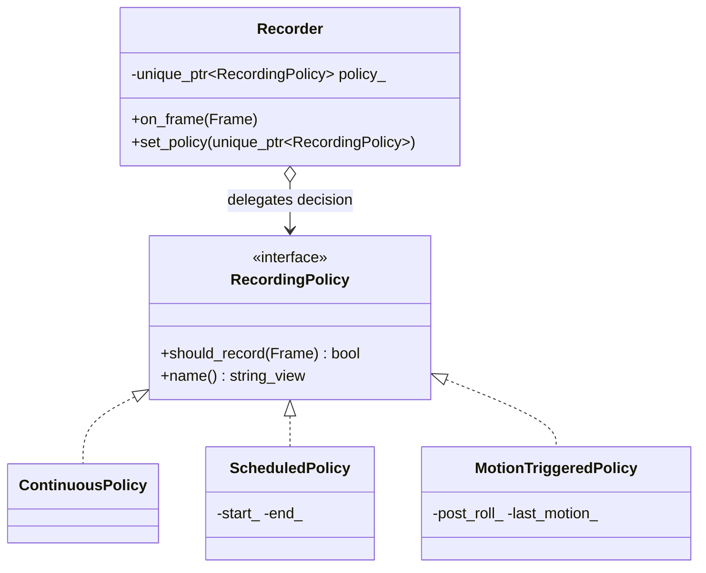

# 01 — Strategy

> Family: **Behavioral** · Code: [`examples/01-strategy/`](../examples/01-strategy/)
> Run: `./build/examples/01-strategy/naive`, `pattern`, `modern`

**Intent (GoF):** define a family of algorithms, encapsulate each one, and make them interchangeable. Strategy lets the algorithm vary independently from the clients that use it.

---

## 1. Force

> The rule *"should this frame be recorded?"* **varies per camera** and an operator can **change it at runtime**. The **recorder loop** (receive frame → decide → write) **must not change** when a new rule is added.

- **What varies:** one decision, the recording rule.
- **Who varies it:** the operator, per camera, while the gateway is running.
- **When:** at runtime. That rules out a compile-time-only solution as the main form.
- **What stays still:** `Recorder`, its write path, and everyone who calls `on_frame()`.

## 2. Naive code and where it hurts

[`naive.cpp`](../examples/01-strategy/naive.cpp): an enum and a `switch` inside `Recorder`.

```cpp
enum class RecordingMode { Continuous, MotionTriggered, Scheduled };

class Recorder {
    Recorder(RecordingMode, TimestampMs post_roll = 0, int start_h = 0, int end_h = 0);
    void on_frame(const Frame& f) {
        switch (mode_) {
            case Continuous:      record = true; break;
            case MotionTriggered: /* uses post_roll_, last_motion_ */ break;
            case Scheduled:       /* uses start_hour_, end_hour_ */  break;
        }
        if (record) write(f);
    }
    // MotionTriggered-only:  post_roll_ms_, last_motion_
    // Scheduled-only:        start_hour_, end_hour_
};
```

With three modes, this is fine. The pain starts with the **fourth**, "record only while an AI detection is active". Adding it means:

1. A new enum value.
2. New state fields in `Recorder`, sitting next to fields every other mode ignores.
3. More constructor parameters that every other mode must default.
4. A new `case` in the switch.
5. Re-testing **every** mode, because they share one class.

Smells, by name:
- **Switch on a type code:** behaviour is selected by an enum, not by an object.
- **Divergent Change:** `Recorder` changes for reasons unrelated to recording, such as a new scheduling rule.
- **Temporary Field:** `start_hour_` is meaningless unless `mode_ == Scheduled`.

## 3. Structure



| Role | In this example | Responsibility |
|---|---|---|
| **Context** | `Recorder` | Holds a strategy and calls it. Never asks which one it is. |
| **Strategy** | `RecordingPolicy` | The single decision, as an interface. |
| **Concrete strategies** | `ContinuousPolicy`, `ScheduledPolicy`, `MotionTriggeredPolicy` | One rule each, with **their own** knobs and state. |
| **Client** | `main()` (in a real gateway: the camera-config handler) | Picks the concrete strategy and hands it to the context. |

The client chooses, and the context delegates. The context never switches strategies on its own initiative. When it does, you have State (chapter 10).

## 4. Gateway example walkthrough

[`pattern.cpp`](../examples/01-strategy/pattern.cpp)

```cpp
class RecordingPolicy {
public:
    virtual ~RecordingPolicy() = default;
    virtual bool should_record(const gw::Frame& f) = 0;   // non-const: may keep state
    virtual std::string_view name() const = 0;
};

class MotionTriggeredPolicy final : public RecordingPolicy {
    bool should_record(const gw::Frame& f) override {
        if (f.motion) last_motion_ = f.ts_ms;
        return last_motion_ && f.ts_ms - *last_motion_ <= post_roll_;
    }
    gw::TimestampMs post_roll_;
    std::optional<gw::TimestampMs> last_motion_;          // state lives *here* now
};

class Recorder {
    void on_frame(const gw::Frame& f) { if (policy_->should_record(f)) write(f); }
    void set_policy(std::unique_ptr<RecordingPolicy> p) { policy_ = std::move(p); }
    std::unique_ptr<RecordingPolicy> policy_;
};
```

What changed compared with the naive version:

- `Recorder` has **no enum, no switch, and no mode-specific fields**. It shrank to its real job.
- Each policy owns its parameters (`ScheduledPolicy(22, 6)`) and its state (`last_motion_`).
- **Runtime swap:** `set_policy()` changes the rule mid-stream. The test runs continuous recording until 12:00, then switches to motion-triggered: 720 + 3 + 3 frames.
- **Same behaviour:** `naive`, `pattern` and `modern` all assert the same counts. Continuous gives 1440, a 22:00–06:00 schedule gives 480, and motion with a 2-minute post-roll gives 10.
- **Adding "AI-event triggered"** is one new class. `Recorder` and the other policies don't change, which is Open/Closed in practice.

Design notes:

- **Stateful strategies are per-context.** `MotionTriggeredPolicy` remembers the last motion, so two cameras sharing one instance would corrupt each other. That's why `Recorder` *owns* its policy through `unique_ptr` and doesn't hold a shared reference. Stateless policies (`ContinuousPolicy`) could be shared safely.
- **Ownership:** the context owns the strategy with `unique_ptr`. If the client must keep it alive and share it, the context takes a reference, and the client is responsible for lifetime.
- **What the strategy may see:** pass it only what it needs (`const Frame&`). If a strategy starts needing half of `Recorder`'s internals, the boundary is in the wrong place (Feature Envy).

## 5. Modern C++ form

[`modern.cpp`](../examples/01-strategy/modern.cpp): the same three rules, two more ways (see the table in [00 §4](00-foundations.md#4-four-kinds-of-polymorphism-in-c)).

**A. `std::function` + lambdas.** A one-operation strategy doesn't need a class hierarchy. The lambda is the concrete strategy, and its captures are its state:

```cpp
using RecordingPolicy = std::function<bool(const gw::Frame&)>;

RecordingPolicy motion_triggered(gw::TimestampMs post_roll) {
    return [post_roll, last = std::optional<gw::TimestampMs>{}](const gw::Frame& f) mutable {
        if (f.motion) last = f.ts_ms;
        return last && f.ts_ms - *last <= post_roll;
    };
}
```

**B. Template policy** (*policy-based design*). The rule is part of the type, chosen at compile time:

```cpp
template <RecordingPolicy Policy>          // a concept, not a base class
class Recorder {
    void on_frame(const gw::Frame& f) { if (policy_.should_record(f)) ++written_; }
    Policy policy_;                         // by value: no heap, no vtable, inlinable
};
Recorder<NightOnly> r;
```

| Form | Pick it when | Cost |
|---|---|---|
| `virtual` interface | Runtime swap **and** the strategy has several operations (`should_record`, `name`, `to_json`…) or must be inspected | Heap allocation, indirect call |
| `std::function` | Runtime swap, **one** operation | Indirect call, may allocate. You can't ask a lambda its name. |
| Template policy | Choice is fixed at build/config time, and it's a hot path (per frame, per packet) | No runtime swap. `Recorder<A>` and `Recorder<B>` are unrelated types, and the code is bigger. |

For this gateway, the operator changes modes at runtime and the UI shows the mode name, so the `virtual` form is the right default. If the policy were a per-pixel operation inside a decoder, the template form would be.

## 6. When NOT to use it

- **There's one rule today and no ticket for a second.** Write the `if`. Extract a Strategy when the second rule actually arrives; refactoring into it then is cheap.
- **Two branches that will never grow:** `if (night) … else …` is clearer than three classes.
- **The "strategy" needs most of the context's internals.** You'd be splitting one cohesive class in two and passing everything across the seam. Keep it together.
- **The variation is configuration, not behaviour.** If modes differ only in numbers (thresholds, durations), that's a struct of parameters, not a hierarchy.

The YAGNI test: do two variants exist **today**, is there a **named source** of variation (here, the operator and the UI mode dropdown), and is the direct version **genuinely worse**? If any answer is no, don't introduce the pattern.

## 7. Confused with

| Pattern | Difference in one line |
|---|---|
| **State** (10) | Strategy: the **client** picks the algorithm. State: the **object switches itself** as its state changes, and the states know about each other. |
| **Template Method** (09) | Template Method varies **steps of a fixed skeleton via inheritance**, at compile time. Strategy swaps the **whole algorithm via composition**, at runtime. |
| **Command** (08) | Command is a **request as an object** (what to do, often queued or undone). Strategy is **how to do** a job the context already decided to do. |
| **Bridge** (17) | Bridge separates **two independent hierarchies** for the long term. Strategy plugs **one interchangeable behaviour** into one context. |

## 8. Seen in the wild

- **`std::sort(first, last, comp)`**, **`std::map<K, V, Compare>`**, **`std::unordered_map<K, V, Hash>`**: comparison and hashing are compile-time strategies.
- **`std::unique_ptr<T, Deleter>`**, **allocator-aware containers (`Allocator`)**: policy-based design in the standard library.
- **Linux TCP congestion control:** `struct tcp_congestion_ops` is a table of function pointers (an interface in C). `cubic`, `bbr` and `reno` are concrete strategies, chosen per socket at runtime with `setsockopt(TCP_CONGESTION)` or system-wide with `sysctl net.ipv4.tcp_congestion_control`.
- **Linux I/O schedulers** (`mq-deadline`, `bfq`, `none`), selectable per block device through `/sys/block/<dev>/queue/scheduler`.
- **Video encoders:** rate-control mode (CBR / VBR / CRF) is a strategy plugged into the same encode loop.

## 9. Exercise and checkpoint

**Exercise**
1. Add `EventTriggeredPolicy` to `pattern.cpp`. It records only while an AI detection is active, plus a post-roll. Add a `bool detection` field to `gw::Frame` (or keep a local frame type) and a CHECK for its count. **Do not edit `Recorder`.**
2. Do the same in `naive.cpp`. List every line you had to touch, and compare that list with step 1.
3. Add a `CompositePolicy` that records if **any** of its child policies says yes, so you get "motion OR night schedule" without writing a new rule. (This previews Composite, chapter 11.)

**Checkpoint**: answer from memory:
- Why does `RecordingPolicy::should_record` take `const Frame&` and not a `Recorder&`?
- Two cameras share one `MotionTriggeredPolicy` instance. What goes wrong, and how does `unique_ptr` ownership prevent it?
- A camera switches by itself from "continuous" to "motion" when disk is above 90%. Is that still Strategy? If not, what is it?
