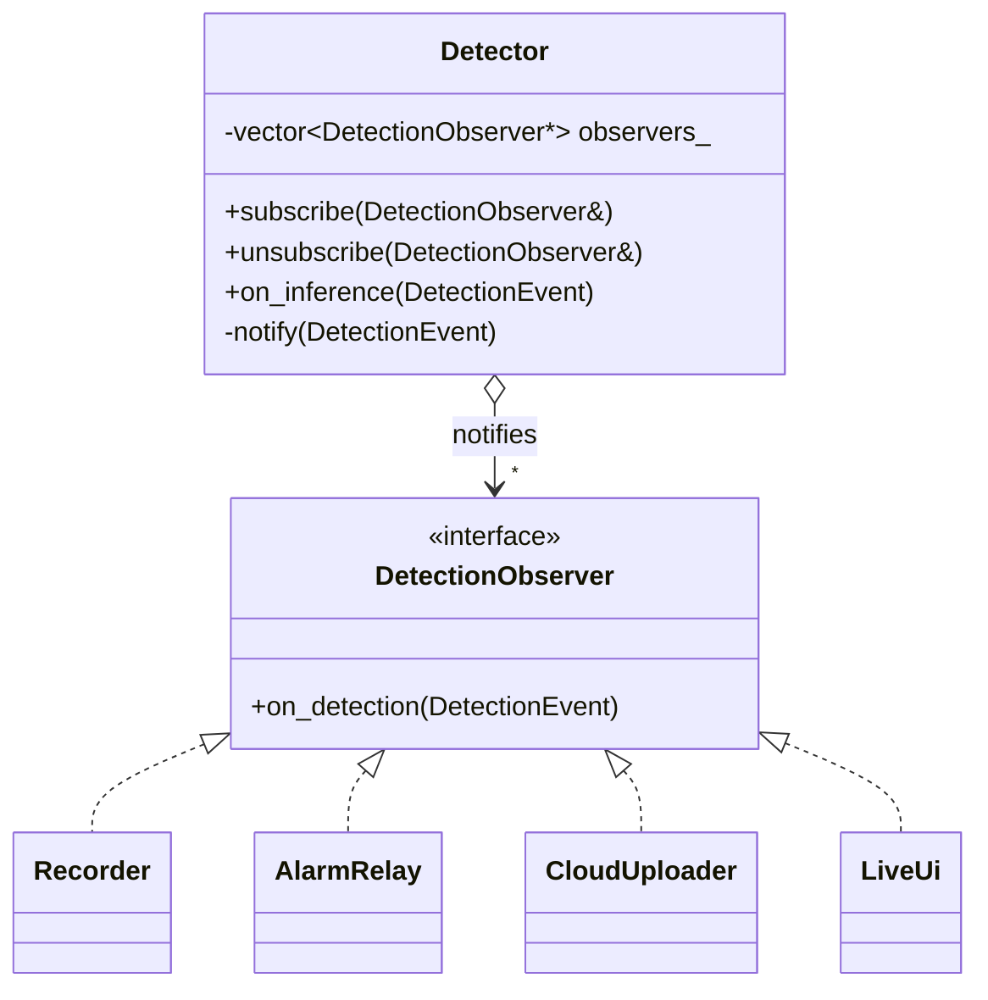
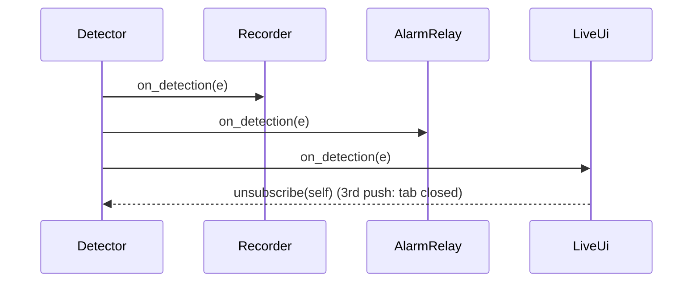

# 02 — Observer

> Family: **Behavioral** · Code: [`examples/02-observer/`](../examples/02-observer/)
> Run: `./build/examples/02-observer/naive`, `pattern`, `modern`

**Intent (GoF):** define a one-to-many dependency between objects so that when one object changes state, all its dependents are notified and updated automatically.

---

## 1. Force

> The **set of components that react to a detection** (recorder, alarm relay, cloud uploader, live UI, audit log…) **grows over time and changes at runtime**. A UI tab opens, then closes. The **detector must not know who they are or how many there are**.

- **What varies:** *who* listens, and how many listen.
- **Who varies it:** product features (each new consumer) and runtime lifecycle (a UI connects and disconnects).
- **When:** at runtime, and repeatedly.
- **What stays still:** the detector and its `on_inference()` path.

## 2. Naive code and where it hurts

[`naive.cpp`](../examples/02-observer/naive.cpp): the producer calls every consumer by name.

```cpp
class Detector {
    Detector(Recorder&, AlarmRelay&, CloudUploader&, LiveUi&);
    void on_inference(const DetectionEvent& e) {
        rec_.start_clip(e);
        relay_.maybe_pulse(e);
        cloud_.upload(e);
        if (ui_.connected) ui_.push(e);   // consumer lifecycle leaks into producer
    }
};
```

Add "write every detection to an audit log" and you have to:

1. Add an `#include` and a constructor parameter to `Detector`.
2. Change every place that builds a `Detector`: `main`, tests, tools.
3. Add one more call to `on_inference()`, in an order nobody chose on purpose.
4. Keep the "is it connected?" logic for optional consumers inside the detector.

Smells, by name:
- **Inappropriate Intimacy:** the producer knows each consumer's type and method name.
- **Shotgun Surgery:** every new consumer edits the producer and everything that constructs it.
- **Untestable producer:** testing detection means building a recorder, relay, uploader and UI.

The dependency arrow points the wrong way. Low-level detection depends on high-level features.

## 3. Structure





| Role | In this example | Responsibility |
|---|---|---|
| **Subject** | `Detector` | Keeps the list of observers and notifies each one in turn. Knows only the interface. |
| **Observer** | `DetectionObserver` | The single callback every reactor implements. |
| **Concrete observers** | `Recorder`, `AlarmRelay`, `CloudUploader`, `LiveUi` | Each decides **for itself** what an event means to it, using its own rules. |

The dependency is now inverted. The detector depends on an interface it owns, and consumers depend on the detector to subscribe.

## 4. Gateway example walkthrough

[`pattern.cpp`](../examples/02-observer/pattern.cpp)

```cpp
class Detector {
public:
    void subscribe(DetectionObserver& o)   { observers_.push_back(&o); }
    void unsubscribe(DetectionObserver& o) { std::erase(observers_, &o); }
    void on_inference(const DetectionEvent& e) { notify(e); }
private:
    void notify(const DetectionEvent& e) {
        const auto snapshot = observers_;              // observers may unsubscribe mid-notify
        for (auto* o : snapshot)
            if (std::ranges::find(observers_, o) != observers_.end()) o->on_detection(e);
    }
    std::vector<DetectionObserver*> observers_;        // non-owning
};
```

What changed compared with the naive version:

- `Detector` contains **no consumer types**. Adding `AuditLog` (done in `main()`) is one class plus one `subscribe()` call, and the detector isn't edited.
- **Filtering moved to the consumer.** The "confident person only" rule lives in `AlarmRelay`, and the "≥ 0.5" rule lives in `CloudUploader`. The subject broadcasts the event, and each observer decides what it means.
- **Runtime membership:** `LiveUi` subscribes in its constructor and unsubscribes itself on its 3rd push, while it's being notified.
- **Same behaviour:** naive, pattern and modern all produce clips = 5, pulses = 2, uploads = 4 and UI pushes = 3.

Design notes, which are the real-world bugs of this pattern:

- **Re-entrancy.** An observer that unsubscribes (or subscribes) inside `on_detection` modifies the vector being iterated, so iterating it directly is undefined behaviour. The fix is to iterate a **snapshot**, and skip anyone removed since the snapshot was taken, so no one is called after they unsubscribe.
- **Lifetime.** The subject holds raw pointers. An observer destroyed without unsubscribing leaves a dangling pointer, and the next `notify` is a use-after-free. In the classic form you defend against this by convention (`LiveUi`'s destructor unsubscribes). The modern form makes it structural.
- **Order is not a contract.** Observers run in subscription order. If "the recorder must start before the relay fires" is a requirement, Observer is the wrong tool, so write that sequence explicitly.
- **Synchronous by default.** A slow observer, such as a cloud upload, blocks the detector thread. In production, slow observers hand work to a queue. That's still Observer at the boundary, with asynchronous work behind it.
- **Push vs pull.** Here the event is **pushed** with the notification. In the *pull* variant, the observer is only told "something changed" and then queries the subject. Push the data when it's small and immutable, as an event is.

## 5. Modern C++ form

[`modern.cpp`](../examples/02-observer/modern.cpp): a typed `Signal<Args...>` with RAII connections.

```cpp
template <class... Args>
class Signal {
public:
    [[nodiscard]] Connection connect(std::function<void(Args...)> fn);
    void emit(const Args&... args);
};

class Detector { public: Signal<DetectionEvent> detected; };

auto conn = detector.detected.connect([&](const DetectionEvent& e) { ++clips; });
// conn's destructor disconnects — the subscription cannot outlive its owner
```

- **No base class.** Any callable can subscribe, including lambdas, member functions bound with a lambda, and free functions.
- **The lifetime problem is fixed by construction.** `connect()` returns a move-only `Connection`, and its destructor unsubscribes. It holds a `weak_ptr` to the signal's state, so it's also safe if the signal dies first.
- `[[nodiscard]]` makes discarding the handle a warning, because a discarded handle would disconnect immediately.

| Form | Pick it when | Cost |
|---|---|---|
| Observer interface (classic) | Observers are real objects with several callbacks (`on_detection`, `on_camera_offline`…), or you need to list or inspect subscribers | Inheritance, plus manual unsubscribe discipline (a dangling-pointer risk) |
| `Signal` + RAII `Connection` | Each event type is its own signal, and subscribers are lambdas or short-lived objects | `std::function` indirection and a copy of the slot list per emit |
| Library: Boost.Signals2 / Qt signals | You already depend on the library | Thread-safety and features you may not need |

## 6. When NOT to use it

- **There's exactly one consumer, and it's part of the same feature.** Call it directly. An event bus with one subscriber is just an indirect function call that's harder to trace.
- **The order of reactions is a requirement** ("stop recording, *then* release the relay"). Write that sequence explicitly, or use a Mediator (18) that owns it.
- **The reaction must succeed for the operation to succeed** (a transactional write). Observers are fire-and-forget by nature, so error propagation from many observers back to the subject gets awkward.
- **You can't answer "who handles this event?" without a debugger.** Overused Observer turns control flow into action at a distance. Keep subscriptions visible, in one wiring function, as `main()` does here.

## 7. Confused with

| Pattern | Difference in one line |
|---|---|
| **Mediator** (18) | Observer: the subject broadcasts and doesn't care who reacts. Mediator: a hub **knows** the participants and **coordinates** them. |
| **Chain of Responsibility** (13) | Observer: **everyone** gets the event. Chain: handlers are tried **in order**, and one can stop propagation. |
| **Publish/Subscribe** (messaging) | Pub/sub puts a **broker or topic** between publisher and subscriber, often across processes (MQTT). Observer is the in-process, direct-registration form. |
| **Command** (08) | Command packages **one request** for **one receiver**. Observer delivers **one notification** to **many** receivers. |

## 8. Seen in the wild

- **Qt signals and slots** (`QObject::connect`): an Observer, with connections automatically broken when either `QObject` is destroyed.
- **Boost.Signals2** (`signal`, `connection`, `scoped_connection`): the shape `modern.cpp` imitates.
- **Linux kernel notifier chains** (`register_netdevice_notifier`): subsystems subscribe to network device events such as an interface going up, going down or being renamed, without the core knowing them.
- **GObject / GStreamer signals** (`g_signal_connect`, for example `"pad-added"` on `decodebin`): an application reacts to a dynamic pad appearing without the element knowing the application.
- **Model/View** (Qt's `QAbstractItemModel::dataChanged`): views observe the model.

## 9. Exercise and checkpoint

**Exercise**
1. Add a `TamperDetector` observer to `pattern.cpp` that counts events with `confidence < 0.5`. Wire it in `main()` and add a `CHECK_EQ`. **Do not edit `Detector`.**
2. In `pattern.cpp`, delete the snapshot copy in `notify()` and iterate `observers_` directly. Build with `-fsanitize=address` and run. Explain what you see, and why it might *not* crash without the sanitizer.
3. In `modern.cpp`, drop the `Connection` returned by `connect()` (don't assign it). What warning do you get, and what happens to the subscription?

**Checkpoint**: answer from memory:
- Why does the relay's "confident person" rule belong in `AlarmRelay` and not in `Detector`?
- Name two ways a classic Observer can call a destroyed object, and how a RAII connection prevents each.
- Recording must start *before* the relay fires, every time. Is Observer still the right tool? What would you use?
