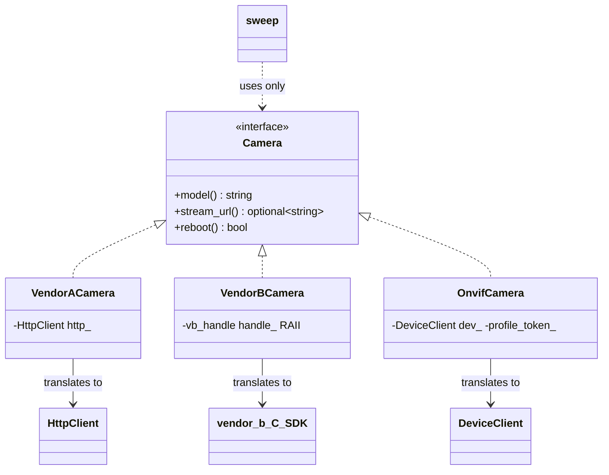

# 03 — Adapter

> Family: **Structural** · Code: [`examples/03-adapter/`](../examples/03-adapter/)
> Run: `./build/examples/03-adapter/naive`, `pattern`

**Intent (GoF):** convert the interface of a class into another interface clients expect. Adapter lets classes work together that couldn't otherwise because of incompatible interfaces.

---

## 1. Force

> **Third-party camera APIs differ in shape** (HTTP key=value text, a C SDK with handles and error codes, ONVIF profiles), and **new vendors keep arriving**. Gateway code (health sweep, recorder, UI) **must see one `Camera` interface and never include a vendor header**.

- **What varies:** the vendor API's names, data formats, error reporting and resource rules.
- **Who varies it:** vendors, and you can't change their code.
- **When:** at integration time. Which adapter is used is decided per camera, at runtime, from config.
- **What stays still:** the `Camera` interface and every caller of it.

## 2. Naive code and where it hurts

[`naive.cpp`](../examples/03-adapter/naive.cpp): every gateway operation branches on the vendor and speaks that vendor's dialect inline.

```cpp
std::optional<std::string> stream_url_of(const CameraConfig& c) {
    if (c.vendor == "vendor_a") {
        auto path = kv_lookup(vendor_a::HttpClient(c.host).get("/cgi-bin/info"), "rtsp_path");
        return "rtsp://" + c.host + ":554" + path;
    } else if (c.vendor == "vendor_b") {
        vendor_b::vb_handle h;
        if (vendor_b::vb_open(c.host.c_str(), &h) != vendor_b::VB_OK) return std::nullopt;
        char buf[128];
        int rc = vendor_b::vb_get_stream_uri(h, c.channel, buf, sizeof buf);
        vendor_b::vb_close(h);                       // forget this on one path → handle leak
        ...
    } else if (c.vendor == "onvif") { ... pick the H264 profile ... }
}
// model_of(), reboot(): the same three-way branch again
```

- **A new vendor** means editing every operation function (`model_of`, `stream_url_of`, `reboot`…).
- **A new operation** means writing all three dialects again, inline.
- **The C SDK's resource rule** ("every `vb_open` needs a `vb_close`") is repeated per call, and one early return leaks a handle.
- **Every caller** includes every vendor SDK header.

Smells, by name:
- **Shotgun Surgery:** one vendor's change touches every operation.
- **Switch on a type code:** `c.vendor == "..."` chains.
- **Mixed levels of abstraction:** gateway intent ("is this camera online?") is interleaved with `char buf[128]` and error codes.

## 3. Structure



| Role | In this example | Responsibility |
|---|---|---|
| **Target** | `Camera` | The interface the gateway wants, designed from the **gateway's** needs. |
| **Adaptee** | `vendor_a::HttpClient`, the `vendor_b` C SDK, `onvif::DeviceClient` | Existing code with the wrong shape, which you can't change. |
| **Adapter** | `VendorACamera`, `VendorBCamera`, `OnvifCamera` | Implements the Target by **translating** calls to the Adaptee. |
| **Client** | `sweep()` | Uses only `Camera`. |

## 4. Gateway example walkthrough

[`pattern.cpp`](../examples/03-adapter/pattern.cpp). Each adapter translates along a different dimension:

| Adapter | Translates |
|---|---|
| `VendorACamera` | **Data format**: `"model=A-200\nrtsp_path=/stream1\n"` becomes typed values. **Composition of a URL** from the host and a path. |
| `VendorBCamera` | **Error model**: negative `int` codes become `std::optional` and `bool`. **Memory model**: C out-buffers become `std::string`. **Resource model**: `vb_open`/`vb_close` become constructor and destructor (RAII). |
| `OnvifCamera` | **Protocol concept**: "a camera has N media profiles" becomes "a camera has a stream URL" by choosing the H.264 profile once, at construction. |

```cpp
class VendorBCamera final : public Camera {
public:
    VendorBCamera(const std::string& host, int channel) : channel_(channel) {
        online_ = vendor_b::vb_open(host.c_str(), &handle_) == vendor_b::VB_OK;
    }
    ~VendorBCamera() override { if (online_) vendor_b::vb_close(handle_); }
    std::optional<std::string> stream_url() const override {
        char buf[128];
        if (!online_ || vendor_b::vb_get_stream_uri(handle_, channel_, buf, sizeof buf) != vendor_b::VB_OK)
            return std::nullopt;
        return std::string(buf);
    }
    ...
};
```

What changed compared with the naive version:

- `sweep()` is **vendor-agnostic**: 10 lines, one loop, no vendor header.
- **A 4th vendor is one new adapter class** plus one line in `make_camera()`. No existing operation is edited.
- **The handle leak is impossible.** The test checks one live handle while the cameras exist and **zero after they're destroyed**.
- **Same results:** the same URLs, models, online count (3) and reboot count (3) as `naive.cpp`.

Design notes:

- **Design the Target from the client's side.** `Camera` has `stream_url()`, not `get_profiles()`, because the gateway wants a URL. If the Target mirrors one vendor's API, every other adapter has to fake that vendor's concepts.
- **An adapter adds no behaviour.** It translates. If you find yourself adding retries, caching or logging inside an adapter, those are Decorator (05) or Proxy (12) concerns and belong in their own wrapper.
- **Lossy translation is a decision.** `VendorBCamera::model()` returns `""` when offline. That's a choice about how the Target reports errors, made once, here, instead of at every call site.
- `make_camera()` is a *simple factory*: the one place that maps a vendor name to an adapter class. It's separate from the Adapter pattern, and Factory Method / Abstract Factory come later (06, 14).

## 5. Modern C++ form

Adapter has no dramatically different "modern" form, so there's no `modern.cpp` here. The interesting C++ choices are about *how* the adapter holds the adaptee:

| Form | What it looks like | Pick it when |
|---|---|---|
| **Object adapter** (used here) | The adapter **has-a** adaptee member and implements Target | Default. Works with final classes, C APIs, and adaptee instances created elsewhere. |
| **Class adapter** | `class X : public Camera, private onvif::DeviceClient` | You need to override an adaptee virtual or reach protected members. Rare, and it couples you to the adaptee's class. |
| **RAII wrapper over a C API** | `std::unique_ptr<handle_t, decltype(&close_fn)>` or a small class with ctor/dtor | The adaptee is a C library with open/close pairs. This is the most common adapter in real C++. |
| **Function adapter** | A lambda or `std::function` that reshapes a call: `[&](int ch) { return dev.get_stream_uri(token_for(ch)); }` | The Target is a single callable, not an interface. |
| **Iterator / range adapter** | `std::views::transform`, `std::reverse_iterator` | You're adapting a *sequence*, not an object. |

## 6. When NOT to use it

- **You own both sides.** Change one interface to match the other. An adapter between two pieces of your own code is a sign the interfaces were never agreed.
- **There's one vendor and no second on the horizon.** Call its API directly from one well-contained module. Extract `Camera` when the second vendor is real, because designing the interface from two real APIs gives a better Target than guessing from one.
- **The interfaces are not semantically compatible.** If the vendor API can't express an operation the Target promises, such as `reboot()` on a camera without that call, the adapter will lie (return `true` and do nothing). Make the capability explicit in the Target instead (`supports_reboot()`, or a separate interface).
- **You're tempted to add caching, retries or metrics in the adapter.** Wrap the adapter in a Decorator or Proxy and keep each class single-purpose.

## 7. Confused with

| Pattern | Difference in one line |
|---|---|
| **Facade** (04) | Adapter makes **one existing interface fit another expected interface**. Facade **invents a new, simpler interface** over a whole subsystem. |
| **Decorator** (05) | Decorator keeps the **same** interface and **adds** behaviour. Adapter **changes** the interface and adds none. |
| **Proxy** (12) | Proxy keeps the **same** interface and **controls access** (lazy, remote, guarded). Adapter **changes** the interface. |
| **Bridge** (17) | Bridge is designed **up front**, so two hierarchies can vary independently. Adapter is applied **after the fact**, to make existing things fit. |

## 8. Seen in the wild

- **`std::stack`, `std::queue`, `std::priority_queue`** are called *container adaptors* in the standard. They present a stack or queue interface over a `std::deque` or `std::vector`.
- **Iterator adaptors:** `std::reverse_iterator`, `std::back_insert_iterator`, `std::move_iterator`.
- **Range adaptors (C++20):** `std::views::transform`, `std::views::filter` adapt one range into another shape.
- **`std::unique_ptr` with a custom deleter** turns any C `open`/`close` API (`fopen`/`fclose`, SDK handles) into RAII. This is exactly what `VendorBCamera` does by hand.
- **ONVIF** is an industry attempt to make the adapter unnecessary: one standard protocol instead of one adapter per vendor. Gateways still need adapters for devices that don't implement it, or implement it partially.

## 9. Exercise and checkpoint

**Exercise**
1. Add a `vendor_c` adaptee to `vendor_libs.hpp` with a different shape, for example a JSON string `{"model":"C-1","url":"rtsp://.../live"}` returned from `fetch_status()`. Write `VendorCCamera`, add it to `inventory()` and `make_camera()`, and update the expected values. Count the files and functions you touched, and compare with doing the same in `naive.cpp`.
2. Rewrite `VendorBCamera`'s handle management as `std::unique_ptr<int, Closer>` with a small `Closer` struct, and remove the hand-written destructor. What does the class lose or gain (copyability, the moved-from state)?
3. Add `snapshot_jpeg()` to `Camera`. Vendor B's SDK has no snapshot call. Decide how the adapter should express that, and justify the choice.

**Checkpoint**: answer from memory:
- Why is `Camera::stream_url()` a better Target operation than `Camera::get_profiles()`?
- List the three kinds of translation `VendorBCamera` performs.
- Adapter vs Facade: you wrap a single C SDK and also simplify its 30 functions down to 3. Which pattern is it, and does the name matter?
