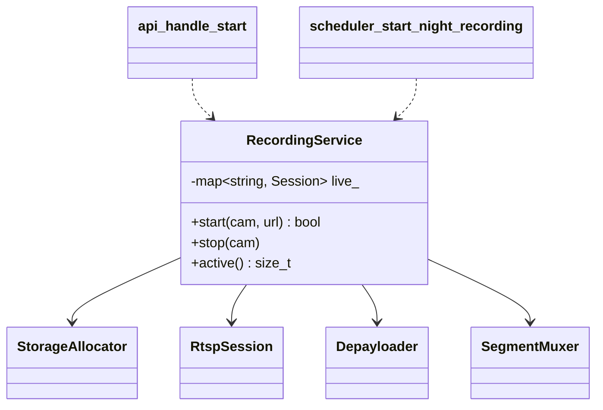

# 04 — Facade

> Family: **Structural** · Code: [`examples/04-facade/`](../examples/04-facade/)
> Run: `./build/examples/04-facade/naive`, `pattern`

**Intent (GoF):** provide a unified interface to a set of interfaces in a subsystem. Facade defines a higher-level interface that makes the subsystem easier to use.

---

## 1. Force

> The **media stack** (storage allocator, RTSP session, depayloader, segment muxer) has **ordering rules and rollback paths that change** as the stack evolves. Its **callers** (HTTP API handler, scheduler, CLI tools) want *"start / stop recording camera X"* and **must not change when the stack does**.

- **What varies:** the internals: which components exist, their call order, and error handling.
- **Who varies it:** whoever maintains the media stack, for example a new codec, a new container format, or a fix to the rollback.
- **When:** over the life of the codebase, not at runtime.
- **What stays still:** the callers and their one-line intent.

## 2. Naive code and where it hurts

[`naive.cpp`](../examples/04-facade/naive.cpp): each caller drives the four components itself.

```cpp
bool api_handle_start(CallLog& log, StorageAllocator& storage, const std::string& cam,
                      const std::string& url) {
    auto path = storage.reserve(cam);
    LiveSession s{RtspSession(log), Depayloader(log), SegmentMuxer(log)};
    if (!s.rtsp.connect(url)) { storage.release(*path); return false; }   // rollback
    const auto codec = s.rtsp.describe();
    s.depay.configure(codec);              // must happen before mux.open
    s.mux.open(*path, codec);
    s.rtsp.play();
    g_live.emplace(cam, std::move(s));
    return true;
}

bool scheduler_start_night_recording(...) { /* the same 12 lines, copied */ }
```

- **Duplicate Code:** the start sequence and its rollback exist twice. The next fix, such as "also release storage if DESCRIBE fails", has to be made in both places, and one copy will be missed.
- **Inappropriate Intimacy:** the API layer and the scheduler include and construct `RtspSession`, `Depayloader` and `SegmentMuxer`. A signature change in the muxer ripples into the HTTP handler.
- **Leaked subsystem rules:** callers have to know that the depayloader is configured before the muxer opens and that storage is released on failure. Those aren't their job.
- **Nobody owns the live sessions:** the naive version needs a global `g_live` map that both callers mutate.

## 3. Structure



| Role | In this example | Responsibility |
|---|---|---|
| **Facade** | `RecordingService` | Knows which components to use, in what order, with what rollback. Owns the per-camera session state. |
| **Subsystem classes** | `StorageAllocator`, `RtspSession`, `Depayloader`, `SegmentMuxer` | Do the real work. They're **unaware of the facade** and still usable directly. |
| **Clients** | API handler, scheduler | Call `start()` / `stop()`. |

A facade is **a convenience, not a wall**. The subsystem classes stay public, so a diagnostics tool that needs raw RTSP access can still use `RtspSession` directly.

## 4. Gateway example walkthrough

[`pattern.cpp`](../examples/04-facade/pattern.cpp)

```cpp
class RecordingService {
public:
    bool start(const std::string& cam, const std::string& url);   // the 6-step sequence, once
    void stop(const std::string& cam);
    std::size_t active() const;
private:
    struct Session { RtspSession rtsp; Depayloader depay; SegmentMuxer mux; };
    StorageAllocator storage_;
    std::map<std::string, Session> live_;     // the facade owns recording state
};

bool api_handle_start(RecordingService& rec, const std::string& cam, const std::string& url) {
    return rec.start(cam, url);
}
```

What changed compared with the naive version:

- **The sequence and its rollback exist once.** A fix is made in one place.
- **The callers shrink to one line** and see none of the media types.
- **Ownership is clear.** The live-session map moved from a global into the facade.
- **Same behaviour:** the test compares the full **subsystem call log**: 17 calls in the same order, the same rollback (`storage.release /var/rec/cam-3` at position 14), and 1 active session. The facade changed who calls the components, not what they're called with.

Design notes:

- **Keep the facade thin.** It orchestrates, and the subsystem does the work. If business rules (which cameras may record, retention policy) creep into `RecordingService`, it's turning into a god class. Those rules belong to its callers or to a separate policy (see Strategy, 01).
- **One facade per use case, not one per subsystem.** If the CLI needs "record for N seconds and give me the file", that's a second method or a second facade, not a mode flag on `start()`.
- **The facade is the natural seam for testing callers.** Callers depend on `RecordingService`. If they need a fake, extract an interface from it then, not before (see 00 §3).

## 5. Modern C++ form

Facade is plain encapsulation, so there's no separate `modern.cpp`. The C++-specific choices are:

| Choice | Pick it when |
|---|---|
| **Class with owned subsystem members** (used here) | The facade owns the lifecycle of what it coordinates, as with per-camera sessions. |
| **Free functions in a namespace** (`recording::start(...)`) | The facade is stateless: pure orchestration over objects passed in. |
| **Pimpl** (`std::unique_ptr<Impl>` in the header) | You want the facade's **header** to include none of the subsystem headers, so changes to the media stack don't recompile its callers. This gives compile-time as well as source-level decoupling. |
| **Module interface (C++20 modules)** | Export only the facade and keep subsystem classes module-private, where your toolchain supports modules. |

## 6. When NOT to use it

- **There's one caller.** The function that drives the subsystem *is* the facade. Don't add another layer on top.
- **The subsystem is already simple.** A facade over two calls is just renaming.
- **Callers genuinely need different sequences.** If every caller needs a different subset or order, a single facade grows a flag per caller. Give them the components, or one facade per use case.
- **You're using it to hide a mess you should fix.** A facade over a tangled subsystem buys time, but it isn't a refactoring. Keep the debt visible.

## 7. Confused with

| Pattern | Difference in one line |
|---|---|
| **Adapter** (03) | Adapter makes **one** existing interface fit an expected one. Facade **defines a new, simpler** interface over **many** classes. |
| **Mediator** (18) | Facade is **one-directional**: clients call it, and the subsystem doesn't know it exists. Mediator is **bidirectional**: colleagues talk *through* it, and it calls them back. |
| **Abstract Factory** (14) | Both can hide subsystem classes. Abstract Factory hides **which classes get created**, and Facade hides **how they're driven**. They're often used together. |
| **Service layer** (architecture) | An application-level facade over domain and infrastructure. `RecordingService` is a small one. |

## 8. Seen in the wild

- **GStreamer `playbin`:** one element, with a `uri` property, that internally builds the source, demuxer, decoders and sinks. You set the URI and the state, and it assembles everything else.
- **libcurl's "easy" interface** (`curl_easy_perform`): a simple blocking transfer API over the same engine the "multi" interface exposes in full.
- **`std::thread`**, **`std::filesystem`**: portable, simplified C++ interfaces over platform APIs. They're part facade, part adapter, and the naming overlap is normal.

## 9. Exercise and checkpoint

**Exercise**
1. Requirement: "if DESCRIBE returns an unsupported codec, tear down RTSP and release storage". Implement it in `pattern.cpp`. Then implement it in `naive.cpp`, and count how many places you edited in each.
2. Add `RecordingService::snapshot(cam)`, which needs only `RtspSession` and a JPEG decode. Does it belong in this facade or a different one? Argue from the "one facade per use case" note.
3. Move `RecordingService` into a header plus `.cpp` with a Pimpl, so the header includes nothing from `media_stack.hpp`. Which callers stop recompiling when `SegmentMuxer` changes?

**Checkpoint**: answer from memory:
- Why does the test compare the whole **call log** rather than just the active-session count?
- A facade method has grown 6 boolean parameters. What has gone wrong, and what are two ways out?
- Facade vs Mediator: who calls whom?
