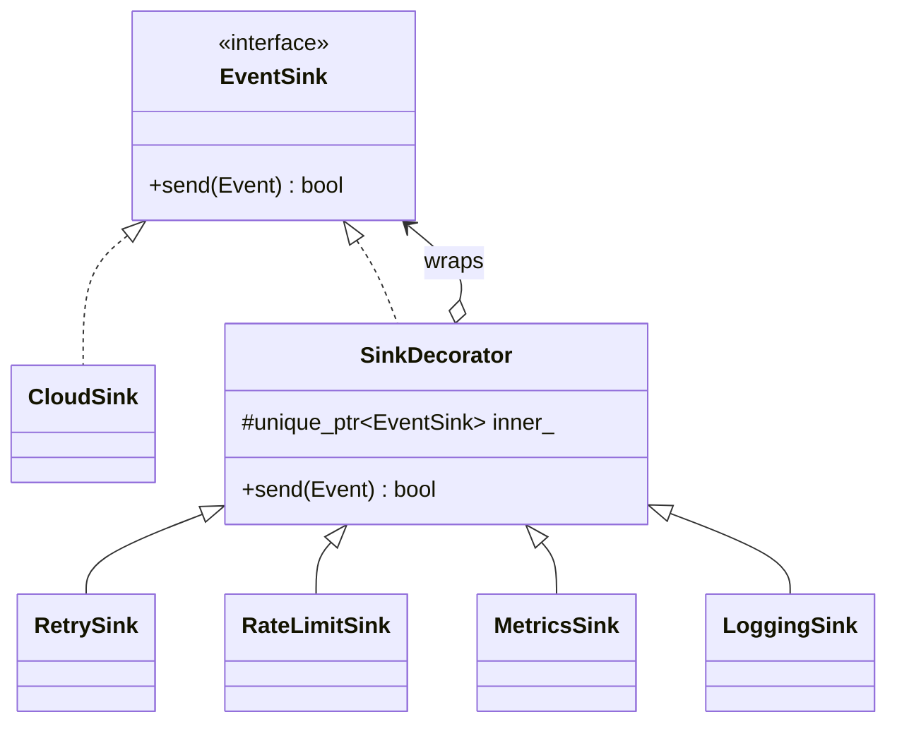

# 05 — Decorator

> Family: **Structural** · Code: [`examples/05-decorator/`](../examples/05-decorator/)
> Run: `./build/examples/05-decorator/naive`, `pattern`, `modern`

**Intent (GoF):** attach additional responsibilities to an object dynamically. Decorators provide a flexible alternative to subclassing for extending functionality.

---

## 1. Force

> **Delivery concerns** (retry, rate limit, metrics, logging, later encryption or batching) are **optional, combine freely, and their order matters** per deployment. The **transport and its callers must not change** when a concern is added, removed or reordered.

- **What varies:** which extra behaviours wrap delivery, and **in what order**.
- **Who varies it:** deployment config (a lab gateway logs everything; a field gateway on LTE rate-limits) and new operational requirements.
- **When:** at assembly time, which usually means startup, and is runtime from the code's point of view.
- **What stays still:** `EventSink::send()`, the transport, and every caller.

## 2. Naive code and where it hurts

[`naive.cpp`](../examples/05-decorator/naive.cpp): one class, one method, one flag per concern.

```cpp
struct CloudSinkOptions { bool logging, metrics, rate_limit; int max_per_window; ... bool retry; int max_attempts; };

bool CloudSink::send(const Event& e) {
    bool ok = true;
    if (opt_.rate_limit) { ... }
    if (ok) { for (int i = 0; i < tries && !ok; ++i) ok = cloud_.post(e); }
    if (opt_.metrics) ++(ok ? sent_ok : sent_failed);
    if (opt_.logging) log.push_back(...);
    return ok;
}
```

- **Combinatorial growth:** 4 flags give 16 combinations inside one method, and each new concern adds a flag, its config fields, and another block in `send()`.
- **Order is frozen.** Should a retry consume rate-limit budget? In this code it can't, because retry sits inside the limiter, and changing that means rewriting `send()`.
- **No reuse:** the MQTT sink needs retry too, so you copy it.
- **No isolation:** testing the rate limiter means constructing a cloud transport.

Smells, by name:
- **Large Class:** transport plus four unrelated concerns.
- **Long Method driven by flags:** every concern is an `if (opt_.x)` block.
- **Combinatorial explosion** (if solved by subclassing instead): `RetryingRateLimitedLoggingCloudSink`.

## 3. Structure



The call path at runtime, which is the order the decorators were assembled in:

```
caller ─▶ LoggingSink ─▶ MetricsSink ─▶ RateLimitSink ─▶ RetrySink ─▶ CloudSink ─▶ FlakyCloud
```

| Role | In this example | Responsibility |
|---|---|---|
| **Component** | `EventSink` | The interface callers use. |
| **Concrete component** | `CloudSink` | The real work (post to the cloud), with **nothing else**. |
| **Decorator** | `SinkDecorator` | **Is-a** `EventSink` (so it can stand in for one) and **has-a** `EventSink` (the thing it wraps). Forwards by default. |
| **Concrete decorators** | `RetrySink`, `RateLimitSink`, `MetricsSink`, `LoggingSink` | **One concern each**: do something before and/or after forwarding, or decide not to forward. |

The essential trick is that **a decorator has the same interface as what it wraps**. That's why decorators stack, and why the caller can't tell a bare `CloudSink` from a five-layer stack.

## 4. Gateway example walkthrough

[`pattern.cpp`](../examples/05-decorator/pattern.cpp)

```cpp
class RetrySink final : public SinkDecorator {
    bool send(const Event& e) override {
        for (int i = 0; i < max_; ++i)
            if (inner_->send(e)) return true;
        return false;
    }
};

class RateLimitSink final : public SinkDecorator {
    bool send(const Event& e) override {
        if (++count_[e.ts_ms / window_] > max_) return false;   // short-circuit: not forwarded
        return inner_->send(e);
    }
};

// Assemble inside-out: cloud ← retry ← rate limit ← metrics ← logging
auto sink = std::make_unique<LoggingSink>(
    std::make_unique<MetricsSink>(
        std::make_unique<RateLimitSink>(
            std::make_unique<RetrySink>(std::make_unique<CloudSink>(cloud), 3),
            3, 1000)),
    log);
```

Tracing the 10-event burst:

| Layer | Effect |
|---|---|
| RateLimit (3 per 1 s window) | Window 08:00:00 lets 3 through and drops 2. Window 08:00:05 lets 3 through and drops 1. Window 08:00:06 lets 1 through. **7 forwarded.** |
| Retry (3 tries) | The flaky transport fails attempts 3, 6 and 9. Each is retried once and succeeds, so **7 delivered with 10 attempts**. |
| Metrics | ok = 7, failed = 3 (the rate-limited drops). |
| Logging | 10 lines, one per `send()` at the top. |

The naive and modern versions produce the same numbers.

**Order is policy.** `pattern.cpp` then builds `Retry(RateLimit(Cloud))`, with retry **outside** the limiter. Now a retried event passes through the limiter again and uses up window budget, so only 5 are delivered. It's a different operational policy, obtained by changing **one assembly expression and no class**. The naive version can't express this without rewriting `send()`.

Design notes:

- **Every decorator does one thing.** If `RetrySink` starts logging its retries, that's a second concern; give it its own decorator or a callback.
- **Ownership:** each decorator owns its inner sink (`unique_ptr`), so destroying the outermost one destroys the stack. To read a decorator's state later, as with metrics here, keep a non-owning pointer taken *before* wrapping it further.
- **Identity is lost.** The caller holds a `LoggingSink`, not a `CloudSink`. Code that does `dynamic_cast<CloudSink*>` on the sink breaks, and that's a sign the code should depend on the interface instead.
- **Debugging deep stacks:** a 6-layer stack is 6 frames per call. Name the decorators after what they do, and assemble them in one visible place.

## 5. Modern C++ form

[`modern.cpp`](../examples/05-decorator/modern.cpp): when the component is a **single operation**, a decorator is a **function from sink to sink**.

```cpp
using Sink = std::function<bool(const Event&)>;

Sink with_retry(Sink inner, int max_attempts) {
    return [inner = std::move(inner), max_attempts](const Event& e) {
        for (int i = 0; i < max_attempts; ++i) if (inner(e)) return true;
        return false;
    };
}

Sink sink = with_logging(with_metrics(with_rate_limit(with_retry(cloud, 3), 3, 1000), m), log);
```

- No base class, no `SinkDecorator`, no `unique_ptr` chain. The lambda's capture list is the decorator's state.
- **Gotcha:** `std::function` requires copyable callables, so mutable state, like the rate limiter's window counts, goes behind a `shared_ptr`. Otherwise a copy of the sink would get its own, separate counters.
- You can't ask a `std::function` for its counters, so observable state (metrics, the log) lives outside and is captured by reference.

| Form | Pick it when | Cost |
|---|---|---|
| Class decorators (classic) | The component interface has **several** methods (`send`, `flush`, `stats`), or decorators expose state | One class per concern, a heap allocation per layer |
| Function decorators | The component is **one call**, as with middleware, handlers and sinks | No introspection, and copy-semantics traps with mutable state |
| Template decorators (`Retry<RateLimit<CloudSink>>`) | The stack is fixed at compile time and on a hot path | No runtime reordering, and a new type per stack |

## 6. When NOT to use it

- **The concern always applies.** If every sink always retries, retry is part of the transport. Put it there.
- **There's one concern and no second.** A `RetryingCloudSink` is fine until the second concern actually shows up.
- **The order must never change and must be enforced.** A decorator stack makes it easy to assemble the wrong order. If "encrypt, then sign" is a hard requirement, encode it in one class or a Builder (07) that validates the order.
- **The interface is wide.** Decorating a 20-method interface means every decorator forwards 19 methods it doesn't care about. Narrow the interface first (Interface Segregation), or use Proxy (12) for access concerns.

## 7. Confused with

| Pattern | Difference in one line |
|---|---|
| **Proxy** (12) | Both wrap with the same interface. A Decorator **adds behaviour** and is **stacked by the client**. A Proxy **controls access** to one subject (lazy, remote, guarded) and usually manages that subject's lifecycle. |
| **Adapter** (03) | An Adapter **changes** the interface. A Decorator **keeps** it. |
| **Chain of Responsibility** (13) | In a chain, a handler usually **either** handles **or** passes on. In a decorator stack, every layer normally **does its part and forwards**. A rate limiter that drops an event blurs the line, and that's fine. |
| **Composite** (11) | Same "wrap the same interface" structure. A Composite holds **many** children and aggregates them, and a Decorator holds **one** and enhances it. |
| **Strategy** (01) | Strategy swaps the **inside** of an object (its algorithm). Decorator changes its **outside** (its wrapping). |

## 8. Seen in the wild

- **Boost.Iostreams `filtering_stream`:** push `gzip_compressor()`, then a file sink. Each filter wraps the next, and they stack.
- **HTTP middleware stacks:** handler-wrapping-handler chains. Logging, auth and compression wrap the real handler, in an order the application chooses.
- **gRPC interceptors:** client and server interceptors wrap each call with cross-cutting behaviour (auth metadata, logging, metrics).
- **`std::ostream` with a custom `std::streambuf`** that forwards to another buffer (for example, prefixing every line with a timestamp) is a decorator over a stream buffer.

## 9. Exercise and checkpoint

**Exercise**
1. Add a `DedupSink` decorator that drops an event identical (camera + label) to the previous one within 2 s. Add it to the stack **without editing any existing class**, and work out the new expected counts before you run the program.
2. Move `LoggingSink` from the outermost to the innermost position, directly around `CloudSink`. How many log lines now, and what does each line mean?
3. In `modern.cpp`, change `with_rate_limit` to capture the `std::map` by value (no `shared_ptr`) and copy the resulting `Sink` once before using it. Explain the counts you get.

**Checkpoint**: answer from memory:
- Why must a decorator implement the **same** interface as the object it wraps?
- Retry inside vs outside the rate limiter: which one can make an outage worse, and why?
- What breaks if code does `dynamic_cast<CloudSink*>(sink.get())`?
