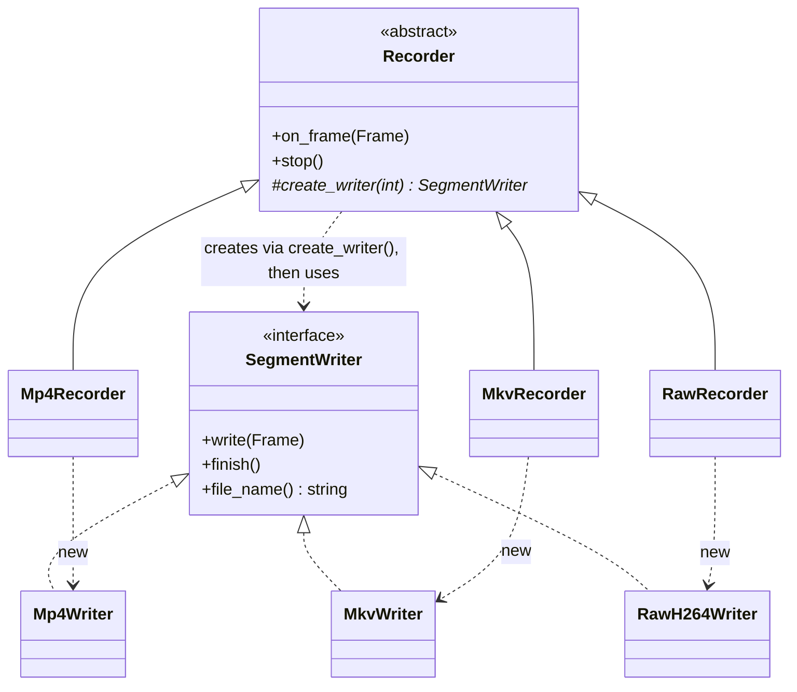

# 06 — Factory Method

> Family: **Creational** · Code: [`examples/06-factory-method/`](../examples/06-factory-method/)
> Run: `./build/examples/06-factory-method/naive`, `pattern`, `modern`

**Intent (GoF):** define an interface for creating an object, but let subclasses decide which class to instantiate. Factory Method lets a class defer instantiation to subclasses.

---

## 1. Force

> The **container format** of recorded segments (MP4, MKV, raw H.264) **varies with the kind of recorder**. The **segmenting algorithm** (open a segment, write N frames, finalise it, rotate) **must live in one place and never name a concrete format**.

- **What varies:** which concrete `SegmentWriter` gets constructed.
- **Who varies it:** whoever *configures* a recorder (an archive profile, a forensic-export job, a plugin shipping a new format), never the code that *runs* the recording.
- **When:** when the recorder is created. After that, every segment uses the same kind of writer.
- **What stays still:** `Recorder::on_frame`, rotation, finalisation and the file list, plus every caller of the recorder.

The key point: the class that **uses** the product is not the class that **knows** the product.

## 2. Naive code and where it hurts

[`naive.cpp`](../examples/06-factory-method/naive.cpp): `Recorder` owns an enum and a switch.

```cpp
enum class Container { Mp4, Mkv, RawH264 };

class Recorder {
    std::unique_ptr<SegmentWriter> create_writer(int index) {
        switch (container_) {
            case Container::Mp4:     return std::make_unique<Mp4Writer>(index);
            case Container::Mkv:     return std::make_unique<MkvWriter>(index);
            case Container::RawH264: return std::make_unique<RawH264Writer>(index);
        }
        throw std::logic_error("unknown container");
    }
};
```

This is a **simple factory**: one function with a switch that returns one of N types. That's fine until the set of formats stops being yours. Suppose a customer needs an encrypted-MP4 variant, delivered as a separate plugin library:

1. Edit the enum in the **core** recording library's header.
2. `#include` the plugin's writer into the core, which reverses the dependency so the core now depends on the plugin.
3. Add a `case`.
4. Rebuild and retest the core, even though the segmenting loop didn't change.

Smells, by name:
- **Divergent Change:** `Recorder` changes when the segmenting rules change *and* whenever a format is added.
- **Switch on a type code:** creation is picked by an enum instead of by polymorphism.
- **Dependency in the wrong direction:** high-level policy (when to rotate) depends on low-level detail (every file format).

## 3. Structure



| Role | In this example | Responsibility |
|---|---|---|
| **Creator** | `Recorder` | Owns an algorithm that needs a product. Declares the factory method and calls it. |
| **Factory method** | `Recorder::create_writer(int)` | The single virtual "new". It is protected because it's a hook, not API. |
| **Concrete creators** | `Mp4Recorder`, `MkvRecorder`, `RawRecorder` | Override *only* the creation decision. |
| **Product** | `SegmentWriter` | The interface the creator's algorithm uses. |
| **Concrete products** | `Mp4Writer`, `MkvWriter`, `RawH264Writer` | One per format. |

The two hierarchies run in parallel: each concrete creator pairs with one concrete product.

### Factory Method vs "simple factory" vs registry

These three get called "factory" interchangeably. They're different:

| | Simple factory | Registry | **Factory Method** (GoF) |
|---|---|---|---|
| Shape | Free or static function with a switch | `map<key, creator function>` | A **virtual** method on a class that *uses* the product |
| Chosen by | An argument (enum, string) | A runtime key, usually from config | Which **subclass** of the creator you instantiated |
| Adding a type | Edit the switch | `registry.add(...)` at startup, core unchanged | Add a creator subclass, core unchanged |
| GoF pattern? | No | No | Yes |
| In this chapter | `naive.cpp` | `modern.cpp` (B) | `pattern.cpp` |

## 4. Gateway example walkthrough

[`pattern.cpp`](../examples/06-factory-method/pattern.cpp)

```cpp
class Recorder {
public:
    void on_frame(const gw::Frame& f) {
        if (!current_ || frames_in_segment_ == frames_per_segment_) rotate();
        current_->write(f);
        ++frames_in_segment_;
    }
protected:
    virtual std::unique_ptr<SegmentWriter> create_writer(int index) = 0;   // the factory method
private:
    void rotate() { close_current(); current_ = create_writer(next_index_++); frames_in_segment_ = 0; }
};

class MkvRecorder final : public Recorder {
public:
    using Recorder::Recorder;
protected:
    std::unique_ptr<SegmentWriter> create_writer(int index) override {
        return std::make_unique<MkvWriter>(index);
    }
};
```

What changed compared with the naive version:

- `Recorder` has **no enum, no switch, and no `#include` of any concrete writer**. It compiles knowing only `SegmentWriter`.
- A new format means a new writer and a new creator subclass, possibly in another library. The core doesn't change.
- **Same behaviour:** all three files assert identical totals for one simulated day (1440 frames, 600 per segment, so 3 segments): MP4 = 144,144 bytes, MKV = 149,832, raw = 144,000.

Design notes:

- **Return `std::unique_ptr<Product>`.** The factory method transfers ownership to the creator. A raw `new` here is how resource leaks start.
- **Never call a factory method from the creator's constructor.** While `Recorder::Recorder` runs, the object's dynamic type is still `Recorder`, so the pure-virtual call crashes. A non-pure virtual would silently call the *base* version. That's why `rotate()` runs lazily on the first frame.
- **Parameterise the factory method when it helps.** `create_writer(int index)` gets the segment number so the product can name its own file. GoF calls this a *parameterized factory method*.
- **Product-only subclasses are a smell.** Each `XxxRecorder` here exists only to override `create_writer`. When the creator varies in nothing else, inject a factory function instead (§5 A). The classic form pays off when creator subclasses *also* override other behaviour, such as an MKV recorder that also rotates on keyframes rather than frame count.

## 5. Modern C++ form

[`modern.cpp`](../examples/06-factory-method/modern.cpp)

**A. Injected factory function.** The core idea, "the user of the product doesn't name it", without a subclass per format:

```cpp
using WriterFactory = std::function<std::unique_ptr<SegmentWriter>(int index)>;

class Recorder {
public:
    Recorder(WriterFactory make_writer, int frames_per_segment);
private:
    void rotate() { close_current(); current_ = make_writer_(next_index_++); ... }
};
```

**B. Registry.** The format comes from configuration (`"container": "mkv"`), so map the string to a factory. Plugins register at startup:

```cpp
WriterRegistry formats;
formats.add("mkv", [](int i) { return std::make_unique<MkvWriter>(i); });
Recorder rec(formats.find(camera_cfg.container), 600);
if (!formats.find("avi")) { /* reject the config up front */ }
```

| Form | Pick it when | Cost |
|---|---|---|
| Virtual factory method | Creator subclasses differ in more than the product, or you're writing a framework users extend by subclassing | One creator subclass per product, a parallel hierarchy |
| Injected `std::function` | The creator varies *only* in what it creates | Indirect call; the creator can't ask the factory anything else |
| Registry | The choice is **data** (config, API request) and new types arrive as plugins | Errors move to runtime: an unknown key must be handled |
| Template parameter (`Recorder<MkvWriter>`) | The type is known at compile time and you want no indirection | No runtime choice; one type per instantiation |

For a gateway where the container is a per-camera setting, **B feeding A** is the shipping design. Learn the classic form so you recognise it in frameworks.

## 6. When NOT to use it

- **The set of types is closed and owned by you.** If three formats live in the same library and a fourth is unlikely, the switch in `naive.cpp` is clearer. It's one function, easy to grep and easy to delete.
- **There's only one product.** `std::make_unique<Mp4Writer>()` inline is fine. A virtual hook with one override is pure ceremony.
- **The creator subclasses would exist only to pick the product.** Use an injected factory function (§5 A) instead.
- **You just need construction with many parameters.** That's Builder (07), not a factory.

## 7. Confused with

| Pattern | Difference in one line |
|---|---|
| **Simple factory / `make_*` functions** | A function that returns one of N types. `std::make_unique` and `std::make_shared` are factory *functions*, not Factory Method. There's no creator and no subclass. |
| **Abstract Factory** (14) | Abstract Factory is an object that creates a **family** of related products (decoder + relay + watchdog) that must match. Factory Method is **one** creation hook inside a class that uses the product. An Abstract Factory is often implemented as a set of factory methods. |
| **Template Method** (09) | Factory Method *is* a Template Method step whose job is creation. The creator's algorithm (`on_frame`/`rotate`) is the template, and `create_writer` is the primitive operation. |
| **Prototype** (21) | Prototype creates by **cloning** a configured instance, so no creator subclass is needed per product. |
| **Builder** (07) | Builder assembles **one complex object step by step**. Factory Method picks **which class** to instantiate. |

## 8. Seen in the wild

- **Qt `QNetworkAccessManager::createRequest()`** is a protected virtual that subclasses override to return their own `QNetworkReply`, while the manager's `get()`/`post()` logic stays the same. It's a textbook factory method.
- **GStreamer `gst_element_factory_make("x264enc", name)`** is a **registry**: plugins register element factories by name at load time, and pipelines create elements from strings.
- **`std::make_unique` / `std::make_shared`** are factory *functions*, listed here as the most common thing people mistake for Factory Method.

## 9. Exercise and checkpoint

**Exercise**
1. Add a `TimelapseRecorder` to `pattern.cpp` that writes MP4 but keeps only every 60th frame. Where does the frame skipping go, and why does this subclass justify the classic form better than `Mp4Recorder` does?
2. In `modern.cpp`, register a `"mp4-enc"` format whose writer adds 16 bytes per frame of encryption overhead. Check the new total. **Don't edit `Recorder`.**
3. In `pattern.cpp`, call `create_writer(0)` from `Recorder`'s constructor. Explain what the compiler warns about, or, if it gets past the compiler, why the program aborts with "pure virtual method called".

**Checkpoint**: answer from memory:
- What's the difference between `std::make_unique<MkvWriter>()`, a registry lookup of `"mkv"`, and `MkvRecorder::create_writer()`? Which one is the GoF pattern?
- Why must a factory method never be called from the creator's constructor in C++?
- The format comes from a JSON config file. Which form do you ship, and where does the "unknown format" error surface?
