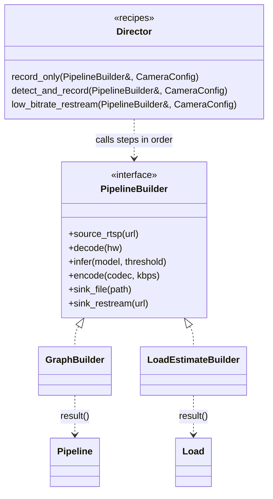

# 07 — Builder

> Family: **Creational** · Code: [`examples/07-builder/`](../examples/07-builder/)
> Run: `./build/examples/07-builder/naive`, `pattern`, `modern`

**Intent (GoF):** separate the construction of a complex object from its representation, so that the same construction process can create different representations.

---

## 1. Force

> A media pipeline has **many optional stages** (decode, infer, encode, different sinks) with **ordering and compatibility rules**. It must be **assembled step by step**, **invalid combinations must be rejected during assembly**, and the **same recipe** ("detect and record") must be **reusable to produce different results**: a running pipeline, or a CPU/GPU load estimate for checking capacity before launch.

- **What varies:** which stages are present and their parameters (per camera), and what the steps produce (graph vs estimate).
- **Who varies it:** camera configuration, plus the scheduler that must decide whether a pipeline fits on the box.
- **What stays still:** the rules (infer ⇒ decode, decode ⇒ encode, one source first, one sink last) and the recipes themselves.

Builder addresses two separate forces, and most C++ code needs only the first:
1. **Construction is complex.** There are many optional parts and the order matters. This is the "fluent builder" most people mean.
2. **The same construction steps should yield different products.** This is the GoF Builder, with a Director and several builders.

## 2. Naive code and where it hurts

[`naive.cpp`](../examples/07-builder/naive.cpp): a **telescoping constructor**.

```cpp
Pipeline(std::string source_url, bool decode, bool hw_decode, std::string model, float threshold,
         std::string codec, int bitrate_kbps, std::string sink_kind, std::string sink_target);

Pipeline restream("rtsp://10.0.0.13/stream1", true, false, "", 0.0f, "h264", 500,
                  "restream", "rtsp://0.0.0.0:8554/cam-3");
```

Where it hurts:

1. **Unreadable call sites.** Which `bool` is "decode" and which is "hardware"? Swap them and it still compiles.
2. **Invalid objects construct fine.** `Pipeline(url, false, false, "person", ...)` asks for inference on compressed data. `valid()` exists, but nothing forces the caller to call it before the pipeline starts.
3. **Every new stage touches every call site.** A privacy-mask stage adds a tenth parameter, including for callers that don't want it.

Smells, by name:
- **Long Parameter List**
- **Primitive Obsession:** `""` and `0` stand for "stage absent".
- **Validation by convention:** the rules exist but aren't part of the structure.

## 3. Structure



| Role | In this example | Responsibility |
|---|---|---|
| **Builder** | `PipelineBuilder` | The construction steps, and nothing else. |
| **Concrete builders** | `GraphBuilder`, `LoadEstimateBuilder` | Implement the steps. Each produces its *own* product type. |
| **Director** | `record_only`, `detect_and_record`, `low_bitrate_restream` | A recipe: which steps, in which order, with which values. It knows nothing about products. |
| **Products** | `Pipeline`, `Load` | Unrelated types, which is why `result()` isn't on the interface. |
| **Client** | `main()` (in a gateway: the camera supervisor) | Picks a recipe and a builder, then fetches the result from the builder. |

## 4. Gateway example walkthrough

[`pattern.cpp`](../examples/07-builder/pattern.cpp)

```cpp
void detect_and_record(PipelineBuilder& b, const CameraConfig& cam) {   // Director
    b.source_rtsp(cam.url);
    b.decode(/*hw=*/true);
    b.infer("person", 0.5f);
    b.encode("h264", 2000);
    b.sink_file("/rec/" + cam.id);
}

class GraphBuilder final : public PipelineBuilder {
    void infer(const std::string& model, float threshold) override {
        require(decode_ && !encode_ && !sink_, "infer needs decoded frames");   // fails at the wrong step
        add("infer", infer_args(model, threshold));
    }
    Pipeline result() { require(source_ && sink_, "pipeline needs a source and a sink"); ... }
};

class LoadEstimateBuilder final : public PipelineBuilder {
    void infer(const std::string&, float) override { load_.gpu_pct += 30; }      // same step, different product
};
```

What changed compared with the naive version:

- **Readable recipes.** Every value sits next to the step it configures.
- **Validation is structural.** Each step checks its own precondition, so "infer on compressed data" throws *at `infer()`*, and `result()` checks completeness. A `Pipeline` can't exist unless it's valid.
- **One recipe, two products.** `detect_and_record` builds the real graph and, unchanged, estimates its load (CPU 22%, GPU 35%) so the scheduler can refuse it *before* launching. This is the force GoF Builder was written for.
- **Same behaviour:** the three descriptions and the single rejection match `naive.cpp` exactly.

Design notes:

- **`result()` belongs to the concrete builder**, not to the interface, because products don't share a type. That's correct, not a flaw.
- **A builder is single-use.** `result()` moves the stages out. Reusing a builder after `result()` is a bug. Either document it, or reset state inside `result()`.
- **Directors are optional.** When there's one product type, the client usually calls the steps itself, and the builder is just a fluent API (§5). Keep a Director when recipes are reused or are domain concepts themselves ("detect and record" is a product feature).

## 5. Modern C++ form

[`modern.cpp`](../examples/07-builder/modern.cpp)

**A. Designated initializers + a validating function.** C++20 named fields fix the readability problem, and `std::optional` replaces magic empty values:

```cpp
struct PipelineSpec {
    std::string source;
    std::optional<bool> decode_hw = std::nullopt;
    std::optional<InferSpec> infer = std::nullopt;
    std::optional<EncodeSpec> encode = std::nullopt;
    std::variant<FileSink, RestreamSink> sink;
};
auto p = make_pipeline({.source = url, .decode_hw = true, .infer = InferSpec{"person", 0.5f},
                        .encode = EncodeSpec{"h264", 2000}, .sink = FileSink{"/rec/cam-2"}});
```

**B. Type-state fluent builder.** The builder's type records progress, so illegal orders don't compile:

```cpp
template <bool Src, bool Dec, bool Enc, bool Sink>
class Builder {
    auto infer(const std::string& m, float t) && requires(Dec && !Enc && !Sink);
    Pipeline build() && requires(Src && Sink);
};
PipelineBuilder{}.from_rtsp(url).infer("person", 0.5f);    // compile error: no decode yet
PipelineBuilder{}.from_rtsp(url).build();                  // compile error: no sink
```

The `static_assert`s in `modern.cpp` prove both rejections at compile time.

| Form | Pick it when | Cost |
|---|---|---|
| Designated-init spec | The object is plain data and the rules are few. This is the default in modern C++. | Validation stays a runtime call. Field order must follow declaration order. |
| Fluent builder (runtime checks) | Many optional parts, a readable chain wanted, checks per step | A second class next to the product |
| Type-state builder | Rules are about **order and presence**, and misuse is costly | Template machinery and harder error messages. Doesn't scale past a handful of states. |
| GoF Builder + Director | The **same recipe must produce different representations** | The full role set. Only worth it with ≥ 2 real builders. |

GCC note: with `-Wextra`, leaving a member out of a designated initializer warns (`-Wmissing-field-initializers`) unless the member has a default member initializer. The `= std::nullopt` defaults in `PipelineSpec` are there for that reason, and they also document intent.

## 6. When NOT to use it

- **≤ 4 parameters, all required.** A constructor is fine. A builder for `Point{x, y}` is ceremony.
- **The object is plain data.** Use designated initializers (§5 A) before writing a builder class.
- **One product and no reused recipes.** Skip the Director and the builder interface. A fluent builder or a spec struct is enough.
- **You want to choose *which class* to create.** That's a factory (06, 14), not a builder.

## 7. Confused with

| Pattern | Difference in one line |
|---|---|
| **Abstract Factory** (14) | Abstract Factory returns **finished family members immediately**, one call each. Builder **assembles one object over many steps** and hands it over at the end. |
| **Factory Method** (06) | Factory Method decides **which class**. Builder decides **how one object is put together**. |
| **Composite** (11) | Builders often *produce* composites, such as a pipeline graph or a device tree. The Builder is the process and the Composite is the product. |
| **Template Method** (09) | A Director looks like a template method (fixed sequence of steps), but the steps go to a **separate builder object** passed in, not to subclass overrides. |

## 8. Seen in the wild

- **gRPC C++ `grpc::ServerBuilder`**: `AddListeningPort(...)`, `RegisterService(...)`, then `BuildAndStart()` returns the server. It's a step-by-step builder with a final build call.
- **Boost.Program_options**: `desc.add_options()("help", "...")("port", po::value<int>(), "...")` is a fluent chain that builds an options description.
- **Media frameworks** (GStreamer, FFmpeg filter graphs): pipelines are assembled stage by stage and validated at link/negotiation time. That's the same problem this chapter models, though their APIs aren't textbook Builder classes.

## 9. Exercise and checkpoint

**Exercise**
1. Add a `privacy_mask(zones)` step that's only legal between `decode` and `encode`. Add it to `GraphBuilder` (runtime check) and to the type-state builder (compile-time). Which one needed fewer lines? Which one catches the mistake earlier?
2. Write a third concrete builder, `LaunchStringBuilder`, that emits one human-readable line per stage for logs. Reuse all three Director recipes unchanged.
3. In `naive.cpp`, swap the two `bool` arguments of `restream`. Does it compile? What does the pipeline become, and does `valid()` notice?

**Checkpoint**: answer from memory:
- Why is `result()` declared on `GraphBuilder` and not on `PipelineBuilder`?
- What does the second concrete builder buy you that a fluent builder alone can't?
- Your object has 6 fields, all plain data and two optional. Which form do you write, and why not a builder class?
