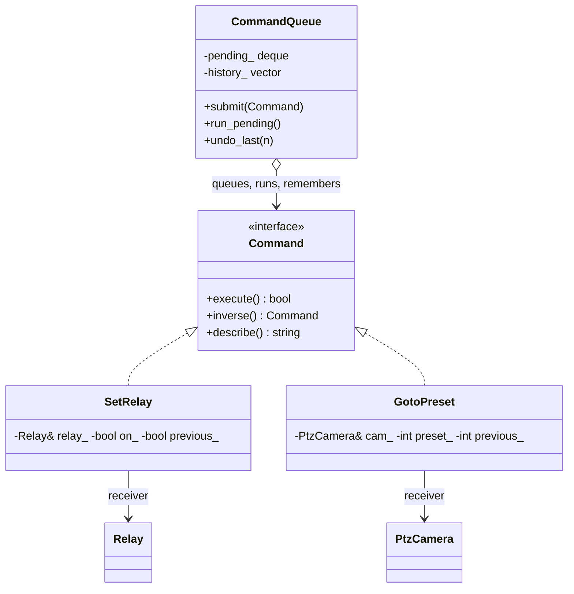

# 08 — Command

> Family: **Behavioral** · Code: [`examples/08-command/`](../examples/08-command/)
> Run: `./build/examples/08-command/naive`, `pattern`, `modern`

**Intent (GoF):** encapsulate a request as an object, so you can parameterize clients with different requests, queue or log requests, and support undoable operations.

---

## 1. Force

> Device actions (siren on, floodlight on, PTZ to preset 3) are **issued by many sources**: the rules engine, the operator UI, the scheduler. They must be **executed by one worker**, **retried**, **audited** and **undone** in exactly the same way. The action must become a **value** that can be queued, logged and reversed, **separate from whoever asked for it**.

- **What varies:** which action, on which device, with which parameter, and who requests it.
- **When:** the request is made *now*. Execution happens *later*, on the device worker. Undo happens *much later*, when the operator acknowledges.
- **What stays still:** the execution policy (retry 3×, audit every result, keep history for undo) and the devices themselves.

## 2. Naive code and where it hurts

[`naive.cpp`](../examples/08-command/naive.cpp): the controller calls the devices directly.

```cpp
void on_intrusion() {
    prev_siren_ = siren_.is_on();   set_with_retry(siren_, true);
    prev_flood_ = flood_.is_on();   set_with_retry(flood_, true);
    prev_preset_ = ptz_.preset();   ptz_.goto_preset(3);  log_.push_back(ptz_.name() + ": preset 3");
}
void on_acknowledge() {             // reverse order, by hand
    ptz_.goto_preset(prev_preset_); ...
    set_with_retry(flood_, prev_flood_);
    set_with_retry(siren_, prev_siren_);
}
```

Every action needs the same three things done by hand: **retry**, **audit line**, and **remember the previous state**. Undo is a mirror-image function maintained separately. Beyond that, the action isn't something you can hold:

- It can't be **queued** to a single device-worker thread. Every caller touches hardware directly, from whichever thread it's on.
- It can't be **persisted** and replayed after a reboot.
- The UI, the scheduler and the rules engine each need their own copy of "set relay with retry and log", and the copies drift.

Smells, by name:
- **Duplicate Code:** retry and log, per action.
- **Shotgun Surgery:** changing the retry policy touches every call site.
- **Temporary Field:** `prev_siren_` only means something between an alarm and its acknowledgement.

## 3. Structure



| Role | In this example | Responsibility |
|---|---|---|
| **Command** | `Command` | `execute()`, plus what the invoker needs: `inverse()` and `describe()`. |
| **Concrete commands** | `SetRelay`, `GotoPreset` | Bind **one receiver + the parameters** of one action. Capture the state needed to reverse it. |
| **Receivers** | `Relay`, `PtzCamera` | Do the real work. They don't know commands exist. |
| **Invoker** | `CommandQueue` | Queues, retries, audits, keeps history, undoes. It knows only `Command`. |
| **Client** | `on_intrusion()` | Creates concrete commands and submits them. It never touches a device. |

## 4. Gateway example walkthrough

[`pattern.cpp`](../examples/08-command/pattern.cpp)

```cpp
class SetRelay final : public Command {
    bool execute() override {
        previous_ = relay_.is_on();          // captured when executed, not when created
        return relay_.set(on_);
    }
    std::unique_ptr<Command> inverse() const override {
        return std::make_unique<SetRelay>(relay_, previous_);
    }
};

class CommandQueue {
    void run_pending() { ... if (run(*c)) history_.push_back(std::move(c)); }
    void undo_last(std::size_t n) { ... auto inv = history_.back()->inverse(); run(*inv); }
    bool run(Command& c) { /* retry kMaxAttempts, then log success or FAILED */ }
};
```

What changed compared with the naive version:

- **Request ≠ execution.** `on_intrusion()` submits three commands, and the test checks the siren is still **off** until `run_pending()`. In a gateway, `run_pending()` is the device-worker loop, the only thread that talks to relay hardware.
- **Retry and audit live in one place**, `CommandQueue::run()`, for every command, including undo.
- **Undo is just another command.** `inverse()` returns a `SetRelay` with the captured previous state, and it goes through the same retry + audit path. There's no separate, rarely tested undo code.
- **Same behaviour:** an identical 6-line audit log, 3 siren attempts (one dropped by the relay board) and 2 floodlight attempts across all three files.

Design notes:

- **Capture "previous" in `execute()`, not in the constructor.** A command may sit in the queue while the state changes, so it must remember what it actually overwrote.
- **Only successful commands go into history.** A command that failed 3 times didn't change anything, so there's nothing to undo.
- **References to receivers bind a command to this process.** That's fine in memory. To persist or send commands, name the target by id instead (§5).
- **Two styles of undo.** Either the command implements `undo()` itself, or it produces an inverse (used here). The inverse style composes better: the inverse can be queued, logged, sent and retried like anything else.

## 5. Modern C++ form

[`modern.cpp`](../examples/08-command/modern.cpp): **commands as plain data**, using `std::variant` + `std::visit`.

```cpp
struct SetRelay   { std::string relay;  bool on; };
struct GotoPreset { std::string camera; int preset; };
using Command = std::variant<SetRelay, GotoPreset>;

std::string           to_line(const Command&);          // "relay siren on"
std::optional<Command> parse_line(const std::string&);  // and back

class Executor {                                         // resolves ids → devices
    std::optional<Command> execute(const Command& c);    // returns the inverse, also plain data
};
```

The alarm arrives as text lines (as if pushed from the cloud or replayed from a journal). Each line is parsed, round-trip-checked, executed, and its inverse pushed onto an undo stack that's itself serialisable. It produces the same audit log and attempt counts.

| Form | Pick it when | Cost |
|---|---|---|
| Virtual `Command` + receiver references | In-process queue/undo; open set of command types (plugins add commands) | Not serialisable; heap per command |
| `std::variant` of plain structs | Commands cross a **process, network or time** boundary (MQTT, REST, persisted job queue, replay) | Closed set: adding a type edits the variant. The compiler then flags every visitor, which is usually what you want. |
| `std::function<void()>` jobs | Fire-and-forget work on a thread pool, with no undo, no audit and no inspection | A lambda can't be logged, compared, serialised or inverted |

## 6. When NOT to use it

- **The call is synchronous, one-off, and nobody needs to queue, log, retry or undo it.** Just call the method. `relay.set(true)` wrapped in a `SetRelay` object with nothing else going on is ceremony.
- **You only need deferred execution.** A `std::function<void()>` or a task on an executor is enough. Introduce command classes when you need inspection, undo or persistence.
- **Undo isn't truly reversible.** Some actions can't be inverted (a sent SMS, a door that already opened). Don't advertise undo that lies. Model these as non-undoable commands and leave them out of history.

## 7. Confused with

| Pattern | Difference in one line |
|---|---|
| **Strategy** (01) | Strategy is **how** to do a job the context already decided to do. Command is **what** to do, as an object handed to someone else to do later. |
| **Memento** (19) | Memento snapshots **state** for rollback. Command records **actions**. They're often combined: a command stores a memento of what it overwrote. |
| **Chain of Responsibility** (13) | A chain decides **who handles** a request. The request travelling the chain is frequently a command object. |
| **Observer** (02) | An event says "**this happened**" and any number of listeners react. A command says "**do this**" and exactly one receiver acts. |

## 8. Seen in the wild

- **Qt Undo framework:** `QUndoCommand` with `redo()`/`undo()`, pushed onto a `QUndoStack` that handles history, merging and clean state.
- **Boost.Asio / thread pools:** `boost::asio::post(ctx, handler)` queues a handler for later execution on an executor. These are command objects in the fire-and-forget form (no undo).
- **Redis AOF (append-only file):** write commands are logged and replayed on restart to rebuild state. This is commands as persisted data, as in §5.
- **Database write-ahead logs:** operations are recorded before they're applied so they can be replayed or rolled back.

## 9. Exercise and checkpoint

**Exercise**
1. Add a `PulseRelay{relay, ms}` command (on, then off after `ms`). It shouldn't be undoable. Change the invoker so non-undoable commands don't enter history.
2. In `pattern.cpp`, make the floodlight relay drop **4** commands. What does the audit log show, and what does `undo_last(3)` do now? Is that what an operator expects?
3. In `modern.cpp`, write the undo stack to a `std::vector<std::string>` with `to_line`, "reboot" (destroy the `Executor`), rebuild it, and replay the undo from the strings.

**Checkpoint**: answer from memory:
- Why does `SetRelay` capture `previous_` in `execute()` and not in its constructor?
- What does modelling undo as "execute the inverse command" buy you over an `undo()` method?
- A command must be sent from the cloud to a gateway. Which C++ form do you choose, and why can't the virtual-with-references form do it?
