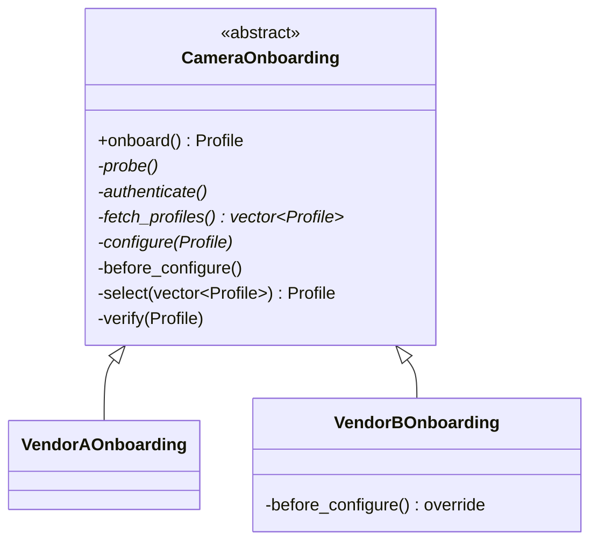
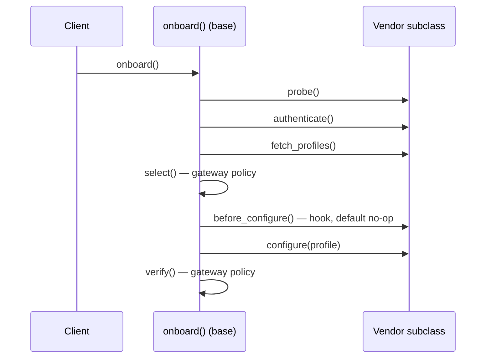

# 09 — Template Method

> Family: **Behavioral** · Code: [`examples/09-template-method/`](../examples/09-template-method/)
> Run: `./build/examples/09-template-method/naive`, `pattern`, `modern`

**Intent (GoF):** define the skeleton of an algorithm in an operation, deferring some steps to subclasses. Template Method lets subclasses redefine certain steps of an algorithm without changing the algorithm's structure.

---

## 1. Force

> The camera onboarding **sequence** (probe → authenticate → fetch profiles → select → configure → verify) and the profile **selection rule** are gateway policy and must exist **exactly once**. **How** to probe, authenticate, list profiles and configure a stream **differs per vendor**.

- **What varies:** the individual steps, per vendor.
- **Who varies it:** camera vendors. Each has its own API.
- **When:** fixed per camera once its vendor is known.
- **What stays still:** the order of steps, the selection rule ("largest stream with height ≤ 1080"), and the final verification.

Compare with Strategy (01): there, the **whole** decision was swapped. Here the **skeleton is the stable part** and only the holes in it vary.

## 2. Naive code and where it hurts

[`naive.cpp`](../examples/09-template-method/naive.cpp): one function per vendor, created by copy-paste.

```cpp
Profile onboard_vendor_a(std::vector<std::string>& log) {
    log.push_back("A: GET /api/device-info");
    log.push_back("A: basic auth");
    ...
    Profile best{0, 0, 0};                       // copy #1 of the selection rule
    for (const auto& p : profiles) if (p.height <= kMaxHeight && ...) best = p;
    ...
    log.push_back("verify stream " + label(best));
}
Profile onboard_vendor_b(std::vector<std::string>& log) { /* same shape, copy #2 */ }
```

Where it hurts:

1. **The sequence lives in N places.** Adding "sync camera clock" after authentication means editing every vendor function, and nothing guarantees they all put it in the same position.
2. **Gateway policy is pasted into vendor code.** Raising the height limit to 1440 means finding every copy of the selection loop.
3. **Required steps are optional by accident.** The next vendor function verifies the stream only if whoever copied it kept that line.

Smells, by name:
- **Duplicate Code:** the skeleton and the selection rule.
- **Shotgun Surgery:** one policy change, N edits.
- **Invariant without an owner:** the "always verify last" rule is enforced by nobody.

## 3. Structure





| Role | In this example | Responsibility |
|---|---|---|
| **Abstract class** | `CameraOnboarding` | Owns the skeleton and the invariant steps. |
| **Template method** | `onboard()` | **Public, non-virtual.** The order lives here and nowhere else. |
| **Primitive operations** | `probe`, `authenticate`, `fetch_profiles`, `configure` | Pure virtual, so every vendor *must* supply them. |
| **Hook** | `before_configure()` | Virtual with a default no-op. A vendor *may* override it. |
| **Invariant steps** | `select`, `verify` | Private, non-virtual. Vendors can't change them. |
| **Concrete classes** | `VendorAOnboarding`, `VendorBOnboarding` | Only the vendor-specific steps. |

The control flow is inverted: the base calls the subclass, not the other way round. This is the **Hollywood principle**: "don't call us, we'll call you."

## 4. Gateway example walkthrough

[`pattern.cpp`](../examples/09-template-method/pattern.cpp)

```cpp
class CameraOnboarding {
public:
    Profile onboard() {                      // non-virtual: the order is fixed here
        probe();
        authenticate();
        const auto profiles = fetch_profiles();
        const Profile chosen = select(profiles);
        before_configure();
        configure(chosen);
        verify(chosen);
        return chosen;
    }
private:
    virtual void probe() = 0;                // primitive operation
    virtual void before_configure() {}       // hook
    Profile select(const std::vector<Profile>&);   // invariant
};

class VendorBOnboarding final : public CameraOnboarding {
private:
    void before_configure() override { note("B: disable smart codec"); }
    void configure(const Profile& p) override { note("B: SetEncoder " + label(p)); }
    ...
};
```

What changed compared with the naive version:

- **The sequence exists once.** Adding "sync camera clock" is one line in `onboard()`, plus a new primitive or hook. Every vendor gets it in the same position.
- **The selection rule exists once**, in the base, as private non-virtual code. Vendor classes can't override it.
- **Required steps are enforced.** A vendor class that forgets `configure()` doesn't compile, because the class is abstract.
- **Vendor-specific extras use the hook.** Vendor B's "disable smart codec" goes into `before_configure()` without changing the skeleton for anyone else.
- **Same behaviour:** vendor A selects 1920x1080@15 (6 steps), vendor B selects 1280x720@25 (7 steps), with identical logs in all three files.

Design notes:

- **NVI (Non-Virtual Interface)** is the idiomatic C++ form: public functions are non-virtual, and virtual functions are private. A derived class can **override** a private virtual but can't **call** it, so a vendor can replace a step but can never reorder or skip one. Make a virtual protected only if overrides genuinely need to call the base version.
- **Primitive operation vs hook.** Use pure virtual when every subclass must decide. Use virtual with a default when most subclasses don't care. Too many hooks make the skeleton hard to follow, because every hook is a place behaviour can change.
- **Don't call the template method from the constructor.** As with Factory Method (06), virtual dispatch doesn't reach the subclass during base construction.
- **Keep the number of primitive operations small.** Every pure virtual is something each new vendor must write.

## 5. Modern C++ form

[`modern.cpp`](../examples/09-template-method/modern.cpp): the **static** template method, using CRTP.

```cpp
template <class Vendor>
class Onboarding {
public:
    Profile onboard() {
        Vendor& v = static_cast<Vendor&>(*this);
        v.probe();
        v.authenticate();
        const auto profiles = v.fetch_profiles();
        const Profile chosen = select(profiles);
        if constexpr (requires { v.before_configure(); }) v.before_configure();   // optional hook, no base default
        v.configure(chosen);
        verify(chosen);
        return chosen;
    }
};

class VendorB : public Onboarding<VendorB> {
    friend class Onboarding<VendorB>;     // steps stay private; only the skeleton calls them
    void before_configure() { ... }
    ...
};
```

| Form | Pick it when | Cost |
|---|---|---|
| NVI with private virtuals | The variant is chosen **at runtime** (vendor detected on the network), and you want a common base pointer | Virtual call per step (irrelevant for onboarding) |
| CRTP | Variants known **at compile time**, the skeleton is hot (per frame/packet), and you want inlining | No common runtime base: `Onboarding<VendorA>` and `Onboarding<VendorB>` are unrelated. Harder error messages. |
| Skeleton function taking callables / a Strategy | Steps vary **independently** of each other, or must be swapped at runtime | The skeleton loses its "one class per variant" structure. At that point it's Strategy. |

For onboarding, the vendor is discovered at runtime and the work happens once per camera, so NVI is the right default.

## 6. When NOT to use it

- **Only one variant exists.** Write the function straight through. A base class with one subclass is indirection without payoff.
- **Steps vary independently.** If auth method and configure method combine freely (4 auth styles × 3 configure styles), inheritance gives 12 subclasses. Compose strategies instead.
- **Subclasses keep needing to change the order.** Then the order isn't actually invariant, and the skeleton is the wrong abstraction.
- **Deep hierarchies.** Template methods stacked over three levels of inheritance are hard to trace. Keep it to one abstract base and its concrete classes.

## 7. Confused with

| Pattern | Difference in one line |
|---|---|
| **Strategy** (01) | Template Method varies **parts of an algorithm through inheritance**, fixed per class. Strategy replaces the **whole algorithm through composition**, swappable at runtime. |
| **Factory Method** (06) | A factory method *is* a primitive operation of a template method whose job is creation. |
| **Builder** (07) | A Director also runs a fixed sequence of steps, but it calls them on a **separate builder object** passed in, not on its own subclass overrides. |

## 8. Seen in the wild

- **`std::basic_streambuf`**: public non-virtual functions (`sputc`, `sgetc`, `pubsync`, …) call protected virtuals (`overflow`, `underflow`, `sync`, …) that custom stream buffers override. This is the standard library's own NVI.
- **Locale facets** (`std::num_put`, `std::ctype`, …): public `put()` calls protected virtual `do_put()`. The whole facet design follows the same split.
- **GoogleTest fixtures**: the framework runs `SetUp()` → test body → `TearDown()`, and your fixture overrides the hooks.
- **Qt `QWidget`**: `event()` dispatches to virtual handlers such as `paintEvent()` and `mousePressEvent()` that subclasses override.

## 9. Exercise and checkpoint

**Exercise**
1. Add a "sync camera clock" step between `authenticate()` and `fetch_profiles()`, as a pure virtual. Do it in `pattern.cpp` and in `naive.cpp`. Count the edits in each.
2. Add `VendorCOnboarding` whose cameras need a reboot after configuring. Is that a new hook (`after_configure()`) or a change to `configure()`? Defend your choice.
3. Make `select()` virtual so vendor B can prefer 25 fps over resolution. What invariant did you just give up, and who owns the selection policy now?

**Checkpoint**: answer from memory:
- Why is `onboard()` public non-virtual while the steps are private virtual? What can a subclass do, and what can't it?
- What's the difference between a primitive operation and a hook?
- The vendor is detected at runtime from a discovery probe. Which form (NVI or CRTP) do you choose, and why?
