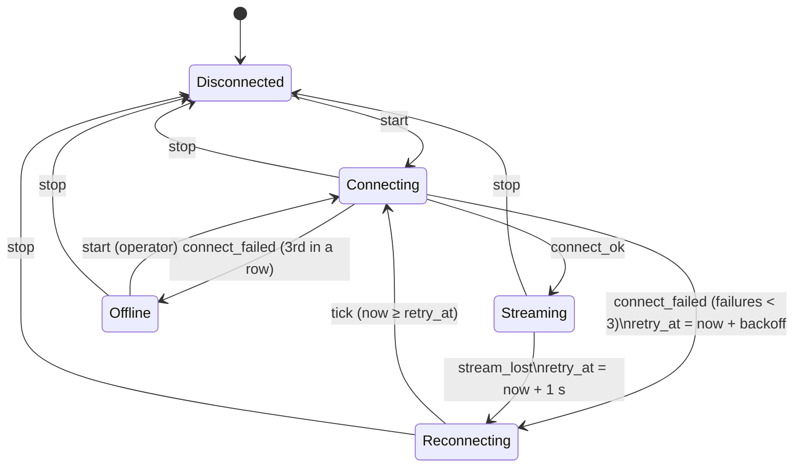
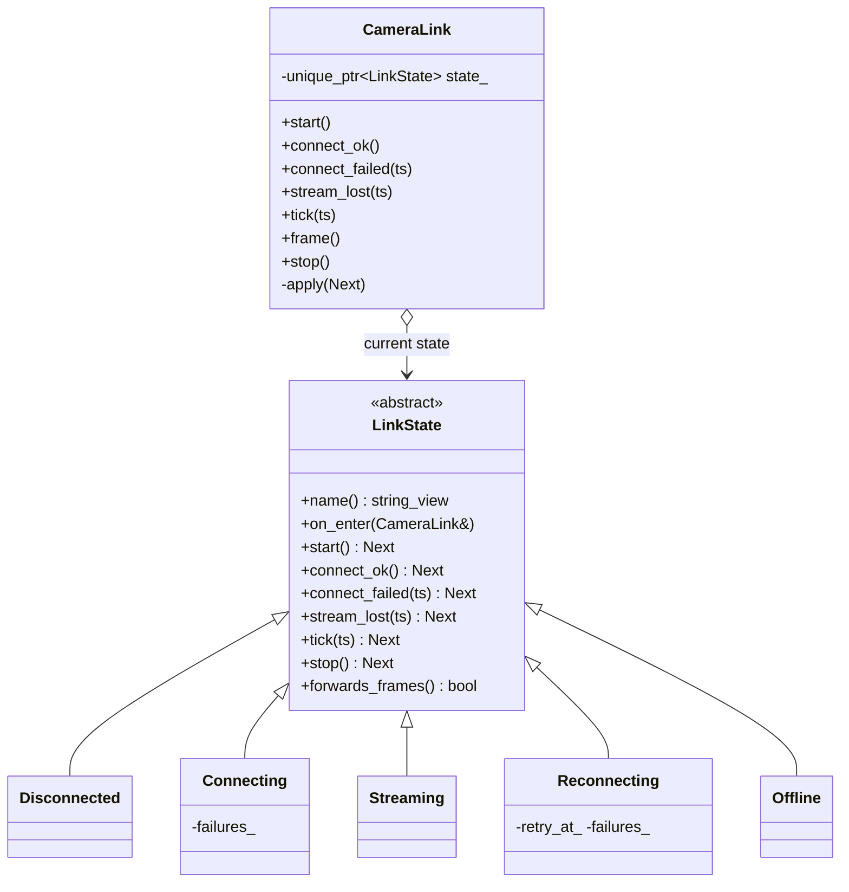

# 10 — State

> Family: **Behavioral** · Code: [`examples/10-state/`](../examples/10-state/)
> Run: `./build/examples/10-state/naive`, `pattern`, `modern`

**Intent (GoF):** allow an object to alter its behaviour when its internal state changes. The object will appear to change its class.

---

## 1. Force

> What every event means — `start`, `connect_ok`, `stream_lost`, `tick`, a frame arriving — **changes wholesale with the link's connection state**, and the **link moves itself** between states in response to those events. The `CameraLink` API and everyone calling it **must not change** when a state is added.

- **What varies:** the behaviour of *all* event handlers at once, keyed by the current state.
- **Who varies it:** the object itself. Events drive transitions; no client picks the behaviour.
- **When:** continuously at runtime, many times per object lifetime.
- **What stays still:** the event API (`start()`, `tick()`, …) and the supervisor that calls it.

The lifecycle being modelled:



Backoff is 1 s, 2 s, 4 s… capped at 8 s. Frames are forwarded only in `Streaming` and are counted as dropped in every other state.

## 2. Naive code and where it hurts

[`naive.cpp`](../examples/10-state/naive.cpp): an enum, plus a `switch` in every event handler.

```cpp
enum class LinkState { Disconnected, Connecting, Streaming, Reconnecting, Offline };

void connect_failed(TimestampMs ts) {
    switch (state_) {
        case LinkState::Connecting:
            ++failures_;
            if (failures_ >= kMaxFailures) enter(LinkState::Offline);
            else { retry_at_ = ts + backoff(failures_); enter(LinkState::Reconnecting); }
            break;
        default: break;
    }
}
// … the same switch shape in start, connect_ok, stream_lost, frame, tick, stop
int failures_;              // meaningful in Connecting / Reconnecting only
TimestampMs retry_at_;      // meaningful in Reconnecting only
```

With five states and seven events, this is a 5 × 7 table written **row by row per event**. Now add `AuthFailed`: wrong credentials, so stop retrying until the operator fixes the password.

1. Add an enum value and its name.
2. Open **all seven** handlers and decide what each event means in `AuthFailed`.
3. If you forget one, nothing tells you. The `default:` silently ignores the event.
4. `AuthFailed` probably needs its own data (which credential failed), which becomes another member that is meaningless in the other states.

"What does `Reconnecting` do?" has no single answer site. It's spread over seven methods.

Smells, by name:
- **Repeated Switches:** the same `switch (state_)` in every method.
- **Temporary Field:** `retry_at_` and `failures_` are garbage outside the states that use them.
- **Shotgun Surgery:** one new state touches every handler.

## 3. Structure



| Role | In this example | Responsibility |
|---|---|---|
| **Context** | `CameraLink` | Public API and counters. Forwards each event to the current state and installs the state it returns. |
| **State** | `LinkState` | One virtual handler per event. The defaults say "ignore it, stay". |
| **Concrete states** | `Disconnected`, `Connecting`, `Streaming`, `Reconnecting`, `Offline` | Override only the events that matter to them, and carry only their own data. |

The defining property: **the states know their successors.** `Connecting::connect_failed` decides between `Reconnecting` and `Offline`. Nobody outside picks the next behaviour.

## 4. Gateway example walkthrough

[`pattern.cpp`](../examples/10-state/pattern.cpp)

```cpp
class LinkState {
public:
    using Next = std::unique_ptr<LinkState>;
    virtual Next start()                          { return nullptr; }   // default: stay
    virtual Next connect_failed(gw::TimestampMs)  { return nullptr; }
    virtual Next tick(gw::TimestampMs)            { return nullptr; }
    // …
};

class Reconnecting final : public LinkState {
    Next tick(gw::TimestampMs ts) override {
        if (ts < retry_at_) return nullptr;            // backoff not elapsed yet
        return std::make_unique<Connecting>(failures_);
    }
    gw::TimestampMs retry_at_;                          // data lives with its state
    int failures_;
};

class CameraLink {
    void tick(gw::TimestampMs ts) { apply(state_->tick(ts)); }
    void apply(LinkState::Next next) {
        if (!next) return;
        state_ = std::move(next);       // old state destroyed *after* its handler returned
        state_->on_enter(*this);        // entry action
    }
};
```

What changed compared with the naive version:

- **Grouping flipped.** Everything `Reconnecting` does is in one class. Adding `AuthFailed` is one new class that overrides `start()` (operator retry) and inherits "ignore" for the rest. Existing states change only where they transition *into* it (`Connecting::connect_failed` on an auth error).
- **No temporary fields.** `retry_at_` exists only inside `Reconnecting` objects. `failures_` is handed from `Connecting` to `Reconnecting` and back as a constructor argument.
- **Entry actions have a home.** `Connecting::on_enter` counts connect attempts. In the naive version that rule was an `if` buried in `enter()`.
- **Same behaviour.** All three programs assert 5 frames forwarded, 2 dropped, 7 connect attempts, and the identical 18-state trace (`Disconnected>Connecting>Streaming>…>Offline>Disconnected`).

Design notes:

- **Return the next state; don't set it from inside.** The textbook version has a state call `context.set_state(new Streaming)` from inside its own member function. With `unique_ptr` ownership, that destroys `*this` while the function is still executing, which is undefined behaviour the moment the function touches a member afterwards. Returning `Next` and letting the context swap after the call removes the hazard and also makes each handler a pure decision that's easy to test.
- **Where does shared data live?** Counters that survive every state (`forwarded_`, `attempts_`) belong to the context. Data that only one state needs belongs to that state. If a state needs to modify the context, pass the context into the handler (`on_enter(CameraLink&)`). Don't store a back-pointer in every state.
- **States can be flyweights.** Stateless states (`Streaming`, `Offline`) could be shared singletons to avoid allocation. Stateful ones (`Reconnecting`) can't. Allocating a few bytes per transition is irrelevant at camera-reconnect frequency.

## 5. Modern C++ form

[`modern.cpp`](../examples/10-state/modern.cpp): states as a `std::variant` of plain structs.

```cpp
struct Connecting   { int failures; };
struct Reconnecting { gw::TimestampMs retry_at; int failures; };
struct Streaming {}; struct Disconnected {}; struct Offline {};
using State = std::variant<Disconnected, Connecting, Streaming, Reconnecting, Offline>;

void tick(gw::TimestampMs ts) {                        // event that matters to one state
    if (const auto* r = std::get_if<Reconnecting>(&state_); r && ts >= r->retry_at)
        apply(Connecting{r->failures});
}

void start() {                                          // event that matters to several
    apply(std::visit(overloaded{
        [](const Disconnected&) -> Next { return Connecting{0}; },
        [](const Offline&)      -> Next { return Connecting{0}; },
        [](const auto&)         -> Next { return std::nullopt; },
    }, state_));
}
```

The variant makes illegal combinations **unrepresentable**: there's no `retry_at` while `Streaming`, because the `Streaming` struct has no such field. There's also no heap allocation and no vtable. The `static_assert` checks that the whole state fits in 24 bytes.

| Form | Pick it when | Cost |
|---|---|---|
| enum + `switch` (naive) | 2–3 states, few events, the logic fits on one screen, and the transition table rarely changes | Repeated switches, temporary fields, silent `default:` |
| State classes (`virtual`) | Many events, rich per-state behaviour, and states added over time by different people | One class per state, heap allocation per transition, behaviour per *event* spread across classes |
| `std::variant` states | States carry different data, the set of states is fairly stable, and you want the compiler to check "can't be in two states" and exhaustive handling | Handlers grouped by event again, and adding a state edits the variant |
| Table-driven FSM (`(state, event) → (action, next)`) | Large protocol machines specified as tables (RFCs, standards) that you want to diff against the spec | Actions become function pointers, and per-state data is awkward |

## 6. When NOT to use it

- **Two states and a boolean.** `if (connected_) … else …` is not a state machine that needs classes.
- **States differ only in data, not behaviour.** If every state answers every event the same way and only a field changes, you need a field, not a hierarchy.
- **The transitions *are* the specification.** For a protocol defined as a table (a parser, the TCP state diagram), a table-driven machine or a `switch` that mirrors the spec line by line is easier to audit than behaviour scattered across classes.
- **A library already does it.** Boost.MSM, Boost.Statechart and Qt's State Machine framework give you hierarchical states, guards and entry/exit actions. Hand-rolling them is rarely worth it beyond the size of this example.

## 7. Confused with

| Pattern | Difference in one line |
|---|---|
| **Strategy** (01) | Strategy: the **client** picks the algorithm and the strategies don't know each other. State: the **object switches itself**, and each state knows its successors. |
| **Command** (08) | A Command is a request to execute. A State is the current mode that decides how incoming requests are executed. |
| **Memento** (19) | Memento *snapshots* an object's state to restore it later. State *is* the object's current behaviour mode. |
| **Flyweight** (22) | Stateless State objects are often implemented as shared flyweights. That's an optimisation of State, not a different intent. |

## 8. Seen in the wild

- **TCP** (RFC 793): `LISTEN`, `SYN_SENT`, `ESTABLISHED`, `FIN_WAIT_1`… is the canonical protocol state machine. The Linux kernel implements it as an enum (`sk->sk_state`) with switches, which is the naive form, kept for performance and auditability against the spec.
- **GStreamer element states:** `NULL → READY → PAUSED → PLAYING`. Every element's behaviour (allocating resources, accepting data) depends on its state, and transitions are driven by `gst_element_set_state()`.
- **Boost.MSM / Boost.Statechart** and **Qt State Machine** (`QStateMachine`, `QState`) are general-purpose C++ state-machine libraries.
- **Device drivers and network interfaces:** a link that goes down, up, and through negotiation is a state machine wherever it's implemented.

## 9. Exercise and checkpoint

**Exercise**
1. Add an `AuthFailed` state to `pattern.cpp`. On a new event `auth_rejected()` from `Connecting`, go to `AuthFailed`. Ignore `tick` there (no auto-retry), and leave only on `start()` (operator fixed credentials) or `stop()`. Count how many existing classes you had to edit.
2. Make the same change in `naive.cpp` and count the edited `switch` statements.
3. Make it in `modern.cpp` as well. Remove the `[](const auto&)` fallback in `start()` first, and note what the compiler tells you when the new alternative is added.

**Checkpoint**: answer from memory:
- In the GoF version, a state calls `context.set_state(new X)`. Why is that dangerous with `unique_ptr` ownership, and how does returning `Next` fix it?
- `failures_` used to be a member of `CameraLink`. Where does it live now, and how does it get from `Connecting` to `Reconnecting` and back?
- An operator dropdown chooses between "H.264" and "H.265" for a camera. Is that State or Strategy? Why?
