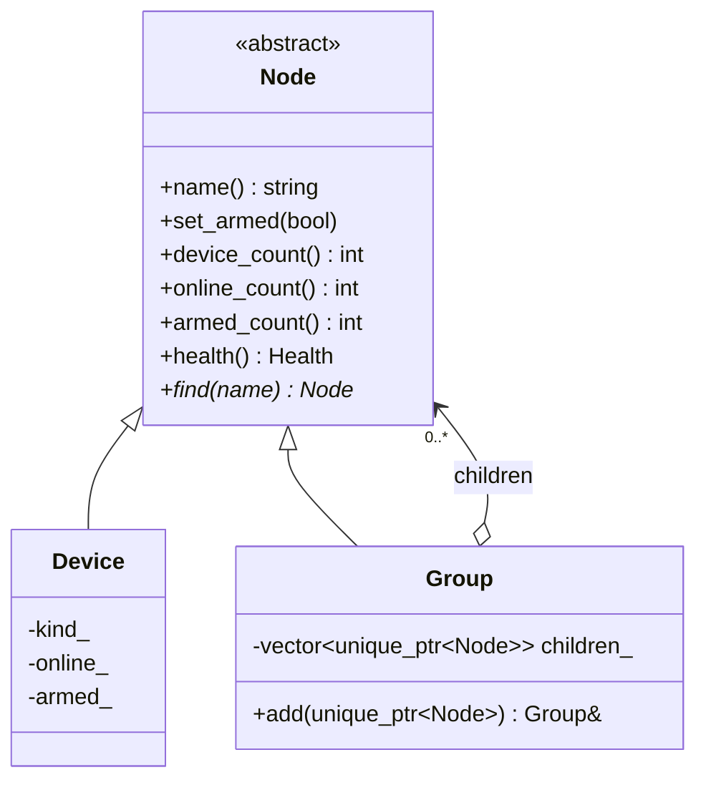

# 11 — Composite

> Family: **Structural** · Code: [`examples/11-composite/`](../examples/11-composite/)
> Run: `./build/examples/11-composite/naive`, `pattern`, `modern`

**Intent (GoF):** compose objects into tree structures to represent part–whole hierarchies. Composite lets clients treat individual objects and compositions of objects uniformly.

---

## 1. Force

> The **depth and shape of the device tree vary per customer**: site → zones for one, site → buildings → floors → zones for another. Operators act on **any node**: "arm this", "how many devices are online here", "how healthy is this". The **operations and their callers must not care** whether the node is one camera or a whole subtree.

- **What varies:** the structure. Depth, fan-out, and which nodes are groups vs devices.
- **Who varies it:** each customer's site layout, edited by installers.
- **When:** at configuration time, and at runtime as devices are added.
- **What stays still:** the operation set (`set_armed`, `device_count`, `online_count`, `health`, `find`) and the UI/API calling it on whatever node was clicked.

## 2. Naive code and where it hurts

[`naive.cpp`](../examples/11-composite/naive.cpp): one struct per level, and one function per operation per level.

```cpp
struct Zone { std::string name; std::vector<Camera> cameras; std::vector<Relay> relays; };
struct Site { std::string name; std::vector<Zone> zones; };

void set_armed(Zone& z, bool armed) { for (auto& c : z.cameras) …; for (auto& r : z.relays) …; }
void set_armed(Site& s, bool armed) { for (auto& z : s.zones) set_armed(z, armed); }
int  online_count(const Zone&);  int online_count(const Site&);
int  armed_count(const Zone&);   int armed_count(const Site&);
Health health(const Zone&);      Health health(const Site&);
```

It works because the tree is exactly two levels deep. Then:

1. **A customer has buildings with floors.** That's two new structs, and a new overload of *every* operation for each of them.
2. **A door-contact sensor arrives.** Every `Zone` function needs one more loop over one more vector.
3. **The UI says "arm the node the operator clicked".** The caller must know whether it's a `Site`, a `Zone` or a `Camera` to pick the right overload, so it ends up with a type switch of its own.

Smells, by name:
- **Duplicate Code:** the same traversal, copied per operation and per level.
- **Shotgun Surgery:** one new level or one new leaf type touches every function.
- **Switch statements at the call site:** clients branch on node type to call the right function.

## 3. Structure



| Role | In this example | Responsibility |
|---|---|---|
| **Component** | `Node` | The uniform interface callers use on any node. |
| **Leaf** | `Device` (camera or relay) | Answers from its own data: count 1, Ok if online. |
| **Composite** | `Group` (site, building, floor, zone) | Answers by delegating to its children and combining the results: sum for counts, roll-up for health, fan-out for arm. |
| **Client** | `main()` (in a real gateway: the UI / API handler) | Holds a `Node*` and never asks what it is. |

The recursion goes through the interface. `Group::online_count` calls `child->online_count()` without knowing whether that child is a camera or another group with 200 cameras under it.

## 4. Gateway example walkthrough

[`pattern.cpp`](../examples/11-composite/pattern.cpp)

```cpp
class Device final : public Node {
    int online_count() const override { return online_ ? 1 : 0; }
    Health health() const override { return online_ ? Health::Ok : Health::Down; }
};

class Group final : public Node {
public:
    Group& add(std::unique_ptr<Node> child);                 // only groups have children
    void set_armed(bool armed) override { for (auto& c : children_) c->set_armed(armed); }
    int online_count() const override { return sum(&Node::online_count); }
    Health health() const override {
        HealthTally t;
        for (const auto& c : children_) t.add(c->health());   // all Ok → Ok, all Down → Down, else Degraded
        return t.result();
    }
private:
    std::vector<std::unique_ptr<Node>> children_;            // the group owns its subtree
};

site.find("parking")->set_armed(true);   // a zone
site.set_armed(true);                    // the whole site, same call
site.find("p2")->health();               // a single camera, same call
```

What changed compared with the naive version:

- **One implementation per operation per role**, two in total, instead of one per level.
- **Depth is free.** The test builds a second tree, `hq → building-A → floor-1/floor-2 → devices`, and arms `building-A` with **zero new code**.
- **Callers stopped switching.** `find()` returns a `Node*`, and every operation works on it.
- **Same behaviour.** All three programs assert 8 devices, 6 online, parking `Degraded`, site `Degraded`, and armed counts 3 → 8 → 5.

Design notes:

- **Where do `add()`/`remove()` live?** GoF describes two options. *Transparency* puts `add()` on `Node`, so every node looks alike, but `camera->add(x)` must fail at runtime. *Safety* puts `add()` on `Group` only, so the type system forbids adding children to a leaf, at the cost of needing a `Group&` to build. This example chooses **safety**: in C++, a compile error beats a runtime throw.
- **Ownership.** `Group` owns its children through `unique_ptr`, so destroying the site destroys the tree. If nodes need a parent pointer (to compute "full path" or to propagate an alarm upward), store a raw non-owning `Group*`. The parent outlives its children by construction.
- **The roll-up rule belongs to the composite.** "All Ok → Ok, all Down → Down, else Degraded" is a decision about groups. A different customer might want "Down if any camera at the entrance is Down", which becomes a policy on `Group`, so Strategy (01) plugs into Composite.
- **Cost of uniformity.** `device_count()` on a leaf is trivially 1, and a leaf has meaningful answers to everything here. When half the operations make no sense for leaves, the uniform interface is lying, and that's a sign the tree should not be a Composite.

## 5. Modern C++ form

[`modern.cpp`](../examples/11-composite/modern.cpp): a recursive `std::variant` value tree.

```cpp
struct Device { std::string name; bool online; bool armed = false; };
struct Node;
struct Group  { std::string name; std::vector<Node> children; };
struct Node : std::variant<Device, Group> { using variant::variant; };

Node site = Group{"site-1", {
    Group{"entrance", {Device{"e1", true}, Device{"e2", true}, Device{"door-1", true}}},
    Group{"parking",  {Device{"p1", true}, Device{"p2", false}, Device{"p3", true}}},
    …
}};

template <class NodeT, class F>
void for_each_device(NodeT& n, F&& f) {          // one walk, reused by arm and all counts
    std::visit([&](auto& alt) {
        if constexpr (std::is_same_v<std::remove_cvref_t<decltype(alt)>, Device>) f(alt);
        else for (auto& c : alt.children) for_each_device(c, f);
    }, n);
}
int online_count(const Node& n) { int c = 0; for_each_device(n, [&](const Device& d) { c += d.online; }); return c; }
```

- `Node` derives from the variant instead of being an alias, so `Group` can mention `Node` before it's complete. `std::vector<Node>` with incomplete `Node` is allowed since C++17. `std::visit` accepts classes derived from `std::variant` as of the C++20 defect report P2162.
- The tree is a **value**. `Node snapshot = site;` is a deep copy, and the test shows that disarming `site` leaves `snapshot` untouched. The class version would need a hand-written `clone()` (Prototype, 21).
- Most operations here are "do X to every device". A single `for_each_device` walk plus a lambda replaces four near-identical virtuals.

| Form | Pick it when | Cost |
|---|---|---|
| Fixed structs per level (naive) | The depth is truly fixed by the domain (a frame always has exactly N planes) | Every operation per level, and new levels are rewrites |
| Class hierarchy (`Node` / `Group` / `Device`) | Node kinds are open-ended (plugins add device types), nodes have identity and live long, and parent pointers are needed | Heap per node, and every new operation edits every class |
| `std::variant` value tree | Node kinds are a small closed set, and operations keep growing (reports, exports, counts) | Adding a node kind edits the variant and every visit. No stable addresses if children are reallocated. |

## 6. When NOT to use it

- **The hierarchy is fixed and shallow.** If a site is always exactly site → zone → device, the naive structs are honest, and the per-level functions are short.
- **Leaves and groups share almost no operations.** A uniform interface where half the methods throw `not supported` on leaves is worse than two separate types.
- **You need to enforce structure rules.** For example, "a relay may only be under a zone, never directly under a site". Composite happily accepts any shape, so you'd have to add runtime validation on `add()`, or keep typed levels.
- **The tree is really a graph.** A camera that belongs to two zones (entrance *and* perimeter) breaks single ownership and double-counts in roll-ups. Model zones as tags or sets, not as parents.

## 7. Confused with

| Pattern | Difference in one line |
|---|---|
| **Decorator** (05) | Both wrap through the same interface. A Decorator has **one** child and **adds behaviour**. A Composite has **many** children and **combines their results**. |
| **Visitor** (20) | Composite defines the tree. Visitor adds new **operations over** that tree without editing node classes. They're often used together. |
| **Iterator** (16) | Iterator **flattens** a traversal so callers loop over it. Composite keeps the **recursion inside** each node. |
| **Chain of Responsibility** (13) | A chain passes a request **along one path** until someone handles it. A composite **fans it out** to every child. |

## 8. Seen in the wild

- **Filesystems:** a directory contains files and directories. `du -s dir` is `device_count` for bytes, and `std::filesystem::recursive_directory_iterator` walks the tree.
- **GStreamer `GstBin`:** a bin is itself a `GstElement` that contains elements, and a `GstPipeline` is a bin. Setting a bin to `PLAYING` sets all its children, so callers treat a single element and a whole pipeline the same way.
- **Qt object and widget trees:** a `QObject` owns its children and deletes them with itself. A `QWidget` with child widgets shows, hides and repaints as a unit.
- **Linux cgroups:** resource limits set on a cgroup apply to the whole subtree of child cgroups below it.
- **HTML DOM / scene graphs:** an element or scene node has children of the same type, and transforms or styles propagate down.

## 9. Exercise and checkpoint

**Exercise**
1. Add a `DoorSensor` leaf to `pattern.cpp` with a battery level. Its health is `Degraded` below 20 % and `Down` when offline. Put one in `entrance` and update the expected numbers. How many existing classes did you edit?
2. Add a `std::string path() const` that returns `site-1/parking/p2`. Decide where the parent link lives and who sets it.
3. In `modern.cpp`, add an operation `offline_devices(const Node&) -> std::vector<std::string>` using `for_each_device`. Compare the edit with adding a new virtual to `Node`, `Device` and `Group` in `pattern.cpp`.

**Checkpoint**: answer from memory:
- Why does this example put `add()` on `Group` and not on `Node`? What does the other choice buy you, and what does it cost?
- `Group::health()` never checks whether a child is a `Device` or a `Group`. Which language feature makes that possible in `pattern.cpp`, and which one in `modern.cpp`?
- A camera must appear in both the `entrance` zone and the `perimeter` zone. What breaks in this design?
