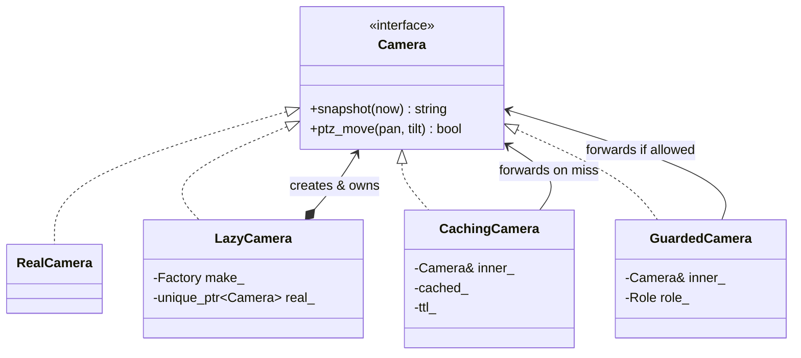

# 12 — Proxy

> Family: **Structural** · Code: [`examples/12-proxy/`](../examples/12-proxy/)
> Run: `./build/examples/12-proxy/naive`, `pattern`, `modern`

**Intent (GoF):** provide a surrogate or placeholder for another object to control access to it.

---

## 1. Force

> **Access to a camera must be controlled.** The connection is deferred until someone actually needs it, recent snapshots are served from a cache instead of hitting the device, and PTZ is refused for roles that may not move the camera. The **driver and every caller keep using the same `Camera` interface**.

- **What varies:** *whether and when* a request reaches the real device.
- **Who varies it:** gateway resources (connect only what's used), device load (many UI tiles asking for the same snapshot), and the security model (role per session).
- **When:** per call, at runtime.
- **What stays still:** the `Camera` interface, the driver (`RealCamera`), and every caller of `snapshot()` and `ptz_move()`.

The three classic kinds of proxy, all in this chapter:

| Kind | Controls | Here |
|---|---|---|
| **Virtual proxy** | *When* the real object is created | `LazyCamera`: connect on first use |
| **Caching proxy** | *Whether* the request reaches the subject | `CachingCamera`: snapshot TTL |
| **Protection proxy** | *Who* may reach the subject | `GuardedCamera`: role check per session |
| *Remote proxy* | *Where* the subject lives (another process or host) | (not in code) a gRPC client stub in front of a camera service |

## 2. Naive code and where it hurts

[`naive.cpp`](../examples/12-proxy/naive.cpp): one `Camera` class does the device protocol, lazy connect, caching and access control.

```cpp
std::string snapshot(gw::TimestampMs now) {
    if (cached_ && now - cached_at_ < ttl_) return *cached_;   // caching concern
    ensure_connected();                                         // lazy-connect concern
    ++stats_.fetches;                                           // the actual job
    …
}
bool ptz_move(Role role, int pan, int tilt) {
    if (role < Role::Operator) { ++stats_.denied; return false; }   // access-control concern
    ensure_connected();                                              // lazy-connect concern, again
    ++stats_.moves;                                                  // the actual job
}
```

Where it hurts:

1. **The device driver knows about users.** `Role` appears in the driver's method signatures, and every caller has to pass it, including internal callers such as the scheduled-preset job that has no user.
2. **The cache is welded to one driver.** The second vendor's driver copies the TTL logic, and the two copies drift.
3. **Testing is tangled.** To test that a snapshot request is built correctly, you have to defeat the cache. To test the cache, you need a full camera.
4. **Every method starts with `ensure_connected()`.** Forget it in one new method and that method crashes on a disconnected camera.

Smells, by name:
- **Divergent Change:** the class changes for protocol reasons, cache-policy reasons and security reasons.
- **Duplicate Code:** the lazy-connect guard is repeated per method, and the cache is repeated per driver.

## 3. Structure



At runtime in the example, two sessions share one cache, which sits in front of one lazy camera:

```
viewer session ─▶ GuardedCamera(Viewer) ─┐
                                          ├─▶ CachingCamera ─▶ LazyCamera ─▶ RealCamera (created on first use)
admin session  ─▶ GuardedCamera(Admin)  ─┘
```

| Role | In this example | Responsibility |
|---|---|---|
| **Subject** | `Camera` | The interface that both the real object and every proxy implement. |
| **Real subject** | `RealCamera` | Device protocol only. No roles, no cache, no lazy logic. |
| **Proxy** | `LazyCamera`, `CachingCamera`, `GuardedCamera` | Same interface. Decides whether and when to forward to the subject. |
| **Client** | `main()` (in a real gateway: the HTTP API handler) | Calls `Camera&` and can't tell a proxy from the real thing. |

## 4. Gateway example walkthrough

[`pattern.cpp`](../examples/12-proxy/pattern.cpp)

```cpp
class LazyCamera final : public Camera {
    std::string snapshot(gw::TimestampMs now) override { return real().snapshot(now); }
    Camera& real() { if (!real_) real_ = make_(); return *real_; }   // connect on first use
    std::unique_ptr<Camera> real_;                                    // owns what it creates
};

class CachingCamera final : public Camera {
    std::string snapshot(gw::TimestampMs now) override {
        if (!cached_ || now - cached_at_ >= ttl_) { cached_ = inner_.snapshot(now); cached_at_ = now; }
        return *cached_;                                              // subject not reached on a hit
    }
};

class GuardedCamera final : public Camera {
    bool ptz_move(int pan, int tilt) override {
        if (role_ < Role::Operator) { ++stats_.denied; return false; }  // subject never reached
        return inner_.ptz_move(pan, tilt);
    }
};
```

What changed compared with the naive version:

- **`RealCamera` is only the device protocol.** It connects in its constructor, which is honest, because a `RealCamera` that exists *is* connected.
- **Each concern is a class** that can be tested alone against a fake `Camera`, and reused in front of any vendor's driver.
- **Roles left the driver's signature.** The role is fixed when the session's `GuardedCamera` is created, so the scheduled-preset job can use the camera without a fake "system" role.
- **Composition decides the topology.** One cache is shared by all sessions, and each session gets its own guard. The naive class couldn't express "two users, one cache".
- **Same behaviour.** Both programs assert 1 connect (cam-2 is never touched), 2 fetches (the t=500 request is a cache hit), 1 move and 1 denial.

Design notes:

- **Ownership tells you which proxy you have.** A virtual proxy usually **creates and owns** its subject (`LazyCamera` holds a `unique_ptr`). Caching and protection proxies usually **reference** a subject that someone else owns. They're views onto it.
- **Thread safety.** `LazyCamera::real()` is a check-then-create race if two threads call it at once. In production, guard it with `std::call_once` or a mutex. Caching proxies need the same care around `cached_`.
- **The cache key.** This cache holds one value. A real snapshot cache would key on resolution or stream profile, and the key design is the actual work.
- **Proxies hide latency changes.** A cache hit returns in microseconds and a miss in hundreds of milliseconds, from the same call. That's the point of the pattern, but callers that time operations will see a bimodal distribution.

## 5. Modern C++ form

[`modern.cpp`](../examples/12-proxy/modern.cpp): generic proxies as class templates.

```cpp
template <class T>
class Lazy {                                  // a smart pointer that creates on first ->
public:
    T* operator->() { if (!obj_) obj_ = make_(); return obj_.get(); }
private:
    std::function<std::unique_ptr<T>()> make_;
    std::unique_ptr<T> obj_;
};

template <class V>
class TtlCache {                              // caching proxy for any "value at time t"
public:
    const V& get(gw::TimestampMs now);
};

Lazy<RealCamera> cam1([&] { return std::make_unique<RealCamera>("10.0.0.11", stats); });
TtlCache<std::string> snapshots([&](gw::TimestampMs t) { return cam1->snapshot(t); }, kSnapshotTtl);
```

GoF lists a fourth kind, the **smart reference**: an object that replaces a bare pointer and does extra work on access. `std::unique_ptr` (ownership), `std::shared_ptr` (reference counting) and `std::weak_ptr` (checks whether the target still exists) are smart references. `Lazy<T>` is the same idea, extended with deferred creation.

| Form | Pick it when | Cost |
|---|---|---|
| Interface proxy (`class LazyCamera : public Camera`) | Callers already take `Camera&`, and the proxy must be **substitutable** anywhere the real object is accepted | One class per proxy per interface, and virtual dispatch |
| Template proxy (`Lazy<T>`, `TtlCache<V>`) | The same access-control idea applies to many unrelated types: lazy DB connections, lazy model loading, cached config reads | Not substitutable: a `Lazy<RealCamera>` is not a `RealCamera&` |
| Smart pointer (`shared_ptr`, `weak_ptr`) | The access control *is* lifetime: shared ownership, or "is it still alive?" | Reference-count traffic for `shared_ptr` |

## 6. When NOT to use it

- **Creation is cheap.** A lazy proxy in front of an object that costs nothing to build adds a branch to every call and buys nothing.
- **A single caller needs a single check.** `if (!user.can_ptz()) return 403;` in the one HTTP handler that moves cameras is clearer than a protection proxy, until a second entry point (CLI, scheduler, ONVIF server) appears.
- **The cache needs knowledge the proxy doesn't have.** If invalidation depends on events elsewhere ("camera reconfigured → drop cached snapshot"), a transparent caching proxy turns into a coherence bug. Put the cache where the invalidation events are visible.
- **Remote calls disguised as local ones.** A remote proxy makes a network call look like a method call. Latency, partial failure and timeouts don't go away, and hiding them invites callers to call it in a loop. Make the remote nature visible in the interface (async, explicit errors).

## 7. Confused with

| Pattern | Difference in one line |
|---|---|
| **Decorator** (05) | Same shape (wrap, same interface). A Decorator **always forwards and adds behaviour**, and clients stack it by choice. A Proxy **controls whether and when** the request reaches the subject, and often manages the subject's lifetime. |
| **Adapter** (03) | An Adapter **changes the interface** to one the client expects. A Proxy keeps **the same interface**. |
| **Facade** (04) | A Facade puts a **new, simpler interface** over a whole subsystem. A Proxy stands in for **one object** with **its own** interface. |

## 8. Seen in the wild

- **`std::unique_ptr`, `std::shared_ptr`, `std::weak_ptr`:** smart references. Ownership, reference counting and liveness checks are performed on access through a pointer-like object.
- **`std::vector<bool>::reference`:** a proxy object that stands in for a single bit, because a real `bool&` into packed storage can't exist.
- **gRPC / RPC client stubs:** generated classes with the service's methods, which forward each call over the network (remote proxy).
- **HTTP caching reverse proxies** (nginx `proxy_cache`, Varnish): the pattern's namesake, a caching proxy at the protocol level.
- **Memory-mapped files and demand paging:** mapping a file is cheap. Pages are actually read from disk only when first touched (virtual-proxy behaviour, implemented by the kernel).

## 9. Exercise and checkpoint

**Exercise**
1. Add an `AuditedCamera` that logs `(role, operation, allowed)` for every PTZ call. Is it a proxy or a decorator? Defend the answer using the definitions in §7.
2. Make `LazyCamera::real()` thread-safe with `std::call_once`. Write a test that calls `snapshot` from 8 threads and asserts `connects == 1`.
3. Change `CachingCamera` to cache per stream profile (`snapshot(now, Profile::Main)` vs `Profile::Sub`). Which classes have to change, and which don't?

**Checkpoint**: answer from memory:
- Why does `LazyCamera` own its subject while `CachingCamera` and `GuardedCamera` hold references?
- The viewer and the admin share one `CachingCamera`. What would change if each session had its own cache, and when would you want that?
- `Lazy<RealCamera>` can't be passed to `void show(Camera&)`. Is that a flaw or a design choice? What would you do if you needed both?
