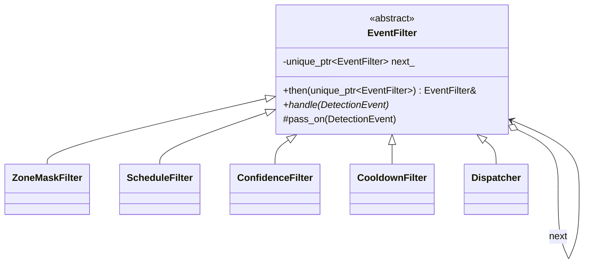

# 13 — Chain of Responsibility

> Family: **Behavioral** · Code: [`examples/13-chain-of-responsibility/`](../examples/13-chain-of-responsibility/)
> Run: `./build/examples/13-chain-of-responsibility/naive`, `pattern`, `modern`

**Intent (GoF):** avoid coupling the sender of a request to its receiver by giving more than one object a chance to handle the request. Chain the receiving objects and pass the request along the chain until an object handles it.

---

## 1. Force

> The **checks a detection event goes through, and their order, vary per camera**: indoor cameras skip the arming schedule, and some sites add stages. **Any check may stop the event.** The detector that emits events and the dispatcher at the end **must not change** when a check is added, removed or reordered.

- **What varies:** the list of handlers, their order, and their parameters, per camera or per site.
- **Who varies it:** installers configuring cameras, plus product features that add stages.
- **When:** at configuration time (building the chain). Each event then runs through it at runtime.
- **What stays still:** the event type, the detector producing it, and the dispatch step.

The chain in this example:

```
detector ─▶ ZoneMask ─▶ Schedule ─▶ Confidence ─▶ Cooldown ─▶ Dispatcher ─▶ alert
              │            │            │            │
              ▼            ▼            ▼            ▼
            drop         drop         drop         drop          (first rejection wins)
```

There are two flavours of the pattern, and both are common:

| Flavour | Semantics | Example |
|---|---|---|
| **First handler that can, handles** (GoF original) | Each handler either handles the request *and stops*, or passes it on | Context-sensitive help, exception `catch` matching, event bubbling to a parent widget |
| **Every handler may veto** (filter / middleware) | Each handler passes the request on or rejects it, and only survivors reach the end | This chapter's event filters, firewall rule chains, HTTP middleware |

## 2. Naive code and where it hurts

[`naive.cpp`](../examples/13-chain-of-responsibility/naive.cpp): one `process()` with every check inline, in a fixed order, plus a flag per optional stage.

```cpp
void process(const DetectionEvent& ev) {
    if (kMaskedZones.contains(ev.zone))           { ++stats_.zone; return; }
    if (opt_.use_schedule) {
        const int h = gw::hour_of_day(ev.ts);
        if (!(h >= kArmedFrom || h < kArmedTo))   { ++stats_.schedule; return; }
    }
    if (ev.confidence < kMinConfidence)           { ++stats_.confidence; return; }
    if (/* last alert for (camera, label) < 30 s ago */) { ++stats_.cooldown; return; }
    last_alert_[key] = ev.ts;
    ++stats_.dispatched;
}
```

At four stages, this is readable. The trouble comes with change:

1. **Indoor cameras skip the schedule:** a `use_schedule` flag. A lobby camera needs "business hours only": another flag and another `if`.
2. **A new stage** ("drop if a neighbouring camera already alerted on this object") means editing `process()` and retesting all the others.
3. **Reordering** (run the cheap zone check before an expensive model-based check) is a code change, not configuration.
4. **No unit tests per stage.** You can't test the confidence threshold without satisfying the zone and schedule checks first.

Smells, by name:
- **Long Method** in the making: every new stage adds to one function.
- **Boolean flag parameters:** `Options{use_schedule}` selects code paths inside the method.
- **Divergent Change:** the pipeline changes for zone, schedule, ML and deduplication reasons.

## 3. Structure



| Role | In this example | Responsibility |
|---|---|---|
| **Handler** | `EventFilter` | `handle(ev)`, plus the link to the next handler and `pass_on()`. |
| **Concrete handlers** | `ZoneMaskFilter`, `ScheduleFilter`, `ConfidenceFilter`, `CooldownFilter` | Each decides one thing: stop here, or `pass_on(ev)`. |
| **End of chain** | `Dispatcher` | Does the work for events that survived. |
| **Client** | `outdoor_chain()`, `indoor_chain()` | Assembles a chain per camera profile and feeds it events. |

A handler knows only "is there a next one". It never knows *which* handler is next, or how long the chain is. That's what makes reordering and per-camera chains free.

## 4. Gateway example walkthrough

[`pattern.cpp`](../examples/13-chain-of-responsibility/pattern.cpp)

```cpp
class EventFilter {
public:
    EventFilter& then(std::unique_ptr<EventFilter> next) { next_ = std::move(next); return *next_; }
    virtual void handle(const DetectionEvent& ev) = 0;
protected:
    void pass_on(const DetectionEvent& ev) { if (next_) next_->handle(ev); }
private:
    std::unique_ptr<EventFilter> next_;
};

class ConfidenceFilter final : public EventFilter {
    void handle(const DetectionEvent& ev) override {
        if (ev.confidence < min_) { ++stats_.confidence; return; }   // stop
        pass_on(ev);                                                  // or forward
    }
};

auto head = std::make_unique<ZoneMaskFilter>(kMaskedZones, s);
head->then(std::make_unique<ScheduleFilter>(22, 6, s))
    .then(std::make_unique<ConfidenceFilter>(0.6f, s))
    .then(std::make_unique<CooldownFilter>(30'000, s))
    .then(std::make_unique<Dispatcher>(s));
```

What changed compared with the naive version:

- **The flag is gone.** `indoor_chain()` simply doesn't include a `ScheduleFilter`. Per-camera variation is chain *assembly*, not branches inside one method.
- **Each stage is a class you can test alone.** The test drives a single `ConfidenceFilter` with no chain behind it.
- **State lives with its stage.** The cooldown map is inside `CooldownFilter`, and each chain gets its own.
- **Order is visible in one place:** the builder function. A cheap zone check runs before anything that costs CPU.
- **Same behaviour.** All three programs assert 4 dispatched, and drops of zone 2, schedule 1, confidence 1, cooldown 2. The indoor chain lets the midday event through.

Design notes:

- **Order is semantics.** Event 9 (low confidence *and* in a masked zone) is counted as a `zone` drop because zone runs first. Swapping the stages changes the statistics, and, for stateful stages, behaviour too. If the cooldown ran before confidence, a low-confidence event would refresh the cooldown timer and suppress the next real alert. Document the order and test it.
- **The unhandled case.** In the GoF flavour, a request can fall off the end with no handler. Decide explicitly what that means. Here the chain always ends in `Dispatcher`, so "survived every filter" has a defined meaning.
- **Ownership.** Each handler owns the next through `unique_ptr`, so destroying the head destroys the chain. Chains are built once per camera and live as long as the camera's pipeline.
- **Deep chains recurse.** `pass_on` is a nested call, so a chain of thousands of handlers grows the stack. At that scale, use the loop form below.

## 5. Modern C++ form

[`modern.cpp`](../examples/13-chain-of-responsibility/modern.cpp): a `std::vector` of named predicates and one runner loop.

```cpp
struct Stage {
    std::string_view name;
    std::function<bool(const DetectionEvent&)> accept;
};

std::string_view run(const std::vector<Stage>& chain, const DetectionEvent& ev) {
    for (const auto& stage : chain)
        if (!stage.accept(ev)) return stage.name;     // first rejection wins
    return "dispatched";
}

std::vector<Stage> outdoor = {zone_mask(), schedule(22, 6), confidence(0.6f), cooldown(30'000)};
std::vector<Stage> indoor  = {zone_mask(),                  confidence(0.6f), cooldown(30'000)};
```

When every handler is "accept or reject, then the next one runs", the links between handlers carry no information, so a loop replaces them. The chain becomes **data**. It can be built from a config file, logged, or diffed.

What the vector form can't do is work **around** the rest of the chain. In the linked form, a handler regains control when `pass_on()` returns:

```cpp
void handle(const DetectionEvent& ev) override {
    const auto t0 = clock::now();
    pass_on(ev);                         // the entire rest of the chain runs here
    metrics_.record(clock::now() - t0);  // …then we're back
}
```

That "before and after" shape is the **middleware** pattern used by HTTP server frameworks. It needs the linked form, or a runner that passes each stage a `next` callable.

| Form | Pick it when | Cost |
|---|---|---|
| `if` sequence (naive) | One fixed pipeline, few stages, no per-camera variation | Flags appear with the first variation |
| Linked handlers (classic) | Handlers must act **around** downstream processing (timing, try/catch, transactions), or decide *themselves* where to forward | Recursion depth, and the chain structure is hidden in pointers |
| Vector of stages (modern) | Pure accept/reject filters, chains built from configuration, stages inspected or logged | No "after" hook. Stages can't forward conditionally to a different branch. |

## 6. When NOT to use it

- **One pipeline, never varied, three checks.** The naive `if` sequence is easier to read top to bottom than a chain spread over five classes.
- **Exactly one handler is always right, and it's known up front.** That's dispatch by key (a `std::map<Kind, Handler>`), not a chain. Walking a chain to find the obvious receiver is slower and obscures intent.
- **Every handler must run.** If no handler can stop the request (logging to N sinks, say), that's Observer (02) or plain iteration, not a chain.
- **The order constraints are complex** ("B must run after A unless C"). A linear chain can't express that. You need an explicit dependency graph or a state machine.

## 7. Confused with

| Pattern | Difference in one line |
|---|---|
| **Decorator** (05) | Same linked shape. A decorator **always forwards** and adds behaviour. A chain handler may **stop** the request. |
| **Observer** (02) | Observer **notifies every** subscriber and nobody can stop the others. A chain **passes along one path**, and any link can end it. |
| **Composite** (11) | A composite **fans a request out** to all children. A chain **passes it linearly**. Requests are often passed *up* a composite tree as a chain (event bubbling to the parent). |
| **Command** (08) | A Command is the **request** as an object. A chain is the **route** the request takes. They combine naturally: pass Command objects along a chain. |

## 8. Seen in the wild

- **Linux netfilter / iptables chains:** packets traverse the rules of a chain (`INPUT`, `FORWARD`, …) in order. A rule with a terminating target such as `ACCEPT` or `DROP` ends the traversal, and the chain's policy applies to packets that fall off the end.
- **C++ exception handling:** a thrown exception unwinds through enclosing `try` blocks, and the first `catch` whose type matches handles it. That's the GoF "first that can, handles" flavour, implemented by the runtime.
- **Qt event propagation:** an event a widget `ignore()`s is propagated to its parent widget, and so on up the tree, until someone accepts it.
- **HTTP middleware stacks** in web frameworks: each middleware can short-circuit with a response or call `next` and act on the way back.

## 9. Exercise and checkpoint

**Exercise**
1. Add a `BusinessHoursFilter` (08:00–18:00) and build a `lobby_chain()` that uses it instead of `ScheduleFilter`. Did you edit any existing class?
2. Move `CooldownFilter` *before* `ConfidenceFilter` in `outdoor_chain()`. Predict the new statistics before running it, then explain the difference.
3. In `modern.cpp`, change `Stage` so each stage receives a `next` callable (`std::function<bool(const DetectionEvent&, Next)>`), and add a stage that counts how many events reach the dispatcher *after* it. That's the middleware shape.

**Checkpoint**: answer from memory:
- Event 9 is both in a masked zone and below the confidence threshold. Which counter increments, and why is that a design decision rather than an accident?
- What can a linked handler do that a vector-of-predicates stage can't?
- An event must be both recorded *and* sent to the cloud *and* shown in the UI, and none of these may stop the others. Is that a chain? If not, which pattern is it?
