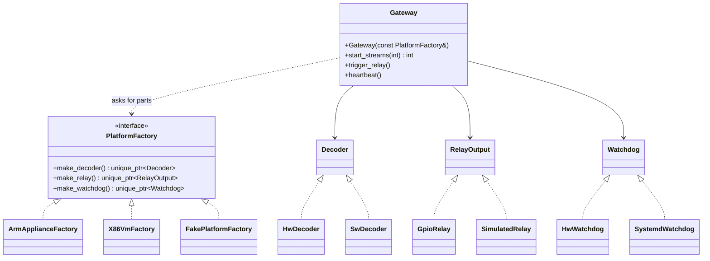

# 14 — Abstract Factory

> Family: **Creational** · Code: [`examples/14-abstract-factory/`](../examples/14-abstract-factory/)
> Run: `./build/examples/14-abstract-factory/naive`, `pattern`, `modern`

**Intent (GoF):** provide an interface for creating families of related or dependent objects without specifying their concrete classes.

---

## 1. Force

> The **platform** (ARM appliance, x86 VM, test rig) **varies per deployment**, and its parts (decoder, relay output, watchdog) **only work as a matched set**. The **gateway logic** that uses those parts **must not change** per platform, and **must not be able to mix** parts from two platforms.

- **What varies:** a *family* of products, all at once. This is several related types, not one object.
- **Who varies it:** the deployment target, i.e. which hardware the image runs on.
- **When:** once, at startup (or at build time: see §5).
- **What stays still:** `Gateway` and everything that calls `start_streams()`, `trigger_relay()` and `heartbeat()`.

The extra constraint, **consistency**, is what separates this from Factory Method (06). One factory method picks one product. An abstract factory picks a whole row of the product table at once.

```
                 Decoder        RelayOutput      Watchdog
ARM appliance    HwDecoder      GpioRelay        HwWatchdog         ← one family
x86 VM           SwDecoder      SimulatedRelay   SystemdWatchdog    ← another
```

## 2. Naive code and where it hurts

[`naive.cpp`](../examples/14-abstract-factory/naive.cpp): `Gateway` builds its own parts with one `if` per part.

```cpp
Gateway(const GatewayConfig& cfg) {
    if (cfg.hw_decode) decoder_ = std::make_unique<HwDecoder>();
    else               decoder_ = std::make_unique<SwDecoder>();

    if (cfg.platform == Platform::ArmAppliance) relay_ = std::make_unique<GpioRelay>();
    else                                         relay_ = std::make_unique<SimulatedRelay>();

    if (cfg.platform == Platform::ArmAppliance) watchdog_ = std::make_unique<HwWatchdog>();
    else                                         watchdog_ = std::make_unique<SystemdWatchdog>();
}
```

The problems:

1. **Nothing ties the choices together.** The decoder grew its own `hw_decode` flag. Setting `{X86Vm, hw_decode=true}` builds `hw-decoder + sim-relay + systemd-watchdog`. That compiles and boots, and then fails on the first decode because a VM has no codec block. The naive test constructs exactly this and checks that `consistent()` is false.
2. **Adding a platform**, such as a test rig or a second appliance model, means finding every `if (platform == …)`. In a real gateway those are spread across many files.
3. **`Gateway` depends on all six concrete classes**, so unit-testing it pulls in both platforms' code.

Smells, by name:
- **Shotgun Surgery:** one new platform means edits in many places.
- **Switch on a type code:** `Platform` is checked repeatedly to choose types.
- **Inappropriate Intimacy:** the high-level gateway knows every low-level hardware class.

## 3. Structure



| Role | In this example | Responsibility |
|---|---|---|
| **Abstract factory** | `PlatformFactory` | One `make_*` per product kind. |
| **Concrete factory** | `ArmApplianceFactory`, `X86VmFactory`, `FakePlatformFactory` | Creates one consistent family. |
| **Abstract products** | `Decoder`, `RelayOutput`, `Watchdog` | What the client uses. |
| **Concrete products** | `HwDecoder`, `GpioRelay`, … | Platform-specific implementations. |
| **Client** | `Gateway` | Uses only the abstract factory and abstract products. |
| **Composition root** | `make_platform(Platform)` | The **one** place that maps a platform to its factory. |

## 4. Gateway example walkthrough

[`pattern.cpp`](../examples/14-abstract-factory/pattern.cpp)

```cpp
class PlatformFactory {
public:
    virtual ~PlatformFactory() = default;
    virtual std::unique_ptr<Decoder>     make_decoder()  const = 0;
    virtual std::unique_ptr<RelayOutput> make_relay()    const = 0;
    virtual std::unique_ptr<Watchdog>    make_watchdog() const = 0;
};

class ArmApplianceFactory final : public PlatformFactory {
    std::unique_ptr<Decoder>     make_decoder()  const override { return std::make_unique<HwDecoder>(); }
    std::unique_ptr<RelayOutput> make_relay()    const override { return std::make_unique<GpioRelay>(); }
    std::unique_ptr<Watchdog>    make_watchdog() const override { return std::make_unique<HwWatchdog>(); }
};

class Gateway {
public:
    explicit Gateway(const PlatformFactory& f)
        : decoder_(f.make_decoder()), relay_(f.make_relay()), watchdog_(f.make_watchdog()) {}
    ...
};

Gateway arm(*make_platform(Platform::ArmAppliance));
```

What changed compared with the naive version:

- **The platform decision happens once**, in `make_platform()`. `Gateway` contains no `if` and names no concrete class.
- **Consistency by construction.** Choosing a factory chooses all three parts, so the mixed set from `naive.cpp` can't be expressed.
- **A new family is one class.** `FakePlatformFactory` (a decoder limited to 2 streams, for capacity tests) plugs in with zero edits to `Gateway`.
- **Same behaviour:** both versions assert ARM accepts 10 of 10 streams, the VM accepts 4, and there are 2 relay pulses and 3 watchdog kicks.

Design notes:

- **The factory is only needed during construction.** `Gateway` takes it by `const&` and doesn't store it. If parts must be re-created later (reconnecting a decoder, say), keep a reference to the factory, and then its lifetime matters.
- **Adding a new *product kind* is expensive.** Adding, say, `make_temperature_sensor()` changes the interface and every concrete factory. Abstract Factory makes new families cheap and new kinds of product costly. Check that your product list is stable before committing to it.
- **Concrete factories are often stateless**, so one instance per process is fine. That isn't a reason to make them Singletons (15). Create one in `main()` and pass it in.

## 5. Modern C++ form

[`modern.cpp`](../examples/14-abstract-factory/modern.cpp): when the platform is fixed **per build** (one firmware image per hardware target), the family can be a type:

```cpp
struct ArmAppliance { using Decoder = HwDecoder; using Relay = GpioRelay; using Watchdog = HwWatchdog; };
struct X86Vm        { using Decoder = SwDecoder; using Relay = SimulatedRelay; using Watchdog = SystemdWatchdog; };

template <PlatformFamily P>             // concept: P names Decoder, Relay, Watchdog
class Gateway {
    typename P::Decoder  decoder_;      // by value: no factory object, no heap
    typename P::Relay    relay_;
    typename P::Watchdog watchdog_;
};

Gateway<ArmAppliance> gw;
```

The traits struct *is* the concrete factory, and the template parameter is the "abstract factory" slot. Mixing is still impossible, because one argument selects the whole family.

| Form | Pick it when | Cost |
|---|---|---|
| `virtual` factory interface | Platform detected **at runtime** (one binary, many targets), or families loaded from plugins | Heap allocations, indirect calls, all families linked in |
| Traits / template family | Platform fixed **per build** (cross-compiled image per hardware target), or hot paths | `Gateway<Arm>` and `Gateway<Vm>` are unrelated types. More template code in headers. |
| A struct of `std::function` creators | Families assembled from config, few products | You can't add product-specific methods. Each creator is checked separately. |

## 6. When NOT to use it

- **There's only one platform.** A factory interface with one implementation is pure indirection. Construct the parts directly.
- **The products aren't related.** If the decoder choice is genuinely independent of the relay choice, there's no family to enforce. Use separate factories or plain injection.
- **The set of product kinds keeps growing.** Every new kind touches every factory. The pattern assumes the columns of the table are stable and the rows grow.
- **Dependency injection already covers it.** If `main()` builds the parts and passes them to `Gateway`'s constructor, you already have one decision point. Add the factory only when the parts must be created later, or repeatedly.

## 7. Confused with

| Pattern | Difference in one line |
|---|---|
| **Factory Method** (06) | Factory Method: **one product**, chosen by a subclass overriding one method. Abstract Factory: a **family of products**, chosen by passing a factory object. Each `make_*` here is often a factory method. |
| **Builder** (07) | Builder assembles **one complex object step by step**. Abstract Factory returns **several finished objects** in one call each. |
| **Prototype** (21) | Prototype creates by **cloning a configured instance**. A factory can be implemented with prototypes instead of `new`. |
| **Bridge** (17) | Bridge separates an abstraction from its implementation. An Abstract Factory is often what **creates and wires** the right implementation side of a Bridge. |

## 8. Seen in the wild

- **Qt's platform abstraction (QPA):** a platform plugin provides a `QPlatformIntegration` subclass. Its virtual factory methods, such as `createPlatformWindow()` and `createPlatformBackingStore()`, return a consistent family of platform objects per plugin (`xcb`, `wayland`, `windows`, `cocoa`).
- **Cross-platform GUI toolkits generally:** one factory per OS creates the matching buttons, menus and dialogs. This is the GoF book's own motivating example.
- **Test doubles:** swapping a whole family of collaborators (clock, filesystem, network) for fakes through one factory object.

## 9. Exercise and checkpoint

**Exercise**
1. Add a `PiDevBoardFactory`: software decoder limited to 2 streams, `GpioRelay`, `SystemdWatchdog`. Note that it mixes parts *intentionally*, as a family someone designed. Don't edit `Gateway`.
2. Add a fourth product kind, `TemperatureSensor`. Count the files and classes you have to touch, and compare with step 1.
3. In `modern.cpp`, try instantiating `Gateway<int>` and read the concept error.

**Checkpoint**: answer from memory:
- What does Abstract Factory guarantee that three separate factory methods don't?
- Why does `Gateway` take `const PlatformFactory&` instead of `std::unique_ptr<PlatformFactory>`?
- The gateway image is cross-compiled once per hardware target and never changes platform at runtime. Which form do you choose, and what do you give up?
