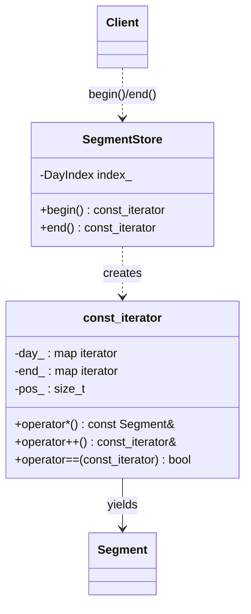

# 16 — Iterator

> Family: **Behavioral** · Code: [`examples/16-iterator/`](../examples/16-iterator/)
> Run: `./build/examples/16-iterator/naive`, `pattern`, `modern`

**Intent (GoF):** provide a way to access the elements of an aggregate object sequentially without exposing its underlying representation.

---

## 1. Force

> **How recorded segments are laid out** (a map of day directories today, possibly a ring buffer or a per-camera index tomorrow) **varies**. The **callers that walk "every segment in time order"** (export job, retention job, timeline API) **must not change** when it does.

- **What varies:** the storage representation and the traversal logic that follows from it.
- **Who varies it:** the storage layer, through a new disk layout, an index format, or a change in retention design.
- **When:** at design time. The traversal is chosen by the container's type.
- **What stays still:** every loop over segments, and every standard algorithm applied to them.

## 2. Naive code and where it hurts

[`naive.cpp`](../examples/16-iterator/naive.cpp): the store hands out its internal map, and every caller writes the same nested loops.

```cpp
class SegmentStore {
public:
    const DayIndex& days() const { return index_; }   // std::map<date, std::vector<Segment>>
};

gw::TimestampMs camera_duration(const SegmentStore& store, const gw::CameraId& cam) {
    gw::TimestampMs total = 0;
    for (const auto& [day, segments] : store.days())   // layout knowledge, copy #1
        for (const auto& s : segments)
            if (s.camera == cam) total += s.duration;
    return total;
}
// count_all() and camera_segments() repeat the same two loops.
```

1. **The layout leaks.** If the store becomes a flat ring buffer, every caller's loop breaks.
2. **Traversal is duplicated:** the outer and inner loops, and in real code the empty-day skip and ordering rules, once per caller.
3. **No single sequence.** You can't hand "all segments" to `std::count_if`, `std::ranges::find`, or anything else that takes a range.

Smells, by name:
- **Inappropriate Intimacy:** callers depend on the store's private data structure.
- **Duplicated Code:** the same nested traversal in three functions.
- **Encapsulate Collection** (the refactoring this calls for): a class returning its internal container for others to walk.

## 3. Structure



| Role | In this example | Responsibility |
|---|---|---|
| **Aggregate** | `SegmentStore` | Owns the data and creates iterators. Its layout stays private. |
| **Iterator** | `SegmentStore::const_iterator` | Knows the layout: which day it's in and the position in that day's vector. Yields one `Segment` at a time. |
| **Client** | `count_all`, `camera_segments`, `camera_duration` | See a flat sequence of `Segment`. |

The GoF interface `first() / next() / is_done() / current_item()` is spelled in C++ as `begin() / ++it / it == end() / *it`. Writing it the C++ way is what lets range-for and every standard algorithm work on the store.

## 4. Gateway example walkthrough

[`pattern.cpp`](../examples/16-iterator/pattern.cpp)

```cpp
class const_iterator {
public:
    using iterator_concept = std::forward_iterator_tag;
    using value_type      = Segment;
    using difference_type = std::ptrdiff_t;
    using reference       = const Segment&;

    reference operator*() const { return day_->second[pos_]; }
    const_iterator& operator++() { ++pos_; settle(); return *this; }
    bool operator==(const const_iterator& o) const {
        return day_ == o.day_ && (day_ == end_ || pos_ == o.pos_);
    }
private:
    void settle() {                        // skip finished and empty days
        while (day_ != end_ && pos_ >= day_->second.size()) { ++day_; pos_ = 0; }
    }
    DayIndex::const_iterator day_, end_;
    std::size_t pos_ = 0;
};

static_assert(std::forward_iterator<SegmentStore::const_iterator>);
```

What changed compared with the naive version:

- **`days()` is gone.** The map is private, and the only way in is `begin()`/`end()`.
- **Traversal lives in one place.** `settle()` encodes "skip finished and empty days" once. The test checks that the 6th segment is the first one on 2026-10-13, so the empty 2026-10-12 is skipped.
- **Clients use standard tools:** `std::distance`, `std::count_if`, and range-for.
- **Same behaviour:** both versions report 8 segments, 5 for cam-1, and 255,000 ms of cam-1 video.

Design notes:

- **`static_assert(std::forward_iterator<…>)`** makes the compiler check the whole iterator contract: default-constructible, `++` returns a reference, `it++` returns a copy, equality comparable, and the right member types. Without it, a missing piece shows up as a confusing error deep inside some algorithm.
- **Equality at the end** compares only `day_` when both iterators are at the end. That makes `end()` unique no matter what `pos_` holds.
- **Invalidation:** the iterator holds `std::map` iterators and an index into a `std::vector`. Adding a segment to *today's* vector can reallocate it, so the store must document "iterators are invalidated by `append()`", as the standard containers do.
- **Several iterators can run at once,** because each holds its own position. The test checks this. That independence is the main reason to put traversal state in an iterator rather than in the aggregate.

## 5. Modern C++ form

[`modern.cpp`](../examples/16-iterator/modern.cpp): don't write the iterator. C++20 already has the "flatten nested ranges" adaptor.

```cpp
class SegmentStore {
public:
    auto all() const { return index_ | std::views::values | std::views::join; }

    auto for_camera(gw::CameraId cam) const {
        return all() | std::views::filter([cam = std::move(cam)](const Segment& s) { return s.camera == cam; });
    }
};

auto durations = store.for_camera("cam-1") | std::views::transform(&Segment::duration);
for (auto s : store.for_camera("cam-2") | std::views::take(2)) { ... }   // lazy: stops after 2
```

- `views::values` turns the map into a range of `std::vector<Segment>`. `views::join` flattens that into a range of `Segment`. That's exactly what `const_iterator` does by hand, including skipping empty days.
- **Views are lazy.** Nothing is copied, and `take(2)` stops the traversal after two matches.
- The return type is `auto`, so callers see "a range of `Segment`", not the layout.

| Form | Pick it when | Cost |
|---|---|---|
| Composed views (`join`, `filter`, `transform`) | The traversal is expressible as standard adaptors over existing containers | Long, unreadable type names in errors. A view refers to the store and must not outlive it. Some views (`filter`) cache `begin()`, so iterating them as `const` is restricted. |
| Hand-written iterator | The layout isn't a standard container (a ring buffer with a wrap point, segments on disk read in pages, a tree), or you need a stable named type in an API | You write and test ~50 lines, and must state its category and invalidation rules |
| Callback (`for_each_segment(fn)`) | Internal iteration is enough: no early exit needed, and no algorithms over the sequence | Callers can't pause, compose or use `<algorithm>`. This is GoF's "internal iterator". |
| Coroutine generator (`std::generator`, C++23) | Traversal is easiest written as a loop with `co_yield`, such as walking a directory tree | Needs C++23 (or a library). There's a coroutine frame allocation, and it's input-only (single pass). |

## 6. When NOT to use it

- **The aggregate *is* a standard container.** If `SegmentStore` is just a `std::vector<Segment>`, return a `std::span<const Segment>` or expose `begin()/end()` that forward to the vector. Don't write a custom iterator.
- **Callers genuinely need the structure.** A UI that shows "day headers, then that day's segments" wants the grouping. Give it a per-day API too, rather than flattening and re-grouping.
- **Single use, internal code.** One loop in one function doesn't need an abstraction. The force is *several callers* plus a *layout that will change*.

## 7. Confused with

| Pattern | Difference in one line |
|---|---|
| **Visitor** (20) | Iterator **walks** a structure and hands you elements. Visitor **dispatches an operation** on each element's concrete type. They're often used together: iterate the tree, visit each node. |
| **Composite** (11) | Composite **builds** a tree of uniform nodes. An iterator is how you **traverse** it (depth-first, breadth-first) without recursion in every caller. |
| **Generator / coroutine** | A generator is an iterator whose state is kept implicitly by the suspended function, instead of by explicit members. |
| **Repository** | A Repository returns query results (often a collection), so it answers *which* elements. Iterator answers *how to walk* them. |

## 8. Seen in the wild

- **Every standard container:** `std::vector::iterator`, `std::map::iterator`, and so on. The STL is built on the separation "containers hold data, iterators traverse, algorithms work on iterators".
- **`std::filesystem::directory_iterator` and `recursive_directory_iterator`:** walk a directory tree with a range-for, hiding the `opendir`/`readdir` calls. This is the same job as walking a recording directory tree.
- **`std::istream_iterator`:** an input iterator over parsed values from a stream.
- **C++20 range adaptors:** `std::views::join`, `filter`, `transform` and `take` all return views whose iterators wrap other iterators.

## 9. Exercise and checkpoint

**Exercise**
1. Change `SegmentStore`'s internal layout in `pattern.cpp` to a single `std::vector<Segment>` sorted by date. Only `const_iterator` and the constructor should change. Check that `count_all`, `camera_segments` and `camera_duration` don't change.
2. Add `std::string day() const` to `const_iterator`, returning the date of the current segment. Why is that easy in the hand-written iterator and awkward with `views::join`?
3. In `modern.cpp`, add `between(TimestampMs from, TimestampMs to)` using `views::filter`, and compose it with `for_camera`.

**Checkpoint**: answer from memory:
- What does `settle()` guarantee about every iterator that isn't `end()`?
- Why is the `static_assert(std::forward_iterator<…>)` worth having?
- A segment is appended to today's vector while the export job is iterating. What can go wrong, and how do standard containers document this?
