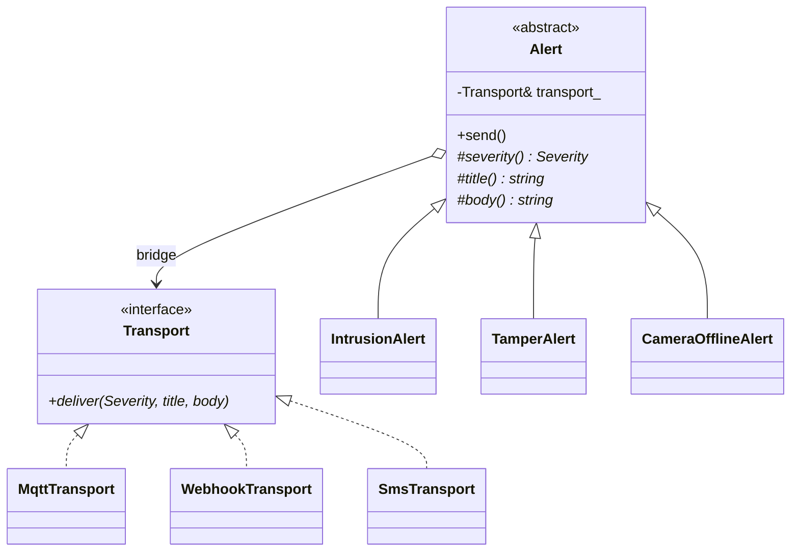

# 17 — Bridge

> Family: **Structural** · Code: [`examples/17-bridge/`](../examples/17-bridge/)
> Run: `./build/examples/17-bridge/naive`, `pattern`, `modern`

**Intent (GoF):** decouple an abstraction from its implementation so that the two can vary independently.

---

## 1. Force

> **Two things vary independently:** *what happened* (intrusion, tamper, camera offline; product adds kinds) and *how it is delivered* (MQTT, webhook, SMS; integrations add transports). **Neither axis may force edits on the other**, and the code must grow as **N + M**, not N × M.

- **What varies:** two dimensions at once, each with its own reasons to change.
- **Who varies them:** different people. Product decides alert kinds, and integrations/customers decide transports.
- **When:** the pairing is chosen at runtime (per customer, per site configuration).
- **What stays still:** `send()`. Every alert, over every transport, goes out through the same call.

The tell is the word **"×"**. Whenever you catch yourself naming classes `<Kind><Transport>Alert`, there are two axes fused into one hierarchy.

## 2. Naive code and where it hurts

[`naive.cpp`](../examples/17-bridge/naive.cpp): one subclass per combination.

```
                    Alert
         ┌────────────┼──────────────┐
  IntrusionAlert   TamperAlert   OfflineAlert          ← axis 1
    ├ MqttIntrusionAlert   ├ MqttTamperAlert   ├ MqttOfflineAlert
    ├ WebhookIntrusionAlert├ WebhookTamperAlert├ WebhookOfflineAlert   ← axis 2, repeated per kind
    └ SmsIntrusionAlert    └ SmsTamperAlert    └ SmsOfflineAlert
```

```cpp
struct MqttIntrusionAlert final : IntrusionAlert {
    void send() override { out_.mqtt.push_back("alerts/high Intrusion: zone=" + zone_); }
};
struct MqttTamperAlert final : TamperAlert {
    void send() override { out_.mqtt.push_back("alerts/high Tamper: camera=" + cam_ + " view blocked"); }
};
// ... seven more
```

- **9 leaf classes for 3 × 3.** A 4th transport (say, Slack) adds 3 classes, and a 4th kind adds 3 more.
- **Every wire format is written once per kind.** The MQTT topic format exists in three places. A fix to it is three edits, and missing one is a silent inconsistency.
- **Two reasons to change, one hierarchy.** Adding a kind means touching transport code, and the reverse.

Smells, by name:
- **Parallel Inheritance Hierarchies:** each new kind requires a new subclass per transport.
- **Duplicated Code:** each wire format copied once per alert kind.
- **Combinatorial explosion:** class count grows as the product of the axes.

## 3. Structure



| Role | In this example | Responsibility |
|---|---|---|
| **Abstraction** | `Alert` | The high-level operation (`send()`), written once in terms of the implementor. |
| **Refined abstractions** | `IntrusionAlert`, `TamperAlert`, `CameraOfflineAlert` | What happened: severity, title, body. Nothing about wire formats. |
| **Implementor** | `Transport` | The low-level primitive (`deliver`), shaped for what *all* abstractions need. |
| **Concrete implementors** | `MqttTransport`, `WebhookTransport`, `SmsTransport` | One wire format each, written once. |

The **bridge** is the `Transport&` member. It's the only connection between the two hierarchies.

## 4. Gateway example walkthrough

[`pattern.cpp`](../examples/17-bridge/pattern.cpp)

```cpp
class Transport {                                   // implementor
public:
    virtual void deliver(Severity, const std::string& title, const std::string& body) = 0;
};

class SmsTransport final : public Transport {
    void deliver(Severity sev, const std::string& title, const std::string& body) override {
        record((upper(sev) + " " + title + ": " + body).substr(0, kSmsMax));
    }
};

class Alert {                                       // abstraction
public:
    explicit Alert(Transport& t) : transport_(t) {}
    void send() { transport_.deliver(severity(), title(), body()); }
protected:
    virtual Severity severity() const = 0;
    virtual std::string title() const = 0;
    virtual std::string body() const = 0;
private:
    Transport& transport_;                          // the bridge
};

for (Transport* t : {&mqtt, &webhook, &sms}) {
    IntrusionAlert(*t, "entrance").send();
    TamperAlert(*t, "cam-2").send();
    CameraOfflineAlert(*t, "cam-3", 15).send();
}
```

What changed compared with the naive version:

- **3 kinds + 3 transports = 6 concrete classes** instead of 9. At 5 × 5 that's 10 instead of 25.
- **Each wire format exists once.** The SMS truncation rule lives only in `SmsTransport`.
- **Pairings are runtime values.** The loop sends every kind over every transport without a class per pair.
- **Same bytes:** all three versions check the same MQTT, webhook and SMS strings from `expected.hpp`.

Design notes:

- **The implementor's interface is the hard part.** `deliver(severity, title, body)` has to serve every alert kind *and* every transport. If SMS later needs a short code and webhooks need structured fields, that interface has to grow. Design it from the real transports you have, not from guesses.
- **The abstraction side has a template method.** `send()` is fixed and the kinds fill in `severity()/title()/body()`. That's Template Method (09) inside the abstraction hierarchy, which is common in Bridge.
- **Who wires the pair?** Here `main()` picks the transport. In a real gateway, per-site configuration would, possibly through an Abstract Factory (14).
- **Lifetime.** `Alert` holds `Transport&`, so the transport must outlive the alert. Use `std::shared_ptr<Transport>` if alerts are queued and sent later.

## 5. Modern C++ form

[`modern.cpp`](../examples/17-bridge/modern.cpp): both axes without class hierarchies. A neutral `Message` struct is the bridge.

```cpp
struct Message { bool high; std::string title; std::string body; };

using Alert = std::variant<Intrusion, Tamper, CameraOffline>;     // axis 1: data
Message to_message(const Alert& a);                               // one std::visit

using Transport = std::function<void(const Message&)>;            // axis 2: one operation
Transport sms(std::vector<std::string>& wire);

void send(const Alert& a, const Transport& t) { t(to_message(a)); }
```

| Form | Pick it when | Cost |
|---|---|---|
| Two class hierarchies (`pattern.cpp`) | Either side has **several operations** (a transport with `connect()`, `deliver()`, `health()`), or either side must be **open to plugins** | Two virtual hierarchies, references to manage |
| `variant` kinds + `function` transports (`modern.cpp`) | Kinds are **data** with no behaviour beyond "describe me", and the set is closed. Transports have **one** operation. | Adding a kind means editing the variant and `to_message`. You can't ask a `std::function` anything. |
| **Pimpl** (`std::unique_ptr<Impl>`) | The goal is a **compilation firewall**: hide a class's implementation from its header so changing it doesn't recompile clients. This is a single-implementation Bridge. | One heap allocation and one indirection per object, and boilerplate for copy and move |

Pimpl is the C++ idiom most often called "Bridge". It has the same structure (a public class holding a pointer to an implementation class), but the force is different. It's about **build dependencies and ABI stability**, not two varying axes.

## 6. When NOT to use it

- **Only one axis actually varies.** If there will only ever be MQTT, an `Alert` hierarchy calling MQTT directly is simpler. Add the bridge when the second transport has a ticket.
- **The axes aren't independent.** If SMS can only carry offline alerts, and webhooks need fields only intrusions have, a uniform implementor interface turns into a lowest-common-denominator or a pile of optional fields. Model the real pairs instead.
- **It's actually a Strategy.** One context and one interchangeable behaviour, with no second hierarchy on the abstraction side, is just Strategy (01).

## 7. Confused with

| Pattern | Difference in one line |
|---|---|
| **Strategy** (01) | Strategy plugs **one behaviour** into **one context**. Bridge separates **two full hierarchies** that both grow. Structurally a Bridge's implementor *is* a strategy of the abstraction. The difference is that the abstraction side also has subclasses. |
| **Adapter** (03) | Adapter is **retrofitted** to make an existing, incompatible interface fit. Bridge is **designed up front** so both sides can evolve. |
| **Abstract Factory** (14) | Abstract Factory **creates** matched objects. It's a common way to choose and build the implementor a Bridge's abstraction will use. |
| **Template Method** (09) | Varies steps through **inheritance** within one hierarchy. Bridge varies the implementation through **composition** across two. They often appear together (see §4). |

## 8. Seen in the wild

- **Pimpl in large C++ libraries:** Qt's public classes hold a `d`-pointer to a private implementation class (`QWidget` → `QWidgetPrivate`). That keeps the binary interface stable across releases.
- **Device drivers:** a generic layer, the abstraction (e.g. the Linux block layer or a network stack), calls driver operation tables, the implementors, that hardware vendors supply. Both sides evolve separately.
- **Logging libraries:** loggers (what to log, levels, formatting) are separated from sinks/appenders (console, file, syslog, network), and any logger can write to any sink. spdlog's logger/sink split is an example.

## 9. Exercise and checkpoint

**Exercise**
1. Add a `SlackTransport` to `pattern.cpp` (format: `":rotating_light: <title> — <body>"` for high severity, `":information_source: …"` for low). Count the classes touched. Then count what the same change would cost in `naive.cpp`.
2. Add a `DiskFullAlert(int percent)` kind to both `pattern.cpp` and `modern.cpp`. In which form did you edit an existing function?
3. SMS should only receive **high**-severity alerts. Where does that rule belong: in `SmsTransport`, in `Alert`, or in whoever wires them? Implement it, and justify the choice.

**Checkpoint**: answer from memory:
- What is the "bridge" in this code, concretely?
- With 6 alert kinds and 4 transports, how many classes do the naive and Bridge versions need?
- Pimpl and the GoF Bridge share a shape. What force does each one answer?
