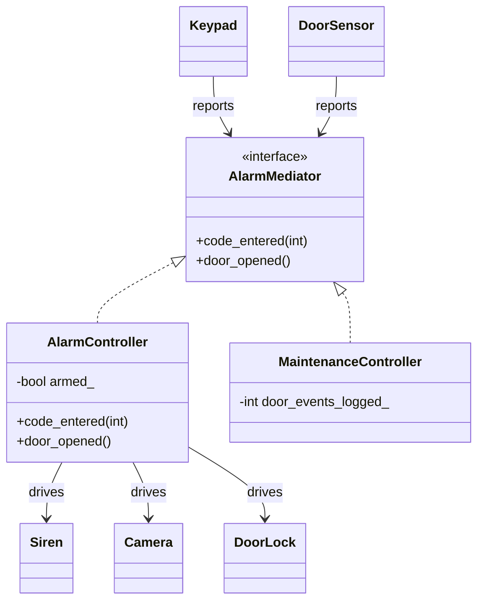

# 18 — Mediator

> Family: **Behavioral** · Code: [`examples/18-mediator/`](../examples/18-mediator/)
> Run: `./build/examples/18-mediator/naive`, `pattern`

**Intent (GoF):** define an object that encapsulates how a set of objects interact. Mediator promotes loose coupling by keeping objects from referring to each other explicitly, and it lets you vary their interaction independently.

---

## 1. Force

> The **coordination rules** between devices on a site vary: arming/disarming, normal vs maintenance mode, a new strobe or a second door sensor. The **devices themselves must stay simple** and reusable on any site, unaware of each other.

- **What varies:** the interaction rules ("when X happens, do Y to Z"), and which devices take part.
- **Who varies it:** site configuration, operating mode, and installers adding hardware.
- **When:** per site at setup, and per mode at runtime.
- **What stays still:** `Keypad`, `DoorSensor`, `Siren`, `Camera`, `DoorLock`. Each one does a single job.

## 2. Naive code and where it hurts

[`naive.cpp`](../examples/18-mediator/naive.cpp): the event sources drive the actuators directly.

```cpp
class Keypad {
    Keypad(Siren&, std::vector<Camera*>, DoorLock&);
    void enter_code(int code) { /* toggles armed_, drives lock, siren, cameras */ }
    bool armed() const;                       // DoorSensor reads this
};

class DoorSensor {
    DoorSensor(const Keypad&, Siren&, std::vector<Camera*>);
    void opened() { if (!keypad_.armed()) return; siren_.on(); /* cameras... */ }
};
```

Five devices produce a dependency graph that grows with every addition:

```
Keypad ─────▶ Siren, Camera×2, DoorLock
DoorSensor ─▶ Keypad, Siren, Camera×2
```

Adding a **strobe light** that flashes with the siren means:

1. `Keypad` needs a `Strobe&` so it can switch it off on disarm.
2. `DoorSensor` needs a `Strobe&` so it can switch it on.
3. Both constructors change, and so does every place that builds them.

A **second door sensor** needs the keypad, the siren, the cameras and the strobe. Every new device adds wiring to every other one.

Smells, by name:
- **Inappropriate Intimacy:** `DoorSensor` reads `Keypad`'s internal armed state.
- **Shotgun Surgery:** one new rule ("strobe with siren") edits several unrelated classes.
- **N×N coupling:** with *n* devices the "who knows whom" graph trends towards *n²* edges.

## 3. Structure



| Role | In this example | Responsibility |
|---|---|---|
| **Mediator** | `AlarmMediator` | The vocabulary of events colleagues can report |
| **Concrete mediator** | `AlarmController`, `MaintenanceController` | Holds the coordination **state** (`armed_`) and **rules** |
| **Colleagues** | `Keypad`, `DoorSensor` | Report events to the mediator. They know no other device. |
| **Actuators** | `Siren`, `Camera`, `DoorLock` | Plain command targets, driven only by the mediator |

The dependency graph is now a star: each device has one edge, to the mediator.

## 4. Gateway example walkthrough

[`pattern.cpp`](../examples/18-mediator/pattern.cpp)

```cpp
class AlarmMediator {
public:
    virtual void code_entered(int code) = 0;
    virtual void door_opened() = 0;
};

class DoorSensor {
public:
    explicit DoorSensor(AlarmMediator& m) : mediator_(m) {}
    void opened() { mediator_.door_opened(); }       // reports, decides nothing
};

class AlarmController final : public AlarmMediator {
    void door_opened() override {
        if (!armed_) return;
        siren_.on();
        for (auto* c : cams_) c->start_recording();
    }
    bool armed_ = false;                              // shared state lives here now
};
```

What changed compared with the naive version:

- **No device references another device.** `Keypad` and `DoorSensor` take only an `AlarmMediator&`.
- **The armed state moved** out of `Keypad` and into the controller. It belongs to the *site*, not to a keypad.
- **The rules sit in one class.** "Strobe with siren" is one edit, in `AlarmController`.
- **Swappable rule sets:** `MaintenanceController` wires the *same* `Keypad` and `DoorSensor` classes to different rules. Door openings are logged and recorded, and the siren never sounds. No device class changed.
- **Same behaviour:** both versions run the same 7-step scenario and assert siren = 1, clips = 1 per camera, and lock toggles = 2.

Design notes:

- **Typed notifications vs `notify(sender, event)`.** GoF uses one generic method: `notify(Colleague* sender, Event e)`. That's extensible without changing the interface, but every event becomes a runtime switch inside the mediator. One virtual per event kind is more idiomatic in C++, and the compiler checks it.
- **Watch for the God Object.** A mediator concentrates rules by design. If it grows to hold every rule in the building, split it by concern (an access-control mediator and an alarm mediator) or move simple reactions to Observer.
- **Lifetime:** colleagues hold a reference to the mediator, so the mediator must outlive them. Construct it first and destroy it last.

## 5. Modern C++ form

Mediator has no dramatically different "modern" spelling, so this chapter has no `modern.cpp`. The choices are about how colleagues reach the mediator:

| Form | Pick it when | Cost |
|---|---|---|
| Typed interface (`AlarmMediator&`), as here | The event set is known and stable. You want compile-time checking and swappable rule sets. | One virtual call per event |
| `std::function` callbacks injected into colleagues (`DoorSensor(std::function<void()> on_open)`) | Colleagues should depend on *nothing*, not even a mediator interface, and the wiring is done in one setup function | The rules are scattered across lambdas in the setup code, so keep them in one place deliberately |
| Generic `notify(sender, Event)` | Events are data (configurable rules, loaded from a file) | A runtime switch on the event, and no compiler help |

For the gateway, the typed interface fits: the events are few and fixed, and the *rules* are what vary.

## 6. When NOT to use it

- **Two or three objects with one interaction.** A direct call is clearer than a hub.
- **One-way fan-out:** "when X happens, tell everyone interested". That's Observer (02). A mediator earns its place when there is **shared state and two-way coordination** (armed state, actuators reacting to several sources).
- **It turns into a God Object.** If every new feature lands in the mediator, it has become the whole application. Split it by concern.
- **The colleagues are already decoupled through a message bus.** Adding a mediator on top is a second hub.

## 7. Confused with

| Pattern | Difference in one line |
|---|---|
| **Observer** (02) | Observer: one subject **broadcasts** to subscribers it doesn't know, and nobody coordinates. Mediator: colleagues talk to a hub that **holds the rules and state** and decides who does what. A mediator is often *implemented* with observer-style notifications. |
| **Facade** (04) | Facade simplifies a subsystem for **outside callers**, and the subsystem doesn't know the facade exists. A mediator is known by and **used by the colleagues themselves**, both ways. |
| **Chain of Responsibility** (13) | A chain passes **one request** along a line of handlers. A mediator routes **many event kinds** among peers through a centre. |

## 8. Seen in the wild

- **GoF's own motivating example:** a dialog's `FontDialogDirector` coordinates list boxes, entry fields and buttons that don't know each other.
- **Home-automation rule engines** (such as Home Assistant automations): sensors and actuators only report to or obey the hub, and the rules live in the hub.
- **Message brokers (MQTT, AMQP)** decouple publishers from consumers through a central broker. That's mediator-like at the architecture level, but a broker *routes*. It doesn't hold domain rules. That part stays in your services.

## 9. Exercise and checkpoint

**Exercise**
1. Add a `Strobe` actuator that turns on with the siren and off on disarm. Edit only `AlarmController`, `main()` and `devices.hpp`. Then make the same change in `naive.cpp`, and count the classes you touched in each.
2. Add a second `DoorSensor` (back door). How many lines change in `pattern.cpp` compared with `naive.cpp`?
3. Add an **entry delay**: on door open while armed, wait for a correct code within 30 s (simulated time) before sounding the siren. Where does the timer state live, and why there?

**Checkpoint**: answer from memory:
- Why did `armed_` move from `Keypad` to the controller?
- The fan-out "a detection event goes to recorder, uploader and UI" from chapter 02: is that a mediator? Why or why not?
- What's the first sign your mediator is turning into a God Object, and what do you split it by?
