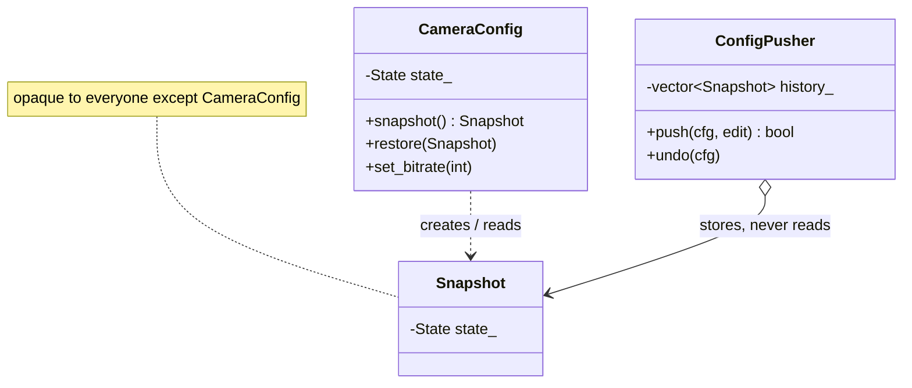

# 19 — Memento

> Family: **Behavioral** · Code: [`examples/19-memento/`](../examples/19-memento/)
> Run: `./build/examples/19-memento/naive`, `pattern`, `modern`

**Intent (GoF):** without violating encapsulation, capture and externalize an object's internal state so that the object can be restored to that state later.

---

## 1. Force

> Before a config push, the **caretaker** (`ConfigPusher`) must save the camera's configuration and **roll it back** if the firmware rejects the change. It also keeps an undo history. The **shape of the configuration varies**, since fields get added, and it **must stay private** to `CameraConfig`.

- **What varies:** the internal state of the originator (fields, representation).
- **Who varies it:** whoever extends camera settings: new firmware features, new OSD options.
- **When:** at development time. Snapshots are taken and restored at runtime.
- **What stays still:** `ConfigPusher` (push, rollback, undo) and `CameraConfig`'s public operations.

## 2. Naive code and where it hurts

[`naive.cpp`](../examples/19-memento/naive.cpp): the caretaker copies the fields out through getters and writes them back through setters.

```cpp
class ConfigPusher {
    struct Backup { int width, height, fps, bitrate; std::string osd; };  // mirror of CameraConfig

    static Backup save(const CameraConfig& c) {
        return {c.width(), c.height(), c.fps(), c.bitrate(), c.osd()};
    }
    static void restore(CameraConfig& c, const Backup& b) {
        c.set_resolution(b.width, b.height);
        c.set_fps(b.fps);
        c.set_bitrate(b.bitrate);
        c.set_osd(b.osd);
    }
};
```

It works today. Adding an `ir_mode` field to `CameraConfig` means:

1. `Backup` needs a new member.
2. `save()` and `restore()` each need a new line.
3. If you forget either one, rollback **silently restores part of the config**. The camera ends up with old resolution and new IR mode, a state nobody configured.

And `restore()` goes through **validating setters, one field at a time**. If an invariant links two fields (max fps depends on resolution), the intermediate states during a rollback can be rejected, even though the final state is valid.

Smells, by name:
- **Inappropriate Intimacy:** the caretaker knows the originator's full internal layout.
- **Shotgun Surgery:** every new field edits two classes.
- **Getter/setter exposure:** accessors exist mainly so outsiders can copy state, which weakens encapsulation.

## 3. Structure



| Role | In this example | Responsibility |
|---|---|---|
| **Originator** | `CameraConfig` | Creates a snapshot of its own state and restores from one |
| **Memento** | `CameraConfig::Snapshot` | Holds the state. It has a **wide interface for the originator** (friend) and a **narrow one for everyone else**: copy it, store it, hand it back. |
| **Caretaker** | `ConfigPusher` | Decides **when** to snapshot and restore, and keeps the history. Never looks inside. |

## 4. Gateway example walkthrough

[`pattern.cpp`](../examples/19-memento/pattern.cpp)

```cpp
class CameraConfig {
    struct State { int width = 1920, height = 1080, fps = 25, bitrate_kbps = 4000; std::string osd_text = "Lobby"; };
public:
    class Snapshot {
    public:
        Snapshot(const Snapshot&) = default;          // caretaker may copy/store it
    private:
        friend class CameraConfig;                    // only the originator can read it
        explicit Snapshot(State s) : state_(std::move(s)) {}
        State state_;
    };
    Snapshot snapshot() const { return Snapshot(state_); }
    void restore(const Snapshot& s) { state_ = s.state_; }   // all fields, one assignment
private:
    State state_;
};

template <class Edit>
bool ConfigPusher::push(CameraConfig& cfg, Edit edit) {
    auto before = cfg.snapshot();
    edit(cfg);
    if (!fw_.apply(cfg.to_wire())) { cfg.restore(before); return false; }
    history_.push_back(std::move(before));
    return true;
}
```

What changed compared with the naive version:

- **`ConfigPusher` has no field list.** It stores `CameraConfig::Snapshot` tokens that it can't open. `// cfg.snapshot().state_;` does not compile outside `CameraConfig`.
- **Adding a field** means adding it to `State`, and snapshot and restore pick it up automatically.
- **Restore is atomic:** one assignment of the whole `State`, never a half-restored object passing through setters.
- **Same behaviour:** naive, pattern and modern all run the same push sequence. Push 1 (bitrate) is accepted. Push 2 (4K) is rejected and rolled back. Push 3 (fps) is accepted, then undone. All three end at 1920x1080 @ 25 fps, 6000 kbps, OSD "Lobby".

Design notes:

- **Put all restorable state in one `State` struct.** Then a snapshot is just a copy of it, and you can't forget a field.
- **Not all state should be restored.** Runtime state such as a live RTSP session, counters and caches stays out of `State`. A memento captures *configuration*, not *resources*.
- **Memory:** each snapshot is a full copy. For large objects or long histories, store diffs or cap the history depth.

## 5. Modern C++ form

[`modern.cpp`](../examples/19-memento/modern.cpp): in C++, a well-encapsulated **value type is already its own memento**.

```cpp
class CameraConfig {                      // private fields, validating setters
public:
    bool operator==(const CameraConfig&) const = default;
private:
    int width_ = 1920 /* ... */;
};

CameraConfig before = cfg;               // the snapshot
edit(cfg);
if (!fw_.apply(cfg.to_wire())) cfg = before;   // the restore
std::vector<CameraConfig> history_;       // the caretaker's store
```

Its private fields stay private in the copy, every copy is valid because invariants are enforced on mutation, and copy-assignment restores everything at once.

| Form | Pick it when | Cost |
|---|---|---|
| **Copy of a value type** (modern.cpp) | The originator is cheap to copy and owns no resources | Nothing extra to write. The copy includes *everything*, wanted or not. |
| **Opaque `Snapshot` class** (pattern.cpp) | The originator owns resources (sockets, handles, threads) or runtime state that must **not** be restored, or is non-copyable | A nested class plus a friend declaration |
| **Serialized snapshot** (bytes/JSON) | Snapshots must outlive the process (rollback after reboot) or cross the network | Serialization code, and versioning of the format |

## 6. When NOT to use it

- **The state is public anyway.** If the config is a plain struct with public fields, copy the struct. There's no encapsulation to protect.
- **Snapshots are huge or frequent** (per-frame state). Full copies are too expensive. Use command-based undo (Command, 08) or store diffs.
- **Restoring isn't really possible.** If the external world was changed too (the camera already rebooted with the new config), restoring the in-memory object doesn't undo it. You need a compensating action, which is a Command with an inverse.

## 7. Confused with

| Pattern | Difference in one line |
|---|---|
| **Command** (08) | Command-based undo stores the **operation and its inverse**. Memento-based undo stores the **state before**. Command is cheap when operations are small and invertible. Memento is simple when the state is small or the operations aren't invertible. They're often combined: a command keeps a memento so it can undo. |
| **Prototype** (21) | Both copy an object's state. Prototype copies to create a **new, independent object**. Memento copies to **restore the same object later**, and keeps the copy opaque. |
| **State** (10) | State swaps **behaviour** according to the current mode. Memento saves and restores **data**. |

## 8. Seen in the wild

- **Network OS config rollback:** Junos keeps previous committed configs (`rollback 1`, `rollback 2`, …), and `commit confirmed` reverts automatically unless the change is confirmed. That's caretaker-managed config snapshots.
- **VM snapshots** (VirtualBox, QEMU/KVM): an opaque snapshot of a machine's state that the hypervisor (the caretaker) stores and restores without interpreting the guest.
- **`<random>` engines:** `std::mt19937` writes its full internal state with `operator<<` and restores it with `operator>>`, so a sequence can be replayed from a saved point without exposing the engine's internals as an API.
- **Editor undo stacks** that store document snapshots rather than inverse operations.

## 9. Exercise and checkpoint

**Exercise**
1. Add `ir_mode` (`"auto"`, `"on"`, `"off"`) to `CameraConfig` in all three files. Make push 2 also change it, and check that it's rolled back. Count the lines you touched in `naive.cpp` compared with `pattern.cpp`.
2. Add `redo()` to `ConfigPusher` in `pattern.cpp`. What extra snapshot must `undo()` take?
3. Give `CameraConfig` a non-copyable member (`std::unique_ptr<RtspSession>`). Which of `pattern.cpp` and `modern.cpp` still compiles unchanged, and why?

**Checkpoint**: answer from memory:
- Why must `Snapshot`'s constructor and data be private, while its copy constructor is public?
- Why is restoring through setters one field at a time worse than restoring the whole state at once?
- When is a plain copy of the object a perfectly good memento, and when is it not?
