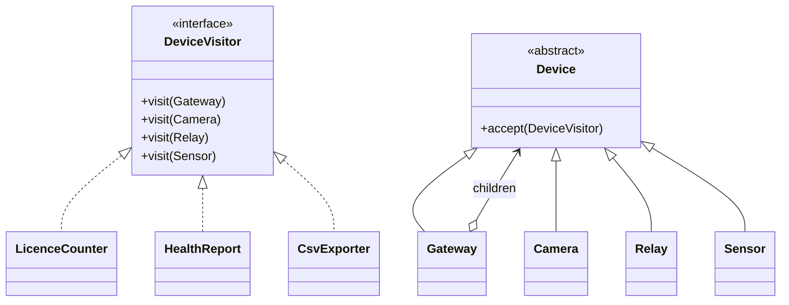
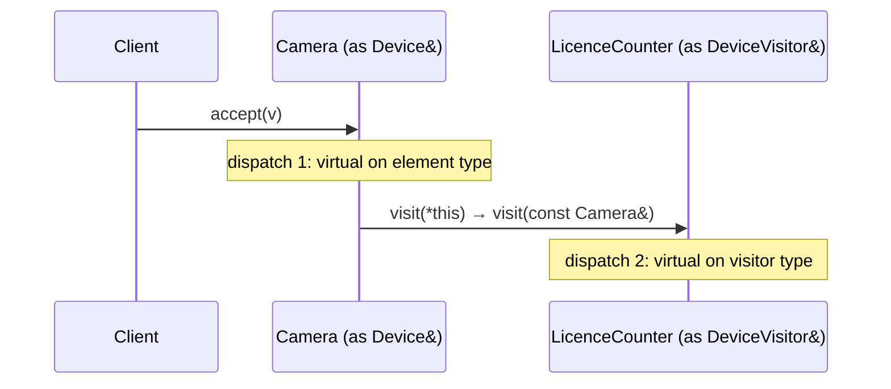

# 20 — Visitor

> Family: **Behavioral** · Code: [`examples/20-visitor/`](../examples/20-visitor/)
> Run: `./build/examples/20-visitor/naive`, `pattern`, `modern`

**Intent (GoF):** represent an operation to be performed on the elements of an object structure. Visitor lets you define a new operation without changing the classes of the elements on which it operates.

---

## 1. Force

> The set of device **types** in a site tree (gateway, camera, relay, sensor) is **stable**. The set of **operations** over the tree (licence count, health report, CSV export, then firmware audit, power budget…) **keeps growing**. New operations must not edit the device classes, and a new device type must **force every operation to handle it**.

- **What varies:** operations over the structure.
- **Who varies it:** product features such as reports, exports and billing.
- **When:** at development time, often.
- **What stays still:** the element classes and the tree structure.

This is the **expression problem** from [00 §4](00-foundations.md#4-four-kinds-of-polymorphism-in-c). Virtual functions make new *types* cheap and new *operations* expensive. Visitor flips that: new operations become cheap, and new types become expensive but compiler-checked.

## 2. Naive code and where it hurts

[`naive.cpp`](../examples/20-visitor/naive.cpp): each operation is a free function that walks the tree and type-tests every node.

```cpp
int licences(const Device& d) {
    if (auto* g = dynamic_cast<const Gateway*>(&d)) { /* recurse into children */ }
    if (auto* cam = dynamic_cast<const Camera*>(&d)) return cam->ai_enabled() ? 2 : 1;
    return 0;   // relays, sensors — and, silently, any type added later
}
// offline(...) and csv(...) repeat the same traversal and the same type tests
```

Where it hurts:

- **Every operation repeats** the traversal and the `dynamic_cast` ladder.
- **Adding an `Nvr` type compiles cleanly** while every operation silently mishandles it. `licences()` returns 0, and `csv()` drops the row. Nothing tells you which functions need a new branch.
- The other naive option, a virtual per operation on `Device` (`virtual int licences()`, `virtual std::string csv()`, …), edits **every stable device class for every new report**. Reporting code ends up spread across the device model.

Smells, by name:
- **Switch Statements**, in the form of `dynamic_cast` ladders repeated across functions.
- **Divergent Change** (for the virtual-per-operation alternative): device classes change for reporting reasons.

## 3. Structure





| Role | In this example | Responsibility |
|---|---|---|
| **Visitor** | `DeviceVisitor` | One `visit` overload per concrete element type |
| **Concrete visitor** | `LicenceCounter`, `HealthReport`, `CsvExporter` | **One operation**, all its per-type cases together, with its own accumulated result |
| **Element** | `Device` | `accept(DeviceVisitor&)` |
| **Concrete element** | `Gateway`, `Camera`, `Relay`, `Sensor` | `accept` calls `v.visit(*this)`. That one line is all each element knows about operations. |
| **Object structure** | The gateway tree | Here `Gateway::accept` does the traversal, pre-order |

## 4. Gateway example walkthrough

[`pattern.cpp`](../examples/20-visitor/pattern.cpp)

```cpp
class DeviceVisitor {
public:
    virtual void visit(const Gateway&) = 0;
    virtual void visit(const Camera&) = 0;
    virtual void visit(const Relay&) = 0;
    virtual void visit(const Sensor&) = 0;
};

class Camera final : public Device {
    void accept(DeviceVisitor& v) const override { v.visit(*this); }   // *this is const Camera&
};

class Gateway final : public Device {
    void accept(DeviceVisitor& v) const override {
        v.visit(*this);
        for (const auto& c : children_) c->accept(v);                 // structure owns traversal
    }
};

class LicenceCounter final : public DeviceVisitor {
    void visit(const Camera& c) override { total += c.ai_enabled() ? 2 : 1; }
    void visit(const Gateway&) override {}  /* Relay, Sensor: {} */
    int total = 0;
};
```

**Double dispatch.** C++ virtual calls dispatch on *one* runtime type (the object). Visitor needs the function chosen by *two*: the element type and the operation. It gets there in two steps:
1. `device->accept(v)` is a virtual call that resolves the **element** type.
2. Inside `Camera::accept`, `*this` has static type `const Camera&`, so overload resolution picks `visit(const Camera&)` at compile time, and that call is virtual on the **visitor** type.

What changed compared with the naive version:

- **No `dynamic_cast` anywhere.** Each operation is one class with its cases side by side.
- **A new operation is a new class.** Device classes don't change.
- **A new element type is a compile error until it's handled.** Add `visit(const Nvr&) = 0` to `DeviceVisitor`, and every concrete visitor that doesn't implement it becomes abstract, so the code fails to build. The naive code's silent `return 0` can't happen.
- **Same behaviour:** naive, pattern and modern all produce licences = 4, offline = {cam-b, s1}, and the identical 8-row CSV.

Design notes:

- **Who traverses?** Here the structure does (`Gateway::accept` visits its children), so every visitor gets the full tree for free. The alternative is for the visitor to traverse, which gives it control over order and pruning. Pick one and use it consistently.
- **Visitors usually need public accessors** on elements (`id()`, `online()`, `ai_enabled()`). That's the encapsulation cost of moving operations out of the classes.
- **Results are usually accumulated in the visitor** (`total`, `offline`, `out`) because `visit` returns `void`. You can return values with a templated visitor, but it's rarely worth it in the classic form. The variant form returns them naturally.

## 5. Modern C++ form

[`modern.cpp`](../examples/20-visitor/modern.cpp): `std::variant` + `std::visit` + the `overloaded` helper.

```cpp
struct Camera { std::string id; bool online; bool ai; };
struct Relay  { std::string id; bool online; };
struct Sensor { std::string id; bool online; };
using Device = std::variant<Camera, Relay, Sensor>;

template <class... Ts> struct overloaded : Ts... { using Ts::operator()...; };

total += std::visit(overloaded{
    [](const Camera& c) { return c.ai ? 2 : 1; },
    [](const Relay&)    { return 0; },
    [](const Sensor&)   { return 0; },
}, device);

// Common fields across all alternatives: one generic lambda.
std::visit([&](const auto& x) { if (!x.online) out.push_back(x.id); }, device);
```

- **No `accept()`, no visitor base class, no forward declarations.** Devices are plain value types, stored by value in a `std::vector`, with no heap allocation per device.
- **Exhaustiveness still holds:** if a lambda for one alternative is missing, `std::visit` doesn't compile, unless you deliberately add a `[](const auto&)` catch-all.
- **Operations can return values** directly.

| Form | Pick it when | Cost |
|---|---|---|
| **Classic double dispatch** | Elements are an existing class hierarchy (with identity, owned by pointer), possibly across a library boundary | `accept()` in every element, a visitor interface, and accessors |
| **`std::variant` + `std::visit`** | You control the types, they're value-like, and the set is closed | Adding a type edits the variant and every exhaustive visit. Recursive types need indirection. |
| **Virtual function per operation** | Operations are few and stable, and *types* are what keep growing | Every new operation edits every class (the other side of the expression problem) |

## 6. When NOT to use it

- **Element types change often.** Each new type edits the visitor interface and every visitor. Use plain virtual functions, since adding types is their strength.
- **One or two operations.** A virtual method on the hierarchy is simpler than a whole visitor apparatus.
- **The operation needs deep private access** to elements. Visitor would force you to expose internals. Keep it as a member function.
- **The structure has a single element type.** Then it's just iteration (Iterator, 16) plus a function.

## 7. Confused with

| Pattern | Difference in one line |
|---|---|
| **Iterator** (16) | Iterator **walks** a structure and hands you elements of one type. Visitor **dispatches on each element's concrete type** to the right case of an operation. They're often combined: iterate, and visit each element. |
| **Composite** (11) | Composite **defines the tree**, so one device and a group are treated alike. Visitor **adds operations to** such a tree. Visitor is frequently applied *to* a Composite, as in this chapter. |
| **Strategy** (01) | Strategy swaps **one algorithm** behind one interface. Visitor bundles **one operation's per-type cases** across a family of types. |
| **Interpreter** (23) | An interpreter's AST is a stable structure that keeps gaining operations (evaluate, print, type-check), which is why Visitor is the classic way to implement them. |

## 8. Seen in the wild

- **`std::visit`** (C++17) over `std::variant`, the standard library's visitor.
- **Clang's `RecursiveASTVisitor`** and **LLVM's `InstVisitor`**: compiler ASTs and IR are stable type sets with an ever-growing list of passes. Both are CRTP-based visitors.
- **Boost.Variant** `boost::static_visitor` with `boost::apply_visitor`, the pre-C++17 form.

## 9. Exercise and checkpoint

**Exercise**
1. Add a `PowerBudget` visitor (camera 6 W, AI camera 9 W, relay 1 W, sensor 0.5 W, gateway 15 W) to `pattern.cpp` and `modern.cpp`. No device class may change.
2. Add an `Nvr` device type to all three files. In `naive.cpp`, observe what the compiler **doesn't** tell you. In `pattern.cpp` and `modern.cpp`, read the errors it **does** give you.
3. Change `pattern.cpp` so the **visitor** traverses (`HealthReport` descends into gateways itself) and `Gateway::accept` only calls `v.visit(*this)`. What does every *other* visitor now have to do?

**Checkpoint**: answer from memory:
- Explain double dispatch: which runtime type does each of the two calls resolve?
- Why is "adding a type is a compile error" a *feature* of Visitor?
- Your device types change monthly and you have two reports. Visitor or virtual functions? Why?
