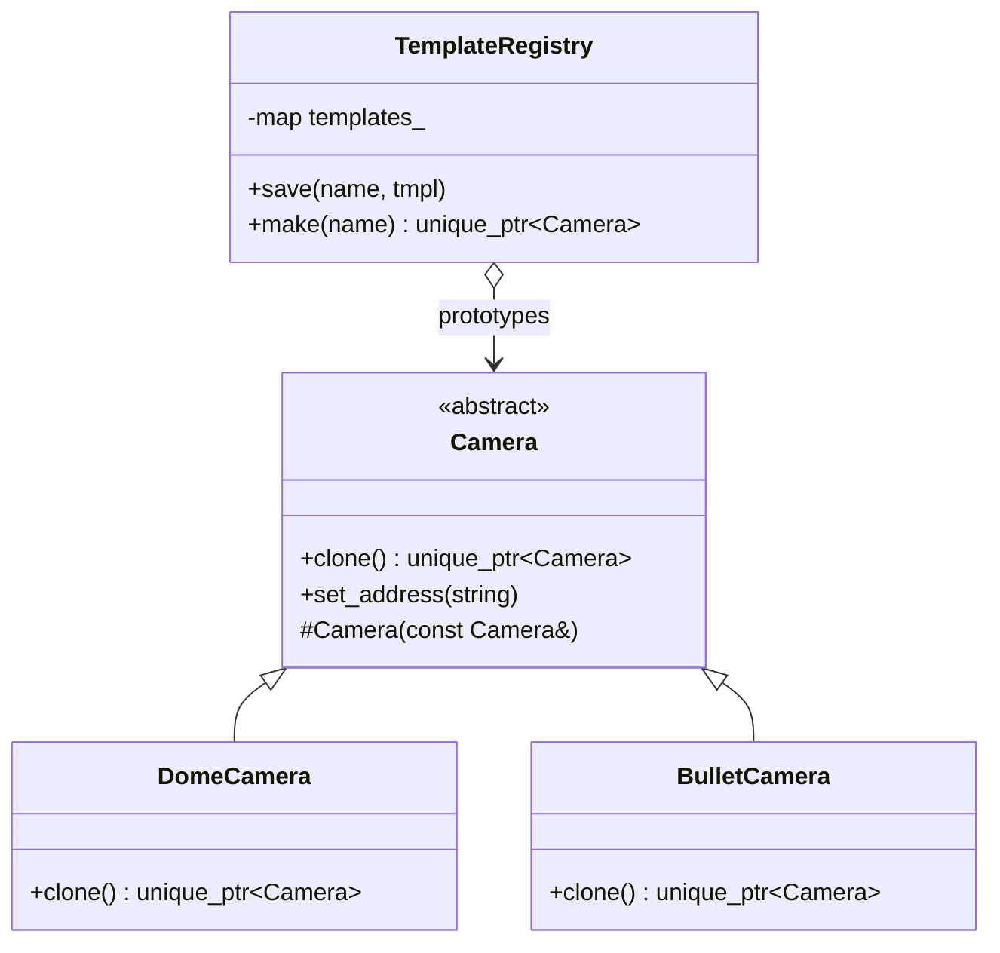

# 21 — Prototype

> Family: **Creational** · Code: [`examples/21-prototype/`](../examples/21-prototype/)
> Run: `./build/examples/21-prototype/naive`, `pattern`, `modern`

**Intent (GoF):** specify the kinds of objects to create using a prototypical instance, and create new objects by copying this prototype.

---

## 1. Force

> An installer configures **one camera per model by hand**: detection zones, motion grid tuning, OSD font, IR range. Then they want 50 more just like it. The **model being duplicated varies** (dome, bullet, PTZ…), and the **onboarding workflow must stamp out copies** of whatever template it's handed **without knowing the concrete class**.

- **What varies:** the concrete type of the object to create, and its configured state.
- **Who varies it:** installers (which templates exist) and product (which models exist).
- **When:** at runtime. The template is chosen by name from a registry.
- **What stays still:** `onboard()`, the generic workflow that clones a template and sets the address.

Cloning beats constructing here because the valuable part is the **configured state** (zones, tuned sensitivity), not the constructor arguments.

## 2. Naive code and where it hurts

[`naive.cpp`](../examples/21-prototype/naive.cpp): the onboarding code has a `const Camera&` and must copy it.

```cpp
Camera copy = tmpl;   // won't compile here — and if it did, it would SLICE:
                      // only the Camera base part is copied, the DomeCamera part is lost.

std::unique_ptr<Camera> copy_of(const Camera& tmpl) {
    if (auto* d = dynamic_cast<const DomeCamera*>(&tmpl))   return std::make_unique<DomeCamera>(*d);
    if (auto* b = dynamic_cast<const BulletCamera*>(&tmpl)) return std::make_unique<BulletCamera>(*b);
    throw std::logic_error("onboarding: unknown camera model " + tmpl.model());
}
```

C++ can't copy an object through a base reference: the copy constructor isn't virtual. So the generic workflow has to ask "which model are you?".

Adding a `PtzCamera` model means:
- `copy_of()` needs a new branch. Forget it and onboarding **throws at runtime**, on site, the first time an installer uses a PTZ template.
- A generic workflow (`onboard`) now depends on **every concrete model**.

Smells, by name:
- **Switch Statements**, as type tests on a hierarchy.
- **Dependency on details:** a high-level workflow is coupled to every low-level class (00 §3, DIP).

## 3. Structure



| Role | In this example | Responsibility |
|---|---|---|
| **Prototype** | `Camera` | Declares `clone()`, the virtual constructor |
| **Concrete prototype** | `DomeCamera`, `BulletCamera` | `clone()` copies **itself** with its own copy constructor. It knows its type, so no one else has to. |
| **Client** | `onboard()` | Clones a template, then customises the copy (address) |
| **Prototype registry** | `TemplateRegistry` | Named, pre-configured prototypes: `"lobby-dome"`, `"parking-bullet"` |

## 4. Gateway example walkthrough

[`pattern.cpp`](../examples/21-prototype/pattern.cpp)

```cpp
class Camera {
public:
    virtual std::unique_ptr<Camera> clone() const = 0;
protected:
    Camera(const Camera& o)                          // protected: no slicing from outside
        : address_(o.address_),
          zones_(o.zones_),                                         // value: copied
          motion_(std::make_unique<MotionGrid>(*o.motion_)),        // owned: DEEP copy
          font_(o.font_) {}                                         // immutable: SHARED
};

class DomeCamera final : public Camera {
    std::unique_ptr<Camera> clone() const override { return std::make_unique<DomeCamera>(*this); }
};

std::unique_ptr<Camera> onboard(const TemplateRegistry& reg, const std::string& tmpl, std::string ip) {
    auto cam = reg.make(tmpl);       // = templates_.at(tmpl)->clone()
    cam->set_address(std::move(ip));
    return cam;
}
```

What changed compared with the naive version:

- **`copy_of()` and its `dynamic_cast` ladder are gone.** Adding `PtzCamera` means writing one `clone()` in `PtzCamera`. `onboard()` doesn't change.
- **The registry** turns templates into data. Installers can save new ones at runtime, and onboarding asks for them by name.
- **Same behaviour:** both versions onboard 60 cameras (50 domes, 10 bullets) with distinct addresses and 2 zones each. Tuning one clone leaves the template and its siblings untouched, and every clone shares one font (`font_refs = 63`: 1 local + 2 templates + 60 clones).

**Getting the copy right is the whole pattern.** `fleet.hpp` deliberately includes all three kinds of member:

| Member | Copy behaviour | Why |
|---|---|---|
| `std::vector<Zone> zones_` | Value copy (default) | Each camera owns its zones |
| `std::unique_ptr<MotionGrid> motion_` | **Deep copy, written by hand.** `unique_ptr` deletes the default copy constructor, so the compiler forces you to decide. | Tuning one camera must not retune the others |
| `std::shared_ptr<const OsdFont> font_` | **Shared** on purpose | Large and immutable. Sharing it is safe and saves memory (a preview of Flyweight, 22). |

A `std::shared_ptr<MotionGrid>` (mutable) would compile with the default copy and **silently share** the grid between all 60 cameras. That's the classic shallow-copy bug.

## 5. Modern C++ form

[`modern.cpp`](../examples/21-prototype/modern.cpp)

**A. CRTP clone mixin: fixing covariance.** `DomeCamera::clone()` must return `unique_ptr<Camera>`, because covariant return types work only for raw pointers and references, not for smart pointers. So code that *has* a `DomeCamera` loses the static type when it clones. The fix combines a non-virtual interface (NVI) with CRTP:

```cpp
class Camera {
public:
    std::unique_ptr<Camera> clone() const { return std::unique_ptr<Camera>(clone_impl()); }
private:
    virtual Camera* clone_impl() const = 0;            // raw pointer: covariance allowed
};

template <class Derived, class Base>
class Cloneable : public Base {
public:
    using Base::Base;
    std::unique_ptr<Derived> clone() const {           // hides Base::clone
        return std::unique_ptr<Derived>(static_cast<Derived*>(clone_impl()));
    }
private:
    Base* clone_impl() const override { return new Derived(static_cast<const Derived&>(*this)); }
};

class DomeCamera final : public Cloneable<DomeCamera, Camera> { /* no clone() written */ };

std::unique_ptr<DomeCamera> d = dome.clone();       // static type kept
std::unique_ptr<Camera>     c = as_base.clone();    // still works polymorphically
```

**B. Value types: the copy constructor *is* the prototype.**

```cpp
using CameraTemplate = std::variant<Dome, Bullet>;   // value types, MotionGrid held by value
CameraTemplate cam = tmpl;                           // polymorphic deep copy, no clone()
```

| Form | Pick it when | Cost |
|---|---|---|
| **Virtual `clone()`** (pattern.cpp) | An open class hierarchy, objects held by pointer | One `clone()` per class, which is easy to forget in a new subclass (silently clones the parent type if the parent isn't abstract) |
| **CRTP `Cloneable<D, B>`** | Same, plus callers need the concrete type back, or you want `clone()` written once | A template base. The hierarchy reads less plainly. |
| **Value type / `std::variant`** | You control the types and the set is closed | The closed set. Adding a model edits the variant. |

## 6. When NOT to use it

- **Construction is cheap and the state is just constructor arguments.** Call the constructor or a factory (Factory Method, 06). Copying an object to avoid passing three parameters is indirection for nothing.
- **Objects own resources that must not be duplicated:** a live RTSP session, a socket, a hardware handle. Cloning those is wrong. Clone the *configuration* (a value), then construct a fresh object from it.
- **The types are value types already.** `auto b = a;` is the prototype. Don't add `clone()`.
- **Deep copy semantics are unclear** (a cyclic object graph, back-pointers). Every `clone()` becomes a design problem of its own. Consider a builder from a config instead.

## 7. Confused with

| Pattern | Difference in one line |
|---|---|
| **Factory Method** (06) / **Abstract Factory** (14) | Factories create from **class knowledge** (a subclass or factory decides the type). Prototype creates from **an existing instance**, copying its configured state. Factories need a parallel hierarchy of creators. Prototype needs none. |
| **Memento** (19) | Memento copies state to **restore the same object later**, opaque to the holder. Prototype copies to make an **independent new object**. |
| **Flyweight** (22) | Flyweight **shares** one instance to save memory. Prototype **duplicates** an instance so each copy can diverge. This chapter's `OsdFont` is a flyweight inside a prototype. |

## 8. Seen in the wild

- **Type-erased wrappers:** copying a `std::function` or `std::any` copies the callable or value held inside, whatever its concrete type. Internally that's a polymorphic clone operation behind a value interface.
- **VM templates:** `VBoxManage clonevm` and "golden images" duplicate a configured machine instead of installing it again.
- **Device provisioning templates:** configure one unit, save it as a template, and stamp out the fleet, as in this chapter's example.

## 9. Exercise and checkpoint

**Exercise**
1. Add `PtzCamera` (presets: `std::vector<std::string>`) to `naive.cpp` and `pattern.cpp`, with a `"lobby-ptz"` template and 5 onboarded cameras. In `naive.cpp`, first forget the `copy_of()` branch and watch it throw at runtime.
2. Change `MotionGrid` in `fleet.hpp` to `std::shared_ptr<MotionGrid>` and use the default copy constructor. Which CHECK fails, and why?
3. In `modern.cpp`, remove `final` from `DomeCamera`, derive `NightDomeCamera` from it *without* `Cloneable`, and clone one through `Camera&`. What type do you get back?

**Checkpoint**: answer from memory:
- Why can't the generic onboarding code copy a template through `const Camera&` with the copy constructor?
- For each member kind (value, owned `unique_ptr`, shared immutable), what should a clone do?
- Why does `DomeCamera::clone()` return `unique_ptr<Camera>` and not `unique_ptr<DomeCamera>`, and how does CRTP get the concrete type back?
