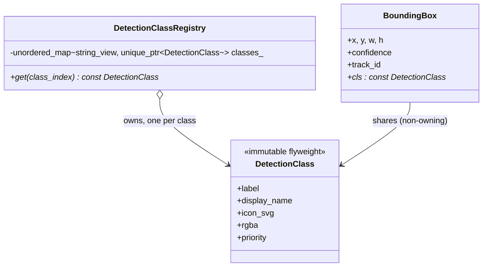

# 22 — Flyweight

> Family: **Structural** · Code: [`examples/22-flyweight/`](../examples/22-flyweight/)
> Run: `./build/examples/22-flyweight/naive`, `pattern`, `modern`

**Intent (GoF):** use sharing to support large numbers of fine-grained objects efficiently.

---

## 1. Force

> The **number of bounding boxes** grows with scene activity and history length (a crowd, a car park, 24 h of track history). The **number of distinct object classes** is tiny and fixed by the model. **Per-box memory must not scale with per-class data.**

- **What varies:** position, size, confidence and track id. These are different for every box.
- **What stays the same:** label, display name, colour, priority and icon. These are identical for every box of a class.
- **What the pattern splits:** each object's state into **intrinsic** (shared, immutable, stored once) and **extrinsic** (per instance, kept by the client or passed in at use time).

The pattern only pays off when three things are all true. There are **many** objects. A **large share** of each object is duplicated. And the duplicated part can be made **immutable**.

## 2. Naive code and where it hurts

[`naive.cpp`](../examples/22-flyweight/naive.cpp): every box owns a full copy of its class metadata.

```cpp
struct BoundingBox {
    int x, y, w, h; float confidence; int track_id;      // per detection
    std::string label, display_name, icon_svg;           // per class — copied 10 000×
    std::uint32_t rgba; int priority;
};
```

Measured, for 10 000 boxes of 4 classes (with ~1 KiB icons):

| | `sizeof(BoundingBox)` | Live heap after building |
|---|---|---|
| naive | 136 B | **12 119 KiB** |
| pattern (pointer to shared class) | 32 B | **317 KiB** |
| modern (1-byte class handle) | 20 B | **199 KiB** |

The numbers come from `alloc_counter.hpp`, which replaces the global `operator new`/`delete` to track live bytes. They're measured, not estimated.

Beyond memory:
- **Allocator churn on the hot path:** each box construction allocates and copies three strings, for every detection on every frame.
- **Data drift:** nothing stops two "person" boxes having different colours, because each owns its copy.
- **Change cost:** recolouring a class in the UI means touching every live box.

Smells: **Duplicated data** and **Data Clumps**. The same five class fields always travel together and are never edited per box.

## 3. Structure



| Role | In this example | Responsibility |
|---|---|---|
| **Flyweight** | `DetectionClass` | Intrinsic state. Immutable (`const` members), safe to share across boxes and threads. |
| **Flyweight factory** | `DetectionClassRegistry` | Returns *the* instance for a key, creating it on first use. Owns all flyweights. |
| **Client** | `BoundingBox` and `render()` | Holds extrinsic state plus a reference, and combines the two at use time. |

## 4. Gateway example walkthrough

[`pattern.cpp`](../examples/22-flyweight/pattern.cpp)

```cpp
struct DetectionClass {                      // all const: shared ⇒ must never change
    const int index;
    const std::string label, display_name, icon_svg;
    const std::uint32_t rgba;
    const int priority;
};

class DetectionClassRegistry {
public:
    const DetectionClass* get(int class_index) {
        auto it = classes_.find(spec.label);
        if (it == classes_.end())
            it = classes_.emplace(spec.label, std::make_unique<DetectionClass>(...)).first;
        return it->second.get();
    }
private:
    std::unordered_map<std::string_view, std::unique_ptr<DetectionClass>> classes_;
};

struct BoundingBox { int x, y, w, h; float confidence; int track_id; const DetectionClass* cls; };
```

What changed compared with the naive version:

- `BoundingBox` shrank from 136 to 32 bytes. The five class fields became one pointer.
- Total memory went from *boxes × metadata* to *boxes × 32 B + classes × metadata*.
- `render()` is the only place the two halves meet. It reads position from the box and colour/label/icon through `cls`.
- The render checksum is identical across all three versions. Same output, different storage.

Design notes:

- **Immutability is the contract.** If anyone could write `cls->rgba = …`, recolouring one box would recolour all of them. `const` members (or handing out `const DetectionClass*`) enforce this at compile time.
- **Why `unique_ptr` in the map:** every pointer handed out must stay valid for as long as the registry lives. `std::unordered_map` happens to guarantee that already, because it never moves elements on rehash. A `std::vector<DetectionClass>` or a flat map would not: they relocate elements as they grow. Boxing each flyweight makes address stability a property of the flyweight, not of the container choice.
- **Lifetime:** boxes hold non-owning pointers, so the registry must outlive every box. In a gateway it lives as long as the loaded model. If boxes can outlive the model (for example, history after a model swap), use `std::shared_ptr<const DetectionClass>`. That costs 16 bytes and an atomic refcount per box, so use it only if you need it.
- **Thread safety:** reading a flyweight is safe from any thread. `get()` mutates the map, so either populate the registry once before the detector threads start (the usual case: the model's class list is known at load), or guard it with a lock.

## 5. Modern C++ form

[`modern.cpp`](../examples/22-flyweight/modern.cpp) uses a data-oriented flyweight: a **handle into a table** instead of a pointer through a factory.

```cpp
using ClassId = std::uint8_t;
const std::array<DetectionClass, 4>& class_table();     // built once, never mutated

struct BoundingBox {
    std::int16_t x, y, w, h;   // 1080p fits in 16 bits
    float confidence;
    std::int32_t track_id;
    ClassId cls;               // 1 byte
};
static_assert(std::is_trivially_copyable_v<BoundingBox>);
```

| Form | Pick it when | Cost |
|---|---|---|
| Pointer + factory (`pattern.cpp`) | Flyweights are discovered at runtime (keys arrive from config or the network) | 8 B per reference, hash lookup at creation, lifetime to manage |
| Index into a table (`modern.cpp`) | The set is known up front (model classes, codec profiles, alarm types) | Set must be indexable; 1–2 B per reference; no lookup, no lifetime issue |
| `shared_ptr<const T>` | References may outlive the factory | 16 B per reference + atomic refcount traffic |
| Interned strings / `string_view` into a pool | The shared part *is* a string (labels, topic names, URLs) | Pool lifetime |

The handle form also makes `BoundingBox` **trivially copyable**. It can be `memcpy`'d into a ring buffer, written to shared memory for the UI process, or sent over IPC. You can't do that with a struct containing `std::string`s or pointers.

## 6. When NOT to use it

- **Few objects.** 50 boxes on screen don't need sharing, so keep the strings in the box. Measure first: Flyweight is a memory optimisation, and optimisations need a profile behind them.
- **The "shared" part isn't really shared.** If metadata differs per instance (custom colour per track), it's extrinsic, and forcing it into a flyweight produces flyweights with one user each.
- **The shared part must be mutable per instance.** Then it can't be shared, by definition.
- **The extrinsic state is expensive to recompute or pass around.** Flyweight moves state out of the object, and someone has to carry it. If every call site now needs five extra parameters, you've traded memory for coupling.

## 7. Confused with

| Pattern | Difference in one line |
|---|---|
| **Singleton** (15) | Singleton: **one instance of a type**, globally reachable. Flyweight: **one instance per key**, many keys, reached through a factory, and immutable. |
| **Prototype** (21) | Prototype **copies** a configured object so each copy can diverge. Flyweight **shares** one object so nothing diverges. |
| **Object pool** (not GoF) | A pool **reuses mutable objects one client at a time** (borrow/return). Flyweights are **used by all clients at once** and are never returned. |
| **Composite** (11) | Composite leaves are often flyweights, as GoF itself suggests (a glyph per character). The patterns compose; they don't compete. |

## 8. Seen in the wild

- **String interning:** Java's `String.intern()`, Python's interned identifiers, and symbol tables in every compiler. The idea is one copy of each distinct string, compared by address.
- **Fonts and glyph caches:** every text renderer (FreeType caches, browsers) stores one rasterised glyph per (font, size, character) and draws it at many positions. Position is extrinsic. This is GoF's own example.
- **`std::locale` facets:** facets are shared, reference-counted, and immutable once installed.
- **Linux page cache and shared libraries:** one physical copy of `libc.so`'s code pages is mapped into every process. The per-process page tables hold the extrinsic part.
- **Game engines:** instanced rendering draws one mesh and texture (intrinsic) with a per-instance transform buffer (extrinsic).
- **Video pipelines:** frames from one stream share one immutable `codec parameters` object (SPS/PPS, resolution, pixel format) instead of carrying copies.

## 9. Exercise and checkpoint

**Exercise**
1. Add a fifth class, `"face"`, to `kClassSpecs` (and to the expected constants). In `pattern.cpp`, confirm that `registry.size()` becomes 5 and the per-box size doesn't change.
2. Give `DetectionClass` a mutable `int boxes_drawn` counter and increment it in `render()`. Explain why the compiler stopped you, and where the counter belongs instead.
3. In `modern.cpp`, reorder `BoundingBox`'s fields to minimise padding. What's the smallest `sizeof` you can reach without changing field types?

**Checkpoint**: answer from memory:
- Name the intrinsic and extrinsic state of a bounding box. Why must the intrinsic part be immutable?
- The registry hands out raw pointers. Which container choices would make them dangle, and how does storing `unique_ptr<DetectionClass>` protect against that?
- When would you choose `shared_ptr<const DetectionClass>` over a raw pointer, and what does it cost per box?
