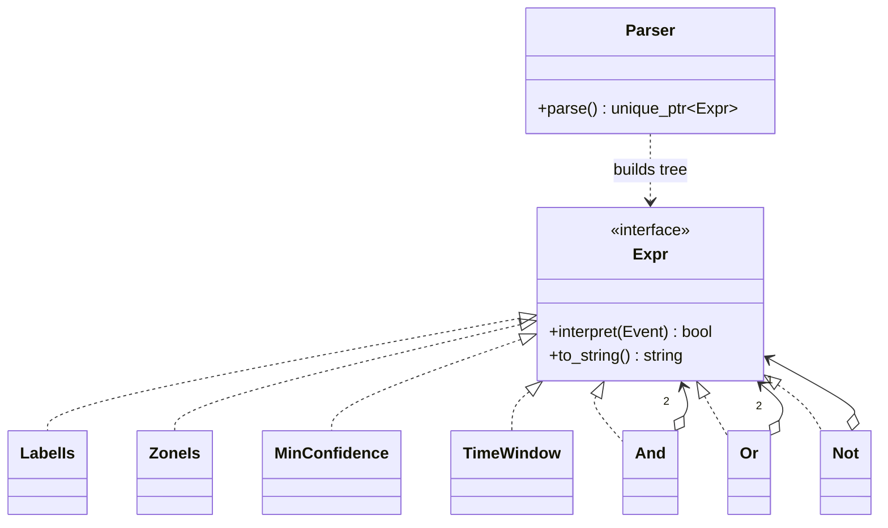

# 23 — Interpreter

> Family: **Behavioral** · Code: [`examples/23-interpreter/`](../examples/23-interpreter/)
> Run: `./build/examples/23-interpreter/naive`, `pattern`, `modern`

**Intent (GoF):** given a language, define a representation for its grammar along with an interpreter that uses the representation to interpret sentences in the language.

---

## 1. Force

> **Alert rules change constantly** and are written by operators in the UI, not by programmers. The **grammar** (term types and operators) is **small and changes rarely**. The evaluation engine **must not be recompiled** when a rule is saved.

- **What varies:** the sentences (individual rules), at runtime, per site and per camera.
- **Who varies it:** operators.
- **What stays still:** the grammar and the engine that walks it.
- **Implied requirement:** rules are **text**. They must be parsed once, validated when saved, and evaluated many times.

The rule language in [`rules.hpp`](../examples/23-interpreter/rules.hpp):

```
rule    := or
or      := and ( "OR" and )*
and     := unary ( "AND" unary )*
unary   := "NOT" unary | "(" or ")" | term
term    := LABEL | "zone=" NAME | "confidence>=" NUMBER | "time" HH:MM-HH:MM
```

Example: `person AND zone=entrance AND time 22:00-06:00`.

## 2. Naive code and where it hurts

[`naive.cpp`](../examples/23-interpreter/naive.cpp): split the string on every event and AND the terms together.

```cpp
bool matches(std::string_view rule, const Event& e) {
    const auto tokens = tokenize(rule);              // re-tokenized for every event
    for (std::size_t i = 0; i < tokens.size(); ++i) {
        if (t == "AND") continue;
        if (t == "time") { ... }
        else if (t.starts_with("zone=")) { ... }
        else if (t.starts_with("confidence>=")) { ... }
        else if (t != e.label) return false;         // anything unknown = a label
    }
    return true;
}
```

It handles the three AND-only rules and gets the same counts as the pattern version: 13 / 20 / 52. Then an operator asks for `(person OR vehicle) AND NOT zone=parking`:

1. **OR, NOT and parentheses need precedence and nesting.** A flat loop can't express them, and fixing that means writing a parser, which is the pattern.
2. **String work on the hot path:** the rule is tokenized again for each of the 288 events.
3. **Silent errors:** the typo `zon=entrance` isn't recognised, falls through as a *label*, and the rule never matches. Nothing fails when the rule is saved. The test pins this: `count_hits("person AND zon=entrance") == 0`.
4. **One growing function:** every new term type is another branch.

Smells: **Primitive Obsession** (the rule stays a `std::string` when it should be a structured value), **Long Method**, and **Shotgun parsing** (validation scattered through evaluation).

## 3. Structure



`person AND zone=entrance AND time 22:00-06:00` parses to:

```
          And
         /   \
       And    TimeWindow(22:00-06:00)
      /   \
LabelIs   ZoneIs
(person)  (entrance)
```

| Role | In this example | Responsibility |
|---|---|---|
| **AbstractExpression** | `Expr` | `interpret(context)`, one per grammar symbol |
| **TerminalExpression** | `LabelIs`, `ZoneIs`, `MinConfidence`, `TimeWindow` | Leaves: test one field of the event |
| **NonterminalExpression** | `And`, `Or`, `Not` | Hold sub-expressions and combine their results |
| **Context** | `Event` | The data a sentence is evaluated against |
| **Client** | `Parser` / `parse_rule()` | Builds the tree from text. GoF leaves this out; you always need it. |

Structurally, Interpreter is **Composite** (chapter 11) with one operation, `interpret`, whose meaning comes from a grammar.

## 4. Gateway example walkthrough

[`pattern.cpp`](../examples/23-interpreter/pattern.cpp)

```cpp
class Expr {
public:
    virtual ~Expr() = default;
    virtual bool interpret(const Event& e) const = 0;
    virtual std::string to_string() const = 0;
};

class And final : public Expr {
    bool interpret(const Event& e) const override { return l_->interpret(e) && r_->interpret(e); }
    ExprPtr l_, r_;
};

class Parser {                                   // one method per grammar rule
    ExprPtr parse_or()    { auto l = parse_and();   while (accept("OR"))  l = make_unique<Or>(move(l), parse_and());   return l; }
    ExprPtr parse_and()   { auto l = parse_unary(); while (accept("AND")) l = make_unique<And>(move(l), parse_unary()); return l; }
    ExprPtr parse_unary() { /* NOT x | ( or ) | term */ }
    ExprPtr parse_term()  { /* label | zone= | confidence>= | time HH:MM-HH:MM; else throw */ }
};
```

What changed compared with the naive version:

- **Parse once, evaluate many.** `parse_rule()` runs when the rule is saved, and `interpret()` runs per event with no string handling.
- **Full grammar:** `(person OR vehicle) AND NOT zone=parking` gives 116 hits. Precedence falls out of the call structure: `parse_or` calls `parse_and`, so AND binds tighter. `to_string()` shows it, since `animal OR bicycle AND confidence>=0.9` prints as `(animal OR (bicycle AND confidence>=0.9))`.
- **Errors are caught when the rule is saved:** `zon=entrance`, an unclosed `(`, a trailing `AND`, and `time 25:00-…` all throw `std::invalid_argument` from the parser, so the UI can reject them before they reach a camera.
- **Same numbers** as naive for every rule both can express.

Design notes:

- **Recursive descent is the pairing to know.** Each grammar rule becomes one method, and each method returns a subtree. For a dozen productions this beats any parser generator in clarity and error messages.
- **Short-circuiting is free:** `And::interpret` uses `&&`, so later terms aren't evaluated. Order cheap terms (label compare) before expensive ones (a geometry test) when you build or optimise the tree.
- **Trees are immutable after parsing.** `interpret` is `const`, so one parsed rule can be shared across detector threads.

## 5. Modern C++ form

[`modern.cpp`](../examples/23-interpreter/modern.cpp): the AST as a `std::variant`, and operations as visitors.

```cpp
struct LabelIs { std::string label; };
struct And; struct Or; struct Not;
using Node = std::variant<LabelIs, ZoneIs, MinConfidence, TimeWindow,
                          std::unique_ptr<And>, std::unique_ptr<Or>, std::unique_ptr<Not>>;
struct And { Node l, r; };

bool eval(const Node& n, const Event& e) {
    return std::visit(overloaded{
        [&](const LabelIs& t) { return e.label == t.label; },
        [&](const std::unique_ptr<And>& t) { return eval(t->l, e) && eval(t->r, e); },
        /* ... one lambda per node type; a missing one is a compile error */
    }, n);
}
void fields(const Node& n, std::set<std::string>& out);   // 2nd operation, no node edited
```

This is the expression problem from [00 §4](00-foundations.md#4-four-kinds-of-polymorphism-in-c) again:

| Form | Pick it when | Cost |
|---|---|---|
| Class per node, virtual `interpret` (`pattern.cpp`) | The grammar grows (new term types often) and operations are few | Each new operation touches every node class |
| Variant AST + visitors (`modern.cpp`) | The grammar is stable and operations keep coming: evaluate, pretty-print, list fields, estimate cost, compile to SQL | Each new node type touches every visitor, but the compiler finds them all |
| Compile to closures (`std::function<bool(const Event&)>`) | Only one operation ever (evaluate) and you want the fastest evaluation | Can't inspect, print or optimise the rule after compiling |

Rule engines usually have a fixed grammar and a growing list of operations, so the variant form tends to win in practice.

## 6. When NOT to use it

- **The rules are data, not language.** If every rule is "label + zone + time window", that's a struct with three fields and a form in the UI. No grammar needed.
- **The grammar is large or evolving fast.** GoF's own warning: a class per rule doesn't scale to a real language. Use a parser generator (ANTLR, Bison, PEGTL) or an embedded engine (Lua, CEL, SQLite's expression engine).
- **Performance is critical and rules are complex.** Tree-walking costs one virtual call per node per event. Past a point, compile to bytecode or closures.
- **An existing language already fits.** JSONLogic, CEL, a SQL `WHERE` clause, or Lua for operators who can script. Don't invent a DSL you then have to document and support.

## 7. Confused with

| Pattern | Difference in one line |
|---|---|
| **Composite** (11) | Same tree shape. Composite is about treating part and whole uniformly. Interpreter gives the tree **meaning from a grammar** and evaluates it against a context. |
| **Visitor** (20) | Visitor is how you add **more operations** to the Interpreter's tree without editing node classes. `modern.cpp` is Interpreter plus a variant-based visitor. |
| **Strategy** (01) | A rule could be a strategy (`bool(const Event&)`), but a strategy is chosen from code. An interpreter tree is **built from text at runtime** and can be inspected. |
| **Chain of Responsibility** (13) | A filter chain is a **linear** sequence of handlers. An expression tree has **nesting and precedence**. |

## 8. Seen in the wild

- **`std::regex`:** a regex string is parsed into an internal NFA/automaton and then interpreted against input. That's parse once, match many, the same split as here.
- **SQL `WHERE` clauses:** every database parses them into an expression tree. SQLite compiles them further to VDBE bytecode.
- **BPF filters:** `tcpdump 'tcp port 554 and host 10.0.0.11'` is a small language. libpcap parses it and compiles it to BPF bytecode, which the kernel interprets (or JITs) per packet.
- **Google CEL, JSONLogic, Prometheus PromQL:** expression languages for policy and alerting rules.
- **Shells and config languages:** `if`-conditions in nginx, systemd unit `Condition*=` directives, and udev rules are all small interpreted grammars.

## 9. Exercise and checkpoint

**Exercise**
1. Add a term `track_age>=N` (seconds a track has existed). Add the field to `Event`, add one terminal class, and add one branch in `parse_term`. Count the lines touched in `pattern.cpp` and compare that with what `naive.cpp` would need for OR support.
2. In `modern.cpp`, add an operation `cost(const Node&)` that returns 1 for label/zone, 2 for confidence and 5 for time. Use it to reorder `And` children so the cheaper side runs first. Which node types did you have to edit?
3. Make the parser report the **token index** of the error (`"rule: unknown field in 'zon=entrance' at token 2"`) and add a CHECK for the message.

**Checkpoint**: answer from memory:
- Why does `parse_or` call `parse_and` and not the other way round? What would change if they were swapped?
- Which two problems in the naive version disappear just by *parsing once*, before any class hierarchy exists?
- Your grammar has 4 term types and gains a new operation every sprint. Which form do you choose, and why?
